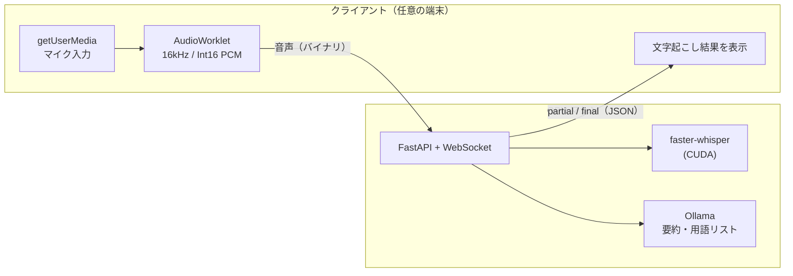

# remote-whisper

[](https://github.com/Studio-Takumi/remote-whisper/actions/workflows/ci.yml)

**三行まとめ**

文字起こしサービスは制限あるし有料プランに誘導される！

でも、家には余ってるGPUがある！

なら家のGPUを使ってAI要約しようぜってツール

**以下AIによる解説↓**

手元の端末にGPUがなくても、別のマシンのGPUを使って疑似リアルタイムで文字起こしするためのツールです。

ブラウザでマイク音声を取り、WebSocket で GPU マシンに送ります。GPU マシンでは [faster-whisper](https://github.com/SYSTRAN/faster-whisper) が文字起こしし、その結果をブラウザに返します。ノートPCやタブレットからでも、GPU を積んだデスクトップや自宅サーバーで文字起こしできます。



> 🚧 開発中です。録音・文字起こし・途中の要約・最終の要約・参考資料セット・保存期間の管理・障害からの復旧まで動きます。別の端末から使う手順は「別の端末から使う（HTTPS）」を見てください。

## 画面

録音中は、話している内容が流れるように文字起こしされ、数分おきに途中の要約が更新されます。録音が終わると、時間をかけて最終の要約を作ります。


| 要約（Markdown・数式・コード） | 録音中の途中の要約（ダーク） |
| --- | --- |
|  |  |

| スマホ | 設定 | 参考資料の選択 |
| --- | --- | --- |
|  |  |  |

ほかの画面（ライト・ダーク、デスクトップ・スマホ）は [docs/images/](docs/images/) にあります。画像の中のプロジェクトや会話はすべて架空のものです。

## 構成

| ディレクトリ | 内容 |
|---|---|
| `server/` | GPU マシンで動く文字起こしサーバー（Python / faster-whisper） |
| `web/` | ブラウザ側のフロントエンド（Vite + React + TypeScript / Tailwind CSS / shadcn/ui） |
| `relay/` | クラウド版の中間サーバー（Cloudflare Workers / D1。作っている途中。[relay/README.md](relay/README.md)） |

## サーバーのセットアップ

Windows で、Python や uv を入れずに使いたいときは、インストーラがあります（[docs/install-windows.md](docs/install-windows.md)）。以下は、リポジトリから動かす（開発用の）手順です。

### 必要なもの
- NVIDIA GPU と、それに対応したドライバ
- Python 3.11 と [uv](https://docs.astral.sh/uv/)
- [Ollama](https://ollama.com/)（要約と用語リストの生成に使う）

### インストール

```bash
cd server
uv sync
```

依存（faster-whisper、FastAPI など）は `server/pyproject.toml` にまとめてあります。cuBLAS と cuDNN の DLL は pip で入れた `nvidia-*` パッケージから読み込むので、CUDA Toolkit を別途インストールする必要はありません。

#### 最終の文字起こし（任意）

録音を終えたあとに、録音全体から文ごとの文字起こしを作り直す機能（WhisperX）は、別に入れます。torch（CUDA 版）などで数 GB になります。入れなければ、この機能だけが動きません。

```bash
uv sync --extra final
```

話者分け（「話者 1」「話者 2」）には、[HuggingFace](https://huggingface.co/) のトークンと、[pyannote/speaker-diarization-community-1](https://huggingface.co/pyannote/speaker-diarization-community-1) のページで利用条件に同意することが必要です。トークンは環境変数 `HF_TOKEN` で渡すか、`uv run hf auth login` で保存してください（`HF_HOME` の下に保存され、サーバーも同じ `HF_HOME` で起動すれば読みます）。なければ、話者を分けずに作ります。

### 起動

```bash
uv run remote-whisper              # http://127.0.0.1:8000
uv run remote-whisper --host 0.0.0.0 --port 8000   # LAN からも見える（認証がないので注意）
```

Windows では、タスクトレイ（右下）にアイコンが出ます。右上の点の色が状態です（灰: 待機中 / 青: GPU で処理中 / 赤: 録音中 / 橙: Whisper か Ollama が使えない）。左クリックで画面を開き、右クリックのメニューからログのフォルダを開いたり、サーバーを止めたりできます。コンソールを出さずに常駐させるときは `.venv\Scripts\remote-whisper-gui.exe --port 8000` で起動します（ログはファイルに残ります）。トレイが要らなければ `--no-tray` を付けます。Mac では、同じアイコンがメニューバーに出ます（クリックで開くメニューの一番上に状態が出ます）。

ほかの端末から使うときは、`--host 0.0.0.0` にするより、後の「別の端末から使う（HTTPS）」の手順をおすすめします（マイクは HTTPS でないと使えないため）。

- `GET /api/health` が `{"status":"ok"}` を返せば起動しています。
- データ（設定・録音・文字起こし・要約）は `~/.remote-whisper/` に置きます。環境変数 `REMOTE_WHISPER_HOME` で場所を変えられます（システムドライブの空きが少ないときは、別のドライブを指定してください）。全体設定は `setting.json` で、初回の起動時に既定値で作られます。
- サーバーのログは、コンソールのほか `~/.remote-whisper/log/server.log` にも残ります（日ごとに分けて 10 日分。文字起こしや要約の本文は書きません）。
- `web/dist` にフロントのビルド結果があれば、同じサーバーから画面も配信します（`cd web && npm run build`）。場所は環境変数 `REMOTE_WHISPER_WEB_DIST` で変えられます。

### 動作確認（ファイルの文字起こし）

```bash
uv run python transcribe.py sample.wav
```

モデルの既定は `large-v3-turbo` です。large-v3 と同程度の精度で、2倍以上速く動きます。日本語向けのモデル [`kotoba-tech/kotoba-whisper-v2.0-faster`](https://huggingface.co/kotoba-tech/kotoba-whisper-v2.0-faster) も試しましたが、turbo のほうが誤変換が少なくなりました。モデルは初回実行時にダウンロードされ、`server/hf/` に保存されます（環境変数 `HF_HOME` で場所を変えられます）。

### 開発

```bash
uv run ruff check
uv run ruff format --check
uv run pytest
```

PR と main への push では、GitHub Actions（`.github/workflows/ci.yml`）が同じチェックを回します（server は ubuntu と windows、web は ubuntu）。GPU・Ollama・HuggingFace のトークンは使わず、要るテストは skip になります。

### Ollama（要約・用語リスト）

[公式サイト](https://ollama.com/download)から GPU マシンにインストールし、モデルを取得します。

```bash
ollama pull qwen3.5:4b
# 推奨: 小さいモデルも入れると、タイトル・用語の抽出などの軽い処理が速くなります
ollama pull qwen3.5:2b
ollama pull qwen3.5:0.8b
```

- モデルは処理ごとに選べます（全体設定の `ollama.models`）。既定は、軽い処理（タイトル・用語の抽出など）に小さいモデル（`qwen3.5:0.8b`・`qwen3.5:2b`）、要約とコンテキストに `qwen3.5:4b` です。
- 小さいモデルは入れなくても動きます。選んだモデルが入っていなければ、入っているモデル（最終の要約のモデルなど）で代わりに動かします。
- モデルは、思考モード（`think`）に対応したものを推奨します。録音後の要約と用語リストの生成で思考モードを使うと、精度が上がるためです。対応していないモデルを選んだ場合は、思考モードなしで動きます。
- サーバーは `http://localhost:11434` の Ollama に接続します。

## フロントエンドの開発

```bash
cd web
npm install
npm run dev
```

開発中は、Vite の dev server が `/api` と `/ws` をサーバー（既定は `http://localhost:8000`）へ転送します。転送先は環境変数 `REMOTE_WHISPER_SERVER` で変えられます。

CI と同じチェックは次のとおりです。

```bash
npm run lint
npm run format:check
npm run build   # 型チェックとビルド
npm test        # Vitest
```

### GPU のない環境で開発する（モックサーバー）

```bash
cd server
uv run remote-whisper --mock
uv run remote-whisper --mock --mock-live-summary-sec 10   # 途中の要約を 10 秒おきに送る
```

`--mock` を付けると、Whisper と Ollama の代わりに、架空の打ち合わせの台本からダミーの文字起こし（partial・final）と要約を `/ws` で流します。届いた音声には `ack` を返すだけで、中身は使いません。画面から登録したプロジェクトに録音すると、ダミーの文字起こしと要約はファイルとして保存され、後から開けます（録音ファイルは作りません）。途中の要約の間隔は、設定の `liveSummaryIntervalMin` ではなく `--mock-live-summary-sec` で決まります。開発用に次の API も使えます。

- `POST /api/mock/status` … `{"whisper": "error"}` や `{"ollama": "error"}` で、サーバーの状態を変えて全員に `status` を送る
- `POST /api/mock/context-set` … 参考資料セットの作成をまねて、`contextSet` を `generating` → `ready`（`{"result": "failed"}` なら `failed`）の順に送る
- `POST /api/mock/disconnect` … WebSocket をすべて切る（再接続と録音の再開を確かめる用）

### スクリーンショットを撮り直す

`docs/images/` の画像は、モックサーバーとダミーデータを使って Playwright で撮っています。画面の URL に `?demo` を付けると、サーバーのデータではなく `web/src/mock.ts` のダミーデータ（架空のプロジェクトとセッション）を出すので、スクリプトはそれで撮ります。ダミーにない状態（再生できる録音・浄書済み文字起こし・GPU のジョブ・マイクの警告など）は、スクリプトが画面のストアに直接入れて作ります。

```bash
cd server && uv run remote-whisper --mock --mock-live-summary-sec 5   # ターミナル 1
cd web && npm run dev                                                  # ターミナル 2
cd web && npx playwright install chromium && npm run screenshots       # ターミナル 3
```

`npm run screenshots` は README に載せる画像だけを撮ります。公式 HP の「使い方」で使う場面（録音の流れ・設定の全ページ・うまく動かないときの表示・クラウド版の画面など、約 100 場面）も撮るときは `--all` を付けます。クラウド版の画面は、スクリプトが `localhost` をクラウド用のドメインとして開発サーバーをもう 1 つ（5199 番）立て、Worker の API は偽の返事にし、ホスト宛ての通信はモックサーバーへ流して撮ります。

```bash
cd web && npm run screenshots -- --all --out ../../rw-hp/public/screenshots   # 全部の場面を HP 用のフォルダへ
cd web && npm run screenshots -- --only playback,settings --layouts desktop-light   # 一部だけ撮り直す
```

画像の名前は `<desktop|mobile>-<light|dark>-<場面>.png` です。画面の URL は `SCREENSHOT_URL`（既定: `http://localhost:5173`）、モックサーバーの URL は `SCREENSHOT_SERVER`（既定: `http://localhost:8000`）、手元の Chromium を使うときは `CHROMIUM_PATH` で指定できます。`SCREENSHOT_DEBUG=1` を付けると、撮れなかった場面のそのときの画面を `_fail-…png` として残します。

常駐アイコン（トレイ・メニューバー）の色ごとの画像は、アイコンを描く処理から書き出します。

```bash
cd server && uv run python tray_icons.py <保存先> 128
```

## 別の端末から使う（HTTPS）

ブラウザの `getUserMedia`（マイク）は、安全なコンテキスト（HTTPS か `localhost`）でしか動きません。GPU マシン以外の端末（ノートPC・スマホ）から録音するには、画面を HTTPS で開く必要があります。画面を HTTPS で開けば、WebSocket も自動で `wss://` になります。

ここでは [Tailscale](https://tailscale.com/) の `tailscale serve` を使う手順を書きます。証明書の取得と HTTPS 化を Tailscale がやってくれ、自分の Tailscale のネットワーク（tailnet）の端末からしか見えないので、一番手軽です（ほかのユーザーを tailnet に招待したり、マシンを共有したりしていなければ、自分の端末だけです）。

### 1. 画面をビルドして、サーバーから配信する

```bash
cd web
npm ci
npm run build          # web/dist ができる

cd ../server
uv run remote-whisper  # http://127.0.0.1:8000 で画面と API を配信する
```

`web/dist` があれば、サーバーが画面も配信します（起動したときに読み込むので、起動した後にビルドしたらサーバーを起動し直してください）。GPU マシンのブラウザで `http://localhost:8000` を開いて、画面が出ることを確かめてください。サーバーは `127.0.0.1` のまま（`--host 0.0.0.0` にしない）で構いません。外からは次の `tailscale serve` を通して入ります。

### 2. `tailscale serve` で HTTPS にする

1. GPU マシンと、録音に使う端末の両方に Tailscale を入れて、同じ tailnet にログインします。
2. Tailscale の管理画面（DNS の設定）で、**MagicDNS** と **HTTPS Certificates** を有効にします。HTTPS の証明書を取ると、マシン名と tailnet 名が証明書の公開ログ（Certificate Transparency）に載ります。見られて困る名前なら、先にマシン名を変えておいてください。
3. GPU マシンで次を実行します。

   ```bash
   tailscale serve --bg 8000
   ```

   `https://<マシン名>.<tailnet 名>.ts.net/` へのアクセスを、`http://127.0.0.1:8000` に転送するようになります（WebSocket も通ります）。表示される URL を控えてください。例: `https://gpu-box.example-tailnet.ts.net/`。Serve や HTTPS をまだ有効にしていなければ、有効にするための URL が表示されるので、開いて許可してから実行し直します。`--bg` で始めた転送は、止めるまで（マシンを再起動しても）続きます。
4. 録音に使う端末のブラウザでその URL を開き、マイクの使用を許可します。

- 今の転送の設定は `tailscale serve status` で見られます。止めるときは `tailscale serve --https=443 off`（または `tailscale serve reset`）。
- `tailscale funnel` は使わないでください。インターネット全体に公開されます。このサーバーには認証がなく、tailnet の中だけで使う前提です（[spec/api.md 7.4](docs/spec/api.md)）。

### 3. ホーム画面に追加する（アプリとして使う）

画面は PWA になっているので、スマホやPCのホーム画面（デスクトップ）に追加すると、ブラウザのバーのない単独のアプリとして開けます。**HTTPS（か `localhost`）で開いたときだけ**追加できます（上の手順の URL で開いてください）。

- **iPhone・iPad（Safari）**: 共有ボタン → 「ホーム画面に追加」
- **Android（Chrome）**: メニュー（︙） → 「ホーム画面に追加」（または「アプリをインストール」）
- **PC（Chrome・Edge）**: アドレスバーの右のインストールのアイコン → 「インストール」

画面（HTML・JS・CSS・アイコン）は端末に置いておくので、次から速く開きます。サーバーとのやりとり（API・WebSocket）は置いておかないので、録音や文字起こしにはサーバーにつながっている必要があります。サーバーを更新すると（`web/dist` をビルドし直すと）、次に開いたときに「新しい版の画面があります」と出るので、「更新」を押してください（録音中は、録音を終えてから）。

### ほかの方法

HTTPS にする方法は何でも構いません。どの方法でも、`/api` と `/ws` を同じオリジンでサーバー（`http://127.0.0.1:8000`）に転送してください。

- Cloudflare Tunnel（Cloudflare Access などで自分だけが入れるようにしてください）
- Caddy や nginx と Let's Encrypt の組み合わせ
- [mkcert](https://github.com/FiloSottile/mkcert) で作った証明書（LAN 内だけで使う場合。証明書を各端末に信頼させる必要があります）

### 開発中

フロントを手元の `localhost` で起動（`npm run dev`）すれば HTTPS は要りません。Vite が `/api` と `/ws` をサーバーに転送します（「フロントエンドの開発」を参照）。
