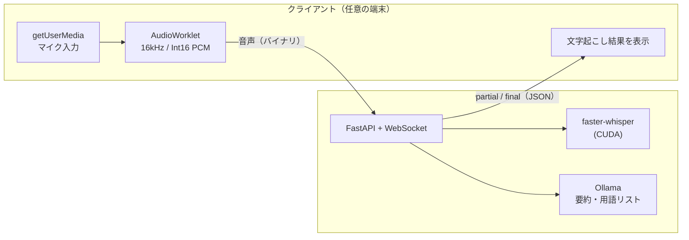

# remote-whisper

**三行まとめ**

文字起こしサービスは制限あるし有料プランに誘導される！

でも、家には余ってるGPUがある！

なら家のGPUを使ってAI要約しようぜってツール

**以下AIによる解説↓**

手元の端末にGPUがなくても、別のマシンのGPUを使って疑似リアルタイムで文字起こしするためのツールです。

ブラウザでマイク音声を取り、WebSocket で GPU マシンに送ります。GPU マシンでは [faster-whisper](https://github.com/SYSTRAN/faster-whisper) が文字起こしし、その結果をブラウザに返します。ノートPCやタブレットからでも、GPU を積んだデスクトップや自宅サーバーで文字起こしできます。



> 🚧 開発中です。現時点では、サーバーの雛形と `server/transcribe.py`（音声ファイルの文字起こし）、`web/` の画面のモック（ダミーデータ）しかありません。

## 画面

録音中は、話している内容が流れるように文字起こしされ、数分おきに途中の要約が更新されます。録音が終わると、時間をかけて最終の要約を作ります。


| 要約（Markdown・数式・コード） | 録音中の途中の要約（ダーク） |
| --- | --- |
|  |  |

| スマホ | 設定 | 参考資料の選択 |
| --- | --- | --- |
|  |  |  |

ほかの画面（ライト・ダーク、デスクトップ・スマホ）は [docs/images/](docs/images/) にあります。画像の中のプロジェクトや会話はすべて架空のものです。

## 構成

| ディレクトリ | 内容 |
|---|---|
| `server/` | GPU マシンで動く文字起こしサーバー（Python / faster-whisper） |
| `web/` | ブラウザ側のフロントエンド（Vite + React + TypeScript / Tailwind CSS / shadcn/ui） |

## サーバーのセットアップ

### 必要なもの
- NVIDIA GPU と、それに対応したドライバ
- Python 3.11 と [uv](https://docs.astral.sh/uv/)
- [Ollama](https://ollama.com/)（要約と用語リストの生成に使う）

### インストール

```bash
cd server
uv sync
```

依存（faster-whisper、FastAPI など）は `server/pyproject.toml` にまとめてあります。cuBLAS と cuDNN の DLL は pip で入れた `nvidia-*` パッケージから読み込むので、CUDA Toolkit を別途インストールする必要はありません。

### 起動

```bash
uv run remote-whisper              # http://127.0.0.1:8000
uv run remote-whisper --host 0.0.0.0 --port 8000
```

- `GET /api/health` が `{"status":"ok"}` を返せば起動しています。
- データ（設定・録音・文字起こし・要約）は `~/.remote-whisper/` に置きます。環境変数 `REMOTE_WHISPER_HOME` で場所を変えられます（システムドライブの空きが少ないときは、別のドライブを指定してください）。全体設定は `setting.json` で、初回の起動時に既定値で作られます。
- `web/dist` にフロントのビルド結果があれば、同じサーバーから画面も配信します（`cd web && npm run build`）。場所は環境変数 `REMOTE_WHISPER_WEB_DIST` で変えられます。

### 動作確認（ファイルの文字起こし）

```bash
uv run python transcribe.py sample.wav
```

モデルの既定は `large-v3-turbo` です。large-v3 と同程度の精度で、2倍以上速く動きます。日本語向けのモデル [`kotoba-tech/kotoba-whisper-v2.0-faster`](https://huggingface.co/kotoba-tech/kotoba-whisper-v2.0-faster) も試しましたが、turbo のほうが誤変換が少なくなりました。モデルは初回実行時にダウンロードされ、`server/hf/` に保存されます（環境変数 `HF_HOME` で場所を変えられます）。

### 開発

```bash
uv run ruff check
uv run ruff format --check
uv run pytest
```

### Ollama（要約・用語リスト）

[公式サイト](https://ollama.com/download)から GPU マシンにインストールし、モデルを取得します。

```bash
ollama pull qwen3.5:4b
```

- モデルは、思考モード（`think`）に対応したものを推奨します。録音後の要約と用語リストの生成で思考モードを使うと、精度が上がるためです。対応していないモデルを選んだ場合は、思考モードなしで動きます。
- サーバーは `http://localhost:11434` の Ollama に接続します。

## フロントエンドの開発

```bash
cd web
npm install
npm run dev
```

開発中は、Vite の dev server が `/api` と `/ws` をサーバー（既定は `http://localhost:8000`）へ転送します。転送先は環境変数 `REMOTE_WHISPER_SERVER` で変えられます。

### GPU のない環境で開発する（モックサーバー）

```bash
cd server
uv run remote-whisper --mock
uv run remote-whisper --mock --mock-live-summary-sec 10   # 途中の要約を 10 秒おきに送る
```

`--mock` を付けると、Whisper と Ollama の代わりに、架空の打ち合わせの台本からダミーの文字起こし（partial・final）と要約を `/ws` で流します。届いた音声には `ack` を返すだけで、中身は使いません。画面から登録したプロジェクトに録音すると、ダミーの文字起こしと要約はファイルとして保存され、後から開けます（録音ファイルは作りません）。途中の要約の間隔は、設定の `liveSummaryIntervalMin` ではなく `--mock-live-summary-sec` で決まります。開発用に次の API も使えます。

- `POST /api/mock/status` … `{"whisper": "error"}` や `{"ollama": "error"}` で、サーバーの状態を変えて全員に `status` を送る
- `POST /api/mock/context-set` … 参考資料セットの作成をまねて、`contextSet` を `generating` → `ready`（`{"result": "failed"}` なら `failed`）の順に送る
- `POST /api/mock/disconnect` … WebSocket をすべて切る（再接続と録音の再開を確かめる用）

### スクリーンショットを撮り直す

`docs/images/` の画像は、モックサーバーとダミーデータを使って Playwright で撮っています。画面の URL に `?demo` を付けると、サーバーのデータではなく `web/src/mock.ts` のダミーデータ（架空のプロジェクトとセッション）を出すので、スクリプトはそれで撮ります。

```bash
cd server && uv run remote-whisper --mock --mock-live-summary-sec 5   # ターミナル 1
cd web && npm run dev                                                  # ターミナル 2
cd web && npx playwright install chromium && npm run screenshots       # ターミナル 3
```

画面の URL は `SCREENSHOT_URL`（既定: `http://localhost:5173`）、手元の Chromium を使うときは `CHROMIUM_PATH` で指定できます。

## ネットワークと HTTPS について

ブラウザの `getUserMedia` は、安全なコンテキスト（HTTPS か `localhost`）でしか動きません。

- **開発中**: フロントをクライアントの `localhost` で起動し、GPU マシンの `ws://` に直接つなぎます。
- **実運用**: フロントを HTTPS で配信し、WebSocket は `wss://` にします。HTTPS にする方法は何でも構いません。
  - [Tailscale](https://tailscale.com/) の `tailscale serve`（証明書の取得と HTTPS 化を自動でやってくれるので一番手軽）
  - Cloudflare Tunnel
  - Caddy や nginx と Let's Encrypt の組み合わせ
  - [mkcert](https://github.com/FiloSottile/mkcert) で作った証明書（LAN 内だけで使う場合）
