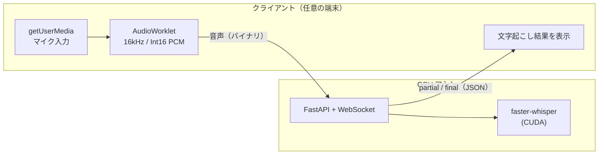

# remote-whisper

手元の端末にGPUがなくても、別のマシンのGPUを使って疑似リアルタイムで文字起こしするためのツールです。

ブラウザでマイク音声を取り、WebSocket で GPU マシンに送ります。GPU マシンでは [faster-whisper](https://github.com/SYSTRAN/faster-whisper) が文字起こしし、その結果をブラウザに返します。ノートPCやタブレットからでも、GPU を積んだデスクトップや自宅サーバーで文字起こしできます。



> 🚧 開発中です。現時点では `server/transcribe.py`（音声ファイルの文字起こし）と、`web/` のプロジェクトの雛形しかありません。

## 構成

| ディレクトリ | 内容 |
|---|---|
| `server/` | GPU マシンで動く文字起こしサーバー（Python / faster-whisper） |
| `web/` | ブラウザ側のフロントエンド（Vite + React + TypeScript / Tailwind CSS / shadcn/ui） |

## 通信形式（案）

エンドポイントは `ws://<GPUマシン>:8000/ws` です。

**クライアント → サーバー**
- 制御メッセージ（テキスト）: `{"type":"start"}` / `{"type":"stop"}`
- 音声（バイナリ）: 16kHz・モノラル・Int16 PCM を約 0.5 秒ごとに送る

**サーバー → クライアント**
- `{"type":"partial","id":1,"text":"..."}`: 途中結果。同じ `id` の結果は新しいもので上書きする
- `{"type":"final","id":1,"start":0.0,"end":4.2,"text":"..."}`: 確定結果。無音を検知した時点で送る

## サーバーのセットアップ

### 必要なもの
- NVIDIA GPU と、それに対応したドライバ
- Python 3.11 と [uv](https://docs.astral.sh/uv/)

### インストール

```bash
cd server
uv venv --python 3.11
uv pip install faster-whisper nvidia-cublas-cu12 "nvidia-cudnn-cu12==9.*"
```

cuBLAS と cuDNN の DLL は pip で入れた `nvidia-*` パッケージから読み込むので、CUDA Toolkit を別途インストールする必要はありません。

### 動作確認（ファイルの文字起こし）

```bash
.venv/Scripts/python transcribe.py sample.wav
```

モデルの既定は [`kotoba-tech/kotoba-whisper-v2.0-faster`](https://huggingface.co/kotoba-tech/kotoba-whisper-v2.0-faster) です（日本語向け、fp16 で VRAM 約 1.3GB）。初回実行時にダウンロードされ、`server/hf/` に保存されます。

## フロントエンドの開発

```bash
cd web
npm install
npm run dev
```

## ネットワークと HTTPS について

ブラウザの `getUserMedia` は、安全なコンテキスト（HTTPS か `localhost`）でしか動きません。

- **開発中**: フロントをクライアントの `localhost` で起動し、GPU マシンの `ws://` に直接つなぎます。
- **実運用**: フロントを HTTPS で配信し、WebSocket は `wss://` にします。HTTPS にする方法は何でも構いません。
  - [Tailscale](https://tailscale.com/) の `tailscale serve`（証明書の取得と HTTPS 化を自動でやってくれるので一番手軽）
  - Cloudflare Tunnel
  - Caddy や nginx と Let's Encrypt の組み合わせ
  - [mkcert](https://github.com/FiloSottile/mkcert) で作った証明書（LAN 内だけで使う場合）
