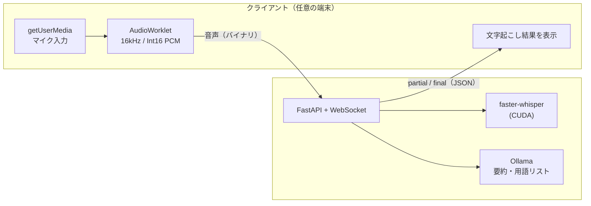

# remote-whisper

**三行まとめ**

文字起こしサービスは制限あるし有料プランに誘導される！

でも、家には余ってるGPUがある！

なら家のGPUを使ってAI要約しようぜってツール

**以下AIによる解説↓**

手元の端末にGPUがなくても、別のマシンのGPUを使って疑似リアルタイムで文字起こしするためのツールです。

ブラウザでマイク音声を取り、WebSocket で GPU マシンに送ります。GPU マシンでは [faster-whisper](https://github.com/SYSTRAN/faster-whisper) が文字起こしし、その結果をブラウザに返します。ノートPCやタブレットからでも、GPU を積んだデスクトップや自宅サーバーで文字起こしできます。



> 🚧 開発中です。現時点では `server/transcribe.py`（音声ファイルの文字起こし）と、`web/` のプロジェクトの雛形しかありません。

## 構成

| ディレクトリ | 内容 |
|---|---|
| `server/` | GPU マシンで動く文字起こしサーバー（Python / faster-whisper） |
| `web/` | ブラウザ側のフロントエンド（Vite + React + TypeScript / Tailwind CSS / shadcn/ui） |

## サーバーのセットアップ

### 必要なもの
- NVIDIA GPU と、それに対応したドライバ
- Python 3.11 と [uv](https://docs.astral.sh/uv/)
- [Ollama](https://ollama.com/)（要約と用語リストの生成に使う）

### インストール

```bash
cd server
uv venv --python 3.11
uv pip install faster-whisper nvidia-cublas-cu12 "nvidia-cudnn-cu12==9.*"
```

cuBLAS と cuDNN の DLL は pip で入れた `nvidia-*` パッケージから読み込むので、CUDA Toolkit を別途インストールする必要はありません。

### 動作確認（ファイルの文字起こし）

```bash
.venv/Scripts/python transcribe.py sample.wav
```

モデルの既定は `large-v3-turbo` です。large-v3 と同程度の精度で、2倍以上速く動きます。日本語向けのモデル [`kotoba-tech/kotoba-whisper-v2.0-faster`](https://huggingface.co/kotoba-tech/kotoba-whisper-v2.0-faster) も試しましたが、turbo のほうが誤変換が少なくなりました。モデルは初回実行時にダウンロードされ、`server/hf/` に保存されます。

### Ollama（要約・用語リスト）

[公式サイト](https://ollama.com/download)から GPU マシンにインストールし、モデルを取得します。

```bash
ollama pull qwen3.5:4b
```

- モデルは、思考モード（`think`）に対応したものを推奨します。録音後の要約と用語リストの生成で思考モードを使うと、精度が上がるためです。対応していないモデルを選んだ場合は、思考モードなしで動きます。
- サーバーは `http://localhost:11434` の Ollama に接続します。

## フロントエンドの開発

```bash
cd web
npm install
npm run dev
```

## ネットワークと HTTPS について

ブラウザの `getUserMedia` は、安全なコンテキスト（HTTPS か `localhost`）でしか動きません。

- **開発中**: フロントをクライアントの `localhost` で起動し、GPU マシンの `ws://` に直接つなぎます。
- **実運用**: フロントを HTTPS で配信し、WebSocket は `wss://` にします。HTTPS にする方法は何でも構いません。
  - [Tailscale](https://tailscale.com/) の `tailscale serve`（証明書の取得と HTTPS 化を自動でやってくれるので一番手軽）
  - Cloudflare Tunnel
  - Caddy や nginx と Let's Encrypt の組み合わせ
  - [mkcert](https://github.com/FiloSottile/mkcert) で作った証明書（LAN 内だけで使う場合）
