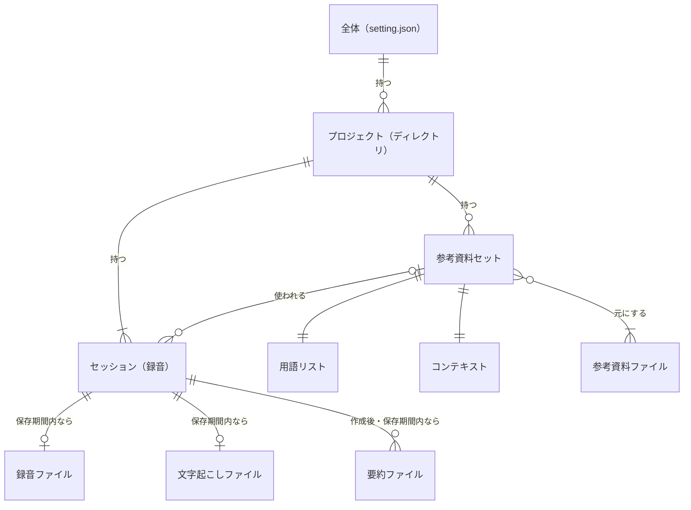
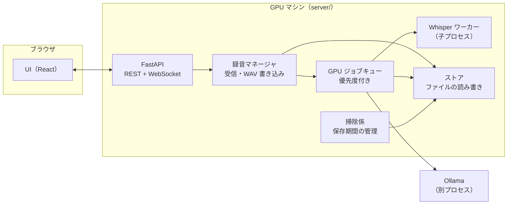
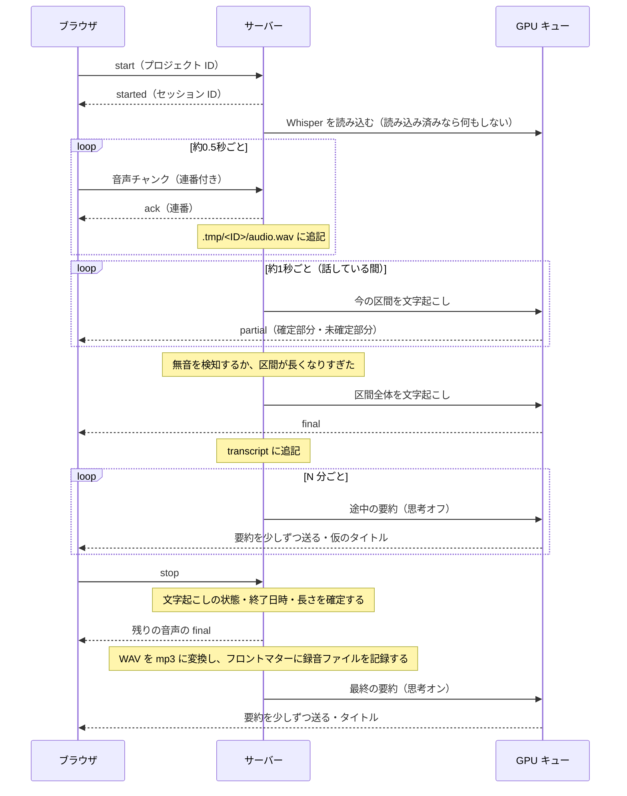

# remote-whisper 仕様書

> 版: 0.2（2026-10-10）
> 状態: 草案。「未決」「要検証」と書いたところは、実装しながら決める。

## 1. 目的と範囲

ブラウザで録音した音声を GPU マシンに送り、疑似リアルタイムで文字起こしする。録音中は数分おきに途中の要約を作り、録音が終わったら時間をかけて最終的な要約を作る。参考資料から用語リストとコンテキストを作り、文字起こしと要約の精度を上げる。

### 今回の範囲に入れないもの（検討事項）

- 認証と、外部に公開するときの安全対策（7.4 節を参照）
- セッションの削除・名前の変更
- ディレクトリをまたいで時系列で並べる履歴表示
- 画像・Notion・Web サイトを参考資料として読み込むこと
- 話者分離（後処理で WhisperX などを使う想定）
- 日本語以外の言語

## 2. 基本方針

1. **録音は AI に依存させない。** Whisper や Ollama が落ちたり読み込み中だったりしても、音声の受信と保存は続ける。文字起こしと要約は録音ファイルから後で作り直せる。
2. **GPU は必要なときだけ使う。** サーバーはいつでも録音を受け付けるが、モデルは録音が始まったときに読み込み、使わなくなったら解放する。
3. **データベースは使わない。** データはすべてファイルとして置く。正本は各ファイルとそのフロントマターで、`project.json` は正本から作り直せる索引として扱う。
4. **フロントマターはシステムが書く。** 日時・モデル・対応するファイルなど、システムが知っている情報は LLM に書かせない。
5. **ファイルの読み書きはサーバー側で行う。** ブラウザはサーバーの API を通してしかファイルを扱わない。

## 3. 用語

| 用語 | 意味 |
|---|---|
| プロジェクト | サーバー上のディレクトリ1つ。録音はどれかのプロジェクトに属する |
| セッション | 1回の録音。録音を開始してから終了するまで |
| 参考資料セット | 選んだ参考資料ファイルの組と、そこから作った用語リストとコンテキストのまとまり |
| 用語リスト（hotwords） | Whisper に渡す用語の一覧 |
| コンテキスト（context） | 参考資料から抜き出した、Ollama に渡すための情報 |
| 途中の要約 | 録音中に数分おきに作る要約。思考モードはオフ |
| 最終の要約 | 録音が終わった後に作る要約。思考モードはオン |

## 4. データモデル



- プロジェクトは、ふつうに使っていればセッションを1つ以上持つ。登録した直後で、まだ一度も録音していないときだけ、一時的に0個になる。
- 録音ファイルと文字起こしは、保存期間が過ぎると消えるので、セッションから見ると「0か1」になる。
- 最終の要約は、作り直すたびに新しいファイルとして増えていく（6.5 節）。作る前、失敗したとき、保存期間が過ぎたあとは0個になる。
- 1つの参考資料セットは、複数のセッションで使い回せる。参考資料セットを使わないセッションもある。
- 用語リストとコンテキストは、必ず同じ参考資料から1組で作る。

## 5. ファイル構成

### 5.1 データのルート

既定は `~/.remote-whisper/`。環境変数 `REMOTE_WHISPER_HOME` で場所を変えられる（システムドライブの空きが少ない場合は、容量に余裕のあるドライブを指定する）。`setting.json` もルートの中に置くので、ルートの場所を `setting.json` で指定することはできない。

```
~/.remote-whisper/
├─ setting.json
└─ projects/
   └─ <プロジェクト ID>/
      ├─ project.json
      ├─ hotwords-<ID>.md
      ├─ context-<ID>.md
      ├─ recording-<ID>.mp3
      ├─ transcript-<ID>.md
      ├─ summary-<ID>-<生成 ID>.md
      └─ .tmp/
         └─ <セッション ID>/
            ├─ audio.wav
            └─ live-summary.md
```

選んだディレクトリには、最終の要約のコピーを `summary-YYYYMMDD-<タイトル>.md` という名前で置く。システムはこのコピーを読まない。同じ名前のファイルがすでにある場合は、末尾に `-2` のような番号を付ける。

### 5.2 ID と命名

| 対象 | 形式 | 例 |
|---|---|---|
| セッション ID | `YYYYMMDD-HHMMSS`（録音を開始した時刻。日付をまたいでも開始時の日付を使う） | `20261009-143012` |
| 参考資料セット ID | `YYYYMMDD-HHMMSS`（作成を開始した時刻） | `20261009-090501` |
| 要約の生成 ID | `YYYYMMDD-HHMMSS`（要約の生成を開始した時刻） | `20261009-160203` |
| プロジェクト ID | パスを変換した名前＋短いハッシュ | `D--work-meetings-a1b2c3` |

- タイトル（要約から作る短い名前）はファイル名に入れない。フロントマターと `project.json` に持たせて、UI にはそれを表示する。
- プロジェクト ID の作り方: パスを絶対パスに解決し、ドライブ文字を大文字にそろえる。そのうえで英数字以外を `-` に置き換え、元のパスから作ったハッシュ（SHA-1 の先頭6文字）を末尾に付ける。
  - ハッシュを付けるのは、日本語のディレクトリ名が `-` だけになって衝突するのを防ぐため。たとえば `D:\work\会議` と `D:\work\資料` は、どちらも `D--work---` になってしまう。
  - ドライブ文字をそろえるのは、同じディレクトリが別のプロジェクトとして扱われるのを防ぐため。Windows ではパスの大文字・小文字が区別されないので、`D:\work` と `d:\work` が別々のプロジェクトとして作られてしまう。

### 5.3 setting.json

全体設定。画面右上の簡易設定と、設定モーダルの両方からこのファイルを書き換える。**録音中は変更できない。**

```json
{
  "version": 1,
  "whisper": {
    "model": "large-v3-turbo",
    "computeType": "float16",
    "beamSize": 5,
    "partialIntervalSec": 1.0,
    "silenceMs": 600,
    "maxSegmentSec": 25,
    "unloadAfterMin": 10
  },
  "ollama": {
    "host": "http://localhost:11434",
    "liveSummaryModel": "qwen3.5:4b",
    "finalSummaryModel": "qwen3.5:4b",
    "contextModel": "qwen3.5:4b",
    "liveSummaryIntervalMin": 3,
    "keepAliveMin": 10
  },
  "recording": {
    "maxConcurrent": 1
  },
  "retentionDays": {
    "recording": 10,
    "transcript": 30,
    "summary": 30,
    "contextSet": 0
  },
  "materials": {
    "roots": ["D:\\work"],
    "extensions": [".md", ".txt", ".pdf", ".html"]
  }
}
```

- `retentionDays` を `0` にすると無期限になる。
- `materials.roots` の既定は、サーバーを動かしているユーザーのホームディレクトリ（上の例の `D:\work` は書き換えた後の例）。
- ファイルがなければ既定値で作る。足りないキーは既定値で埋めて書き戻す。知らないキーや範囲外の値は受け付けない（`PATCH /api/settings` は `422`）。
- `recording.maxConcurrent` は、サーバー全体で同時に録音できるセッションの数。1つのクライアント（ブラウザのタブ）が同時に録音できるのは1つだけなので、2以上にするのは複数の端末から同時に録音する場合。
- 思考モードは処理ごとに固定する。参考資料セットの作成と最終の要約はオン、途中の要約はオフ。思考モードに対応していないモデルが選ばれた場合は、オフで実行する（9.3 節）。
- 数値の既定値は仮のもので、実際に測ってから決める。

### 5.4 project.json

プロジェクトの索引と、そのプロジェクトで今選んでいる状態を記録する。書き込むときは、一時ファイルに書いてから rename する（アトミック書き込み）。

```json
{
  "version": 1,
  "path": "D:\\work\\meetings",
  "selection": {
    "contextSet": "20261009-090501",
    "useHotwords": true,
    "useContext": true
  },
  "contextSets": [
    {
      "id": "20261009-090501",
      "status": "ready",
      "materials": ["D:\\work\\meetings\\weekly\\agenda.md", "D:\\work\\meetings\\weekly\\notes.md"]
    }
  ],
  "sessions": [
    {
      "id": "20261009-143012",
      "title": "新機能のリリース計画",
      "status": "done",
      "startedAt": "2026-10-09T14:30:12+09:00",
      "endedAt": "2026-10-09T15:59:40+09:00",
      "contextSet": "20261009-090501"
    }
  ]
}
```

- 参考資料のパスは絶対パスで書く。参考資料は、プロジェクトのディレクトリの外（`materials.roots` の中）からも選べるため。
- `selection` がまだ保存されていないときは、`ready` のセットのうち最初に作ったものを選び、用語リストとコンテキストはどちらも使う。
- UI では、プロジェクトをディレクトリ名で表示する。
- 各ファイルの名前は ID から決まるので、ここには書かない。ファイルがあるかどうかは、実際にファイルを見て判定する。
- `project.json` が壊れたり消えたりした場合は、同じディレクトリにあるファイルのフロントマターを読んで作り直す。
  - プロジェクトのパスは、フロントマターの `project` から取る（5.5 節）。フロントマターを持つファイルが1つもなければ作り直せないので、もう一度登録する。
  - `selection` はほかのファイルに残っていないので、作り直すと既定（上の「まだ保存されていないとき」）に戻る。作成中・失敗した参考資料セットも、ファイルがないので載らない。
  - 壊れていたファイルは `project.json.broken-<日時>` という名前で残す。`version` がサーバーより新しいファイルは、作り直さずにエラーにする。
- `contextSets` と `sessions` は ID の昇順に並べる。
- プロジェクトの一覧は、`projects/*/project.json` を読んで作る。ディレクトリをまたいで時系列に並べる表示が必要になったら、`history.jsonl`（追記のみ）を追加する。

### 5.5 フロントマター

日時はすべて、サーバーのローカルのタイムゾーン付きの ISO 8601 で書く（日本なら `+09:00`）。ID もローカルの時刻で作る。

どのファイルにも、プロジェクトのディレクトリの絶対パスを `project` として書く。`project.json` を作り直すときに使う（5.4 節）。

**用語リスト `hotwords-<ID>.md`**

```markdown
---
id: 20261009-090501
project: D:\work\meetings
createdAt: 2026-10-09T09:05:01+09:00
model: qwen3.5:4b
think: true
materials:
  - path: D:\work\meetings\weekly\agenda.md
    sha1: 3f2a...
  - path: D:\work\meetings\weekly\notes.md
    sha1: 9b1c...
---
リリース計画
ステージング環境
...
```

本文には1行に1語を書く。重要な語から順に並べる。Whisper に渡すときは「、」でつないで1行にする。

**コンテキスト `context-<ID>.md`**: フロントマターは用語リストと同じ。本文は Markdown で書く。

**文字起こし `transcript-<ID>.md`**

```markdown
---
id: 20261009-143012
project: D:\work\meetings
title: 新機能のリリース計画
status: done            # recording | done | interrupted
startedAt: 2026-10-09T14:30:12+09:00
endedAt: 2026-10-09T15:59:40+09:00
durationSec: 5368
language: ja
whisper:
  model: large-v3-turbo
  beamSize: 5
  silenceMs: 600
contextSet: 20261009-090501   # 使わなかった場合は null
useHotwords: true
recording: recording-20261009-143012.mp3
---
[00:00:03] 今日はリリース計画について…
[00:00:15] …
```

**要約 `summary-<ID>-<生成 ID>.md`**

```markdown
---
id: 20261009-143012
generationId: 20261009-160203
project: D:\work\meetings
title: 新機能のリリース計画
startedAt: 2026-10-09T14:30:12+09:00
endedAt: 2026-10-09T15:59:40+09:00
model: qwen3.5:4b
think: true
transcript: transcript-20261009-143012.md
contextSet: 20261009-090501
useContext: true
generatedAt: 2026-10-09T16:03:11+09:00
---
（要約の本文）
```

## 6. 処理の流れ

### 6.1 構成



- Whisper は子プロセスで動かす。CUDA まわりの異常終了がサーバー全体を道連れにしないようにするため（基本方針の1）。Ollama はもともと別プロセス。
- 録音マネージャは GPU に依存しない。キューやワーカーが止まっていても、音声の受信と保存は続ける。

### 6.2 録音



- Whisper の読み込みが終わる前に届いた音声は、溜めておいて後でまとめて文字起こしする。
- partial は LocalAgreement で「確定部分」と「未確定部分」に分けて送る。UI は確定部分だけを文字送りの演出で表示し、未確定部分は薄い色で表示する想定。
- 録音中は全体設定を変更できない。そのセッションで使った設定値は、フロントマターに記録する。
- stop を受けたら、まず文字起こしの状態（`done`）・終了日時・長さを確定し、設定のロックを外す。残りの区間の final と mp3 への変換はその後ろで行う（UI が「録音中」のまま待たないようにするため）。この間にサーバーが落ちると、最後の区間が文字起こしに残らないことがある（録音ファイルは次の起動時に変換する。6.7 節）。
- 録音は一時停止・再開できる。一時停止中もセッションは続いているので、設定のロックなどは録音中と同じ扱いにする。一時停止中は経過時間と途中の要約のタイマーを止め、再開したら続きから数える。
  - 一時停止していた時間は、録音ファイルと文字起こしの時刻に含めない（録音ファイルは詰める）。一時停止中に届いた音声は保存しない（**仮**。実際に使ってから見直す）。
  - 一時停止中にブラウザとの接続が切れた場合も、60秒で `interrupted` にするか（6.7 節、**未決**）。

### 6.3 GPU ジョブの優先順位

GPU を使う処理は、1つのキューを通して順番に実行する。

| 優先度 | ジョブ |
|---|---|
| 1 | 文字起こし（partial と final） |
| 2 | 途中の要約・仮のタイトル |
| 3 | 最終の要約・タイトル・参考資料セットの作成・作り直し |

- 録音中の要約を作っている間に partial がどれだけ遅れるかは、まだ測っていない（**要検証**）。このシステムの肝になる部分。
- 最終の要約を作る前に、ほかに録音中のセッションがなければ Whisper を VRAM から下ろす。
- Whisper は、最後に使ってから `unloadAfterMin` 分たったら下ろす。Ollama は `keep_alive` で同じように管理する。録音中は `-1`（下ろさない）にする。

### 6.4 途中の要約

- `liveSummaryIntervalMin` 分ごとに作る。入力は、前回の途中の要約、前回から増えた確定済みの文字起こし、（`useContext` がオンなら）コンテキスト。これらから要約を更新する。Ollama との会話履歴に足していく方式は取らない。入力が際限なく長くなるため。
- 結果は `.tmp/<ID>/live-summary.md` に保存する。最終の要約を保存できたら削除する。最終の要約に失敗した場合は残しておく。
- 更新するたびに、仮のタイトルも作る。

### 6.5 最終の要約とタイトル

- 文字起こし全体が `num_ctx` に収まれば、一度に要約する。収まらなければ区間ごとに要約し、それらをまとめて最終の要約にする（map-reduce）。
- 要約は Markdown のままストリーミングで送る。タイトルは要約の後に別のリクエストで作り、JSON Schema（`format`）で「15文字以内」に制限する。
- 保存先は `summary-<ID>-<生成 ID>.md` と、選んだディレクトリへのコピー（5.1 節）。
- **作り直し**: 過去のセッションについて、今の全体設定で最終の要約を作り直せる。既存の要約は上書きせず、新しい生成 ID で別のファイルとして保存する（別のモデルの結果と見比べられるようにするため）。選んだディレクトリにも、新しいコピーを置く。
- UI では、今の全体設定の最終の要約モデル（`finalSummaryModel`）で作った要約のうち、いちばん新しいものを表示する。そのモデルの要約がなければ、モデルを問わずいちばん新しい要約を表示する。
- 最終の要約のモデルを変えたとき、開いているセッションにそのモデルの要約がなければ、自動で作り直しを始める。簡易設定と設定モーダルのどちらで変えた場合も同じ。

### 6.6 参考資料セットの作成

1. UI で参考資料を選ぶと、その場で作成を始める。
2. 資料のテキストを取り出す。`.md` と `.txt` はそのまま読む。`.html` はタグを取り除く。`.pdf` はテキストを抽出する（パスワード付きの PDF は対象外）。
3. Ollama（思考オン）で用語リストとコンテキストを作る。
4. `hotwords-<ID>.md` と `context-<ID>.md` に保存する。

- 同じ資料の組み合わせ（ハッシュが一致するもの）で作ったセットがすでにあれば、作り直さずに使い回す。
- Whisper のプロンプトには上限がある（`hotwords` と `initial_prompt` を合わせて約224トークン）。上限を超える用語は、重要度の低いものから外す。
- 作成中（数分かかる）に録音が始まった場合は、用語リストなしで文字起こしを始める。セットができた時点から、次の区間に適用する。

### 6.7 障害が起きたとき

| 状況 | 動作 |
|---|---|
| Whisper が読み込めない・落ちた | 録音は続ける。UI には状態を通知する。文字起こしは録音ファイルから後で作り直す（**提案**: 文字起こしの作り直し機能） |
| Ollama に接続できない | 録音と文字起こしは続ける。要約は失敗として記録し、後で作り直せるようにする |
| ブラウザとの接続が切れた | サーバーはセッションを60秒保持する。再接続したら、受け取り済みの連番の次から送ってもらう。60秒を過ぎたら `interrupted` にして、そこまでの録音を保存する |
| サーバーが落ちた | 次に起動したとき、`.tmp/` に残っている WAV を mp3 に変換する。`status: recording` のままの文字起こしは `interrupted` に直し、最後の区間の時刻を終了日時にする |

### 6.8 保存期間の管理

- サーバーの起動時と、その後1日1回、掃除を行う。
- 期間はセッションの終了日時から数える。参考資料セットは作成日時から数える。
- 期間を過ぎたファイルは消して、`project.json` を更新する。UI では、ファイルがないものを「期限切れ」と表示する。
- 選んだディレクトリに置いた要約のコピーは消さない。

## 7. API

### 7.1 REST

| メソッド | パス | 内容 |
|---|---|---|
| GET | `/api/settings` | 全体設定を返す |
| PATCH | `/api/settings` | 全体設定を部分的に更新する。録音中は `409` |
| GET | `/api/settings/options` | 選べる値を返す（Whisper のモデル、Ollama のモデルと、それぞれが思考モードに対応しているか） |
| GET | `/api/projects` | プロジェクトの一覧 |
| POST | `/api/projects` | ディレクトリをプロジェクトとして登録する（すでにあればそれを返す） |
| GET | `/api/projects/{pid}/sessions` | セッションの一覧（サイドバー用） |
| GET | `/api/projects/{pid}/sessions/{sid}` | セッションのメタ情報 |
| GET | `/api/projects/{pid}/sessions/{sid}/transcript` | 文字起こし |
| GET | `/api/projects/{pid}/sessions/{sid}/summaries` | 最終の要約の一覧（生成 ID・モデル・生成日時） |
| GET | `/api/projects/{pid}/sessions/{sid}/summaries/{gid}` | 指定した最終の要約。`gid` に `latest` を指定すると、いちばん新しいものを返す。最終の要約がまだないときは、途中の要約を返す |
| POST | `/api/projects/{pid}/sessions/{sid}/summaries` | 最終の要約を作り直す（202 で使うモデルを返す。結果は WebSocket で全員に送る。録音中のセッションは 409、文字起こしが消えていれば 410） |
| GET | `/api/fs?path=…` | 許可したルートの中のディレクトリの中身を返す |
| GET | `/api/projects/{pid}/context-sets` | 参考資料セットの一覧 |
| POST | `/api/projects/{pid}/context-sets` | 参考資料を指定して、セットの作成を始める |
| PATCH | `/api/projects/{pid}/selection` | 使うセットと、用語リスト・コンテキストそれぞれを使うかどうかを設定する。録音中は `409` |

- セッションの一覧とメタ情報には、`files`（`recording`・`transcript` があるか、最終の要約の数 `summaries`、途中の要約があるか `liveSummary`）を付ける。UI はこれを見て「期限切れ」を出す。
- 文字起こしのファイルが消えたセッションの `GET .../transcript` は `410`（セッション自体がなければ `404`）。文字起こしは `lines`（`[{time, text}]`）とフロントマター `meta` で返す。
- `GET .../summaries/latest` で途中の要約を返すときは `kind: "live"`、最終の要約は `kind: "final"` を付ける。どちらもなければ `404`。

### 7.2 WebSocket `/ws`

接続は1本で、録音とサーバーの状態の通知の両方に使う。サーバーから送るメッセージには、関係するセッション ID を付ける。

**ブラウザ → サーバー**

| 種類 | 中身 |
|---|---|
| 制御 | `{"type":"start","project":"<pid>"}` / `{"type":"stop"}` / `{"type":"pause"}` / `{"type":"unpause"}` / `{"type":"resume","session":"<sid>","nextSeq":n}`（`resume` は再接続のためのもので、一時停止からの再開は `unpause`） |
| 音声 | バイナリ。先頭4バイトが連番（uint32、リトルエンディアン）、続きが 16kHz・モノラル・Int16 の PCM |

**サーバー → ブラウザ**

| type | 中身 |
|---|---|
| `started` | `session` |
| `ack` | `seq`。ブラウザは、ここまでの音声を手元のバッファから消してよい |
| `partial` | `segment`、`committed`、`tentative` |
| `final` | `segment`、`start`、`end`、`text` |
| `summary.delta` | `kind`（`live` / `final`）、`text`（追加分） |
| `summary.done` | `kind` |
| `title` | `title`、`provisional`（仮のタイトルかどうか） |
| `contextSet` | `id`、`status`（`generating` / `ready` / `failed`） |
| `status` | `whisper`（`unloaded` / `loading` / `ready` / `error`）、`ollama`（`ready` / `error`）、`recordings`（録音中のセッションの数）、`queue` |
| `error` | `code`、`message` |

- `resume` を受け付けたら、`started`（`resumed: true`）と、受け取り済みの最後の連番の `ack` を返す。ブラウザはその次から送り直す。再開できるセッションがなければ `error`（`session_not_found`）。
- 音声の連番は 0 から始める。抜けがあったチャンクは受け取らず、受け取り済みの最後の連番の `ack` を返す。受け取り済みの連番がもう一度届いたら、捨てて `ack` だけ返す。
- `error` の `code`: `bad_message`（読めないメッセージ）、`not_recording`、`already_recording`（1つの接続で録音できるのは1つだけ）、`too_many_recordings`（`recording.maxConcurrent` を超えた）、`session_not_found`、`project_not_found`（`start` のプロジェクトが登録されていない）、`write_failed`（ディスクが一杯などで音声を保存できない。そのチャンクは受け取らずに、受け取り済みの最後の連番の `ack` を返す。最終の要約を保存できなかったときにも使う）、`ollama_unavailable`、`summary_skipped`（文字起こしが空か読み込めないので、最終の要約を作らなかった）、`not_available`（録音を受け付けられないサーバー）。
- サーバーとの接続（再接続中かどうか）とマイクの許可は、`status` には含めず、ブラウザ側で判定して表示する。
- `recordings` と `queue` は、今のところ UI には出さない。

### 7.3 ディレクトリ一覧 API の安全対策

- 返すのは `materials.roots` に指定したディレクトリの中だけにする。パスは、`..`、シンボリックリンク、ジャンクションをすべて解決した実際のパスで判定する。
- 中身を読み込むファイルは、`materials.extensions` に指定した拡張子のものに限る。
- 一覧には、ルートの外を指すリンクと、`.` で始まる隠しファイルを出さない。`path` を省略すると、ルートの一覧を返す。
- プロジェクトとして登録できるのも、ルートの中のディレクトリだけにする。

### 7.4 検討事項（今回は実装しない）

- 認証。サーバーは localhost か Tailscale のネットワークの中だけで公開する。Tailscale は自分の端末しか入れないので、当面はこれを認証の代わりにする。外部に公開する場合は、トークン認証と WebSocket の `Origin` の確認を追加する。
- HTTPS。`getUserMedia` は安全なコンテキストでしか使えないので、実際に使うときは `tailscale serve` などで HTTPS にする。

## 8. UI のイメージ

- ChatGPT や Claude に近い、シンプルな見た目（shadcn）。
- 左にサイドバーがあり、プロジェクトごとに過去のセッションを並べる。Ctrl+B で開閉できる。
- サイドバーのプロジェクトの ＋ を押すと、そのプロジェクトの新しいセッションの画面を開く。録音はまだ始めない。録音を始める前に、モデルや参考資料を選び直せるようにするため。
- メイン画面の中央下にマイクのボタンがある。押したときの動きは、開いている画面によって変わる。
  - 新しいセッションの画面: 録音が始まり、音量に合わせてアニメーションする。
  - 既存のセッションを開いているとき: ＋ のボタンになり、押すと同じプロジェクトの新しいセッションの画面を開く（録音は始めない）。
  - プロジェクトを選んでいないとき: 押せない。
- 録音中は、マイクのボタンで一時停止・再開する。録音の終了は取り返しがつかないので、横の小さいボタンに分ける。
- 文字起こしは、文字送りの演出で流れるように表示する。
- 画面上部で「文字起こし」と「要約」の表示を切り替える。
- 右上にモデルなどの簡易設定と、参考資料を選ぶ場所を置く。簡易設定は全体設定をそのまま書き換える。
- 全体設定はモーダルで開く。
- 録音中は、すべての設定を操作できないようにする。新規プロジェクトの作成と、ほかのセッションを開くこともできない（録音中の画面に戻れなくなるため）。
- スマホ（幅 768px 未満）でも使える。
  - サイドバーは画面に重なるシートになり、左上のボタンで開く。セッションを選ぶと閉じる。
  - 上部のモデルの簡易設定は、ボタン1つにまとめて、下から出るシートで選ぶ。参考資料はそのまま。
  - マイクのボタンは少し小さくし（96px）、画面の下端（ホームバーなど）を避けて置く。
  - タッチではツールチップが出ないので、待機中はマイクのボタンの上に短い説明を、録音中は終了ボタンの下に「終了」を出す。
  - 設定モーダルは、カテゴリを上に横並びにし、各項目は入力欄を説明の下に置く。
  - 実機（iOS Safari・Android Chrome）での録音は HTTPS が要るので、確認は 7.4 の HTTPS の手順の後。
- ライトとダークのテーマがある。既定は OS の設定（`prefers-color-scheme`）に従い、サイドバーの下のボタンで「OS に合わせる / ライト / ダーク」を切り替えられる。テーマは端末ごとの好みなので、`setting.json` ではなくブラウザ（localStorage）に保存する。録音中でも切り替えられる。読み込み時のちらつきを防ぐため、画面を描く前にテーマを当てる。

## 9. 実装メモ

### 9.1 録音ファイル

- 録音中は `.tmp/<ID>/audio.wav` に追記していく。サーバーが落ちても、そこまでの音声は残る。
- 録音が終わったら mp3（モノラル・64kbps、90分で約43MB）に変換して、WAV を消す。変換には faster-whisper が内部で使っている PyAV を使う。PyAV の配布版に mp3 のエンコーダーが含まれているかは**要検証**。含まれていなければ m4a（AAC）にする。

### 9.2 Whisper の設定

- 既定のモデルは large-v3-turbo（実験で、精度と速さのバランスがいちばんよかった）。
- 区間の頭で前の確定文を `initial_prompt` として渡すかどうかは、用語リストとトークンの上限を分け合うことになるので、実験してから決める。

### 9.3 Ollama

- 思考モードに対応しているかは、`ollama show` の `capabilities` に `thinking` が含まれるかで判定する。
- 思考モードと JSON Schema（`format`）を同時に使えるかは**要検証**。

### 9.4 開発の順番（案）

1. ストアと設定（`setting.json`、`project.json`、フロントマター）
2. モックサーバー（GPU なしでも、`/ws` からダミーの partial・final・要約を流す）。GPU のない環境でフロントエンドを開発するため
3. 録音マネージャと Whisper ワーカー（partial と final）
4. 途中の要約・最終の要約・タイトル
5. 参考資料セットの作成
6. 保存期間の管理と、障害からの復旧
