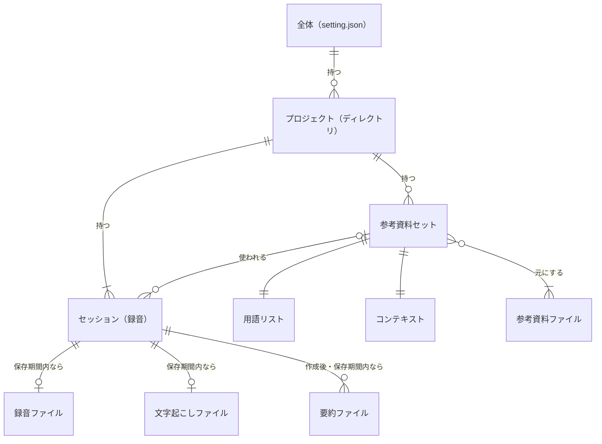
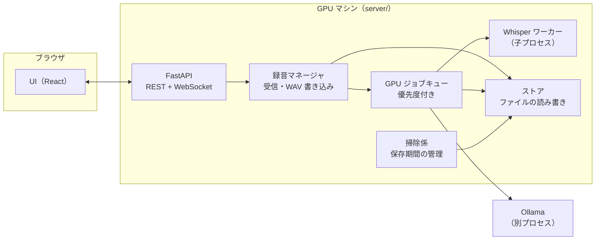
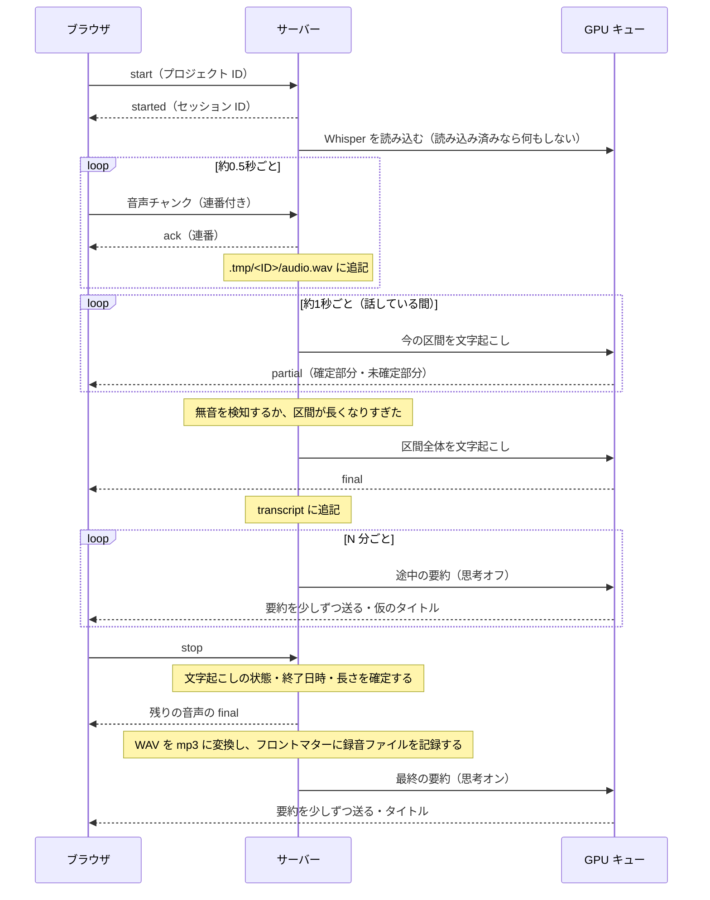

# remote-whisper 仕様書

> 版: 0.2（2026-10-10）
> 状態: 草案。「未決」「要検証」と書いたところは、実装しながら決める。

## 1. 目的と範囲

ブラウザで録音した音声を GPU マシンに送り、疑似リアルタイムで文字起こしする。録音中は数分おきに途中の要約を作り、録音が終わったら時間をかけて最終的な要約を作る。参考資料から用語リストとコンテキストを作り、文字起こしと要約の精度を上げる。

### 今回の範囲に入れないもの（検討事項）

- 認証と、外部に公開するときの安全対策（7.4 節を参照）
- セッションの削除・名前の変更
- ディレクトリをまたいで時系列で並べる履歴表示
- 画像・Notion・Web サイトを参考資料として読み込むこと
- 話者分離（後処理で WhisperX などを使う想定）
- 日本語以外の言語

## 2. 基本方針

1. **録音は AI に依存させない。** Whisper や Ollama が落ちたり読み込み中だったりしても、音声の受信と保存は続ける。文字起こしと要約は録音ファイルから後で作り直せる。
2. **GPU は必要なときだけ使う。** サーバーはいつでも録音を受け付けるが、モデルは録音が始まったときに読み込み、使わなくなったら解放する。
3. **データベースは使わない。** データはすべてファイルとして置く。正本は各ファイルとそのフロントマターで、`project.json` は正本から作り直せる索引として扱う。
4. **フロントマターはシステムが書く。** 日時・モデル・対応するファイルなど、システムが知っている情報は LLM に書かせない。
5. **ファイルの読み書きはサーバー側で行う。** ブラウザはサーバーの API を通してしかファイルを扱わない。

## 3. 用語

| 用語 | 意味 |
|---|---|
| プロジェクト | サーバー上のディレクトリ1つ。録音はどれかのプロジェクトに属する |
| セッション | 1回の録音。録音を開始してから終了するまで |
| 参考資料セット | 選んだ参考資料ファイルの組と、そこから作った用語リストとコンテキストのまとまり |
| 用語リスト（hotwords） | Whisper に渡す用語の一覧 |
| コンテキスト（context） | 参考資料から抜き出した、Ollama に渡すための情報 |
| 途中の要約 | 録音中に数分おきに作る要約。思考モードはオフ |
| 最終の要約 | 録音が終わった後に作る要約。思考モードはオン |
| 録音中の文字起こし | 録音中に区間ごとに流れてくる文字起こし |
| 最終の文字起こし | 録音を終えたあとに、保存した録音全体から作り直した文字起こし（文ごとの行・話者分け。6.9 節） |
| 要約度 | 要約の細かさ。1（ごく短く要点だけ）〜5（できるだけ省かず細かく）の5段階で、既定は 3。途中の要約・最終の要約の概要・最終の要約の詳細のそれぞれで設定する |

## 4. データモデル



- プロジェクトは、ふつうに使っていればセッションを1つ以上持つ。登録した直後で、まだ一度も録音していないときだけ、一時的に0個になる。
- 録音ファイルと文字起こしは、保存期間が過ぎると消えるので、セッションから見ると「0か1」になる。
- 最終の要約は、作り直すたびに新しいファイルとして増えていく（6.5 節）。作る前、失敗したとき、保存期間が過ぎたあとは0個になる。
- 1つの参考資料セットは、複数のセッションで使い回せる。参考資料セットを使わないセッションもある。
- 用語リストとコンテキストは、必ず同じ参考資料から1組で作る。

## 5. ファイル構成

### 5.1 データのルート

既定は `~/.remote-whisper/`。環境変数 `REMOTE_WHISPER_HOME` で場所を変えられる（システムドライブの空きが少ない場合は、容量に余裕のあるドライブを指定する）。`setting.json` もルートの中に置くので、ルートの場所を `setting.json` で指定することはできない。

```
~/.remote-whisper/
├─ setting.json
├─ log/
│  ├─ server.log              # サーバーのログ（6.10 節）
│  └─ server.log.YYYY-MM-DD   # 前の日の分（10 日分）
└─ projects/
   └─ <プロジェクト ID>/
      ├─ project.json
      ├─ hotwords-<ID>.md
      ├─ context-<ID>.md
      ├─ recording-<ID>.mp3
      ├─ transcript-<ID>.md
      ├─ transcript-final-<ID>-<生成 ID>.md
      ├─ summary-<ID>-<生成 ID>.md
      └─ .tmp/
         └─ <セッション ID>/
            ├─ audio.wav
            └─ live-summary.md
```

選んだディレクトリには、最終の要約のコピーを `summary-YYYYMMDD-<タイトル>.md` という名前で置く。システムはこのコピーを読まない。同じ名前のファイルがすでにある場合は、末尾に `-2` のような番号を付ける。

### 5.2 ID と命名

| 対象 | 形式 | 例 |
|---|---|---|
| セッション ID | `YYYYMMDD-HHMMSS`（録音を開始した時刻。日付をまたいでも開始時の日付を使う） | `20261009-143012` |
| 参考資料セット ID | `YYYYMMDD-HHMMSS`（作成を開始した時刻） | `20261009-090501` |
| 要約の生成 ID | `YYYYMMDD-HHMMSS`（要約の生成を開始した時刻） | `20261009-160203` |
| プロジェクト ID | パスを変換した名前＋短いハッシュ | `D--work-meetings-a1b2c3` |
| プロジェクト・セッションの UUID | UUID（画面の URL に出す。#177） | `9ce88ddf-db8e-5f9b-818e-11c3c80f9335` |

- **UUID（#177）**: 画面の URL（8 章）に出す ID。ファイル名と今の ID・命名は変えず、`project.json`（5.4 節）にだけ持たせる。プロジェクト ID にはパスが入っていて URL に出すと読めてしまうので、プロジェクトにも持たせる。
  - 値はパスと ID から決める（UUID v5。プロジェクトはそのパス、セッションは振ったときのプロジェクトのパスとセッション ID）。`project.json` を作り直しても（5.4 節）同じ値になるようにするため。
  - 一度振ったら変えない。`project.json` に書いた値を正とし、セッションを別のプロジェクトへ移しても（#172）そのまま持っていく。そのため、移したセッションは `project.json` を作り直すと UUID が変わる。
  - #177 より前の `project.json` は、読み込んだときに振って書き足す。

- タイトル（要約から作る短い名前）はファイル名に入れない。フロントマターと `project.json` に持たせて、UI にはそれを表示する。
- プロジェクト ID の作り方: パスを絶対パスに解決し、ドライブ文字を大文字にそろえる。そのうえで英数字以外を `-` に置き換え、元のパスから作ったハッシュ（SHA-1 の先頭6文字）を末尾に付ける。
  - ハッシュを付けるのは、日本語のディレクトリ名が `-` だけになって衝突するのを防ぐため。たとえば `D:\work\会議` と `D:\work\資料` は、どちらも `D--work---` になってしまう。
  - ドライブ文字をそろえるのは、同じディレクトリが別のプロジェクトとして扱われるのを防ぐため。Windows ではパスの大文字・小文字が区別されないので、`D:\work` と `d:\work` が別々のプロジェクトとして作られてしまう。

### 5.3 setting.json

全体設定。画面右上の簡易設定と、設定モーダルの両方からこのファイルを書き換える。**録音中は、次の項目だけ変更できない**（#133。`PATCH /api/settings` で値を変えようとすると `409`。同じ値を送るのはかまわない）。ほかの項目は録音中も変えられる。

| 項目 | 録音中に変えられない理由 |
|---|---|
| `whisper.model`・`whisper.computeType` | 変えると読み込み直しになり、その間の文字起こしが止まる |
| `whisper.silenceMs`・`whisper.maxSegmentSec`・`whisper.speechThreshold`・`whisper.speechDbfs` | 区切りの設定は録音を始めたときに決まるので、今の録音には効かない |
| `recording.noiseSuppression`・`recording.autoGainControl`・`recording.echoCancellation` | ブラウザが録音を始めるときにマイクに設定する |

```json
{
  "version": 1,
  "whisper": {
    "model": "large-v3-turbo",
    "computeType": "float16",
    "beamSize": 5,
    "partialIntervalSec": 1.0,
    "silenceMs": 600,
    "maxSegmentSec": 25,
    "unloadAfterMin": 10,
    "speechThreshold": "auto",
    "speechDbfs": -40,
    "finalTranscript": true,
    "diarize": true
  },
  "ollama": {
    "host": "http://localhost:11434",
    "models": {
      "materialTerms": "qwen3.5:2b",
      "context": "qwen3.5:4b",
      "scope": "qwen3.5:2b",
      "transcriptTerms": "qwen3.5:2b",
      "liveSummary": "qwen3.5:2b",
      "liveTitle": "qwen3.5:2b",
      "overview": "qwen3.5:4b",
      "detail": "qwen3.5:4b",
      "finalTitle": "qwen3.5:0.8b"
    },
    "liveSummaryIntervalMin": 5,
    "keepAliveMin": 10,
    "liveSummaryDensity": 3,
    "overviewDensity": 3,
    "detailDensity": 3,
    "pickTerms": false
  },
  "recording": {
    "maxConcurrent": 1,
    "resumeTimeoutMin": 10,
    "noiseSuppression": true,
    "autoGainControl": true,
    "echoCancellation": true,
    "uploadMaxMb": 2048
  },
  "retentionDays": {
    "recording": 10,
    "transcript": 30,
    "summary": 30,
    "contextSet": 0
  },
  "materials": {
    "roots": ["D:\\work"],
    "extensions": [".md", ".txt", ".pdf", ".html"]
  },
  "display": {
    "sessionMeta": false
  }
}
```

- `retentionDays` を `0` にすると無期限になる。
- `materials.roots` の既定は、サーバーを動かしているユーザーのホームディレクトリ（上の例の `D:\work` は書き換えた後の例）。
- ファイルがなければ既定値で作る。足りないキーは既定値で埋めて書き戻す。知らないキーや範囲外の値は受け付けない（`PATCH /api/settings` は `422`）。
- `recording.maxConcurrent` は、サーバー全体で同時に録音できるセッションの数。1つのクライアント（ブラウザのタブ）が同時に録音できるのは1つだけなので、2以上にするのは複数の端末から同時に録音する場合。
- `recording.resumeTimeoutMin` は、ブラウザとの接続が切れてから、つながり直すのを待つ時間（分、既定 10。0 より大きい数で、小数も書ける。設定画面からは 1 分以上）。過ぎたら `interrupted` にする（続きから録音できる。6.7 節）。
- `ollama.models` は、Ollama を使う処理ごとのモデル（#178）。既定はおすすめのモデルで、軽い処理は小さいモデルにしている。おすすめはあくまで目安で、設定で自由に変えられる。

  | 大きな段階 | 処理 | キー | おすすめ（既定） |
  |---|---|---|---|
  | 参考資料 | 用語リスト（資料抽出） | `materialTerms` | `qwen3.5:2b` |
  | | コンテキスト | `context` | `qwen3.5:4b` |
  | | 範囲の判断（#182） | `scope` | `qwen3.5:2b` |
  | リアルタイム文字起こし | 用語リスト（文字起こし抽出） | `transcriptTerms` | `qwen3.5:2b` |
  | リアルタイム要約 | 要約 | `liveSummary` | `qwen3.5:2b` |
  | | タイトル | `liveTitle` | `qwen3.5:2b` |
  | 最終要約 | 全体概要 | `overview` | `qwen3.5:4b` |
  | | 要約詳細 | `detail` | `qwen3.5:4b` |
  | | タイトル | `finalTitle` | `qwen3.5:0.8b` |

  - 録音中に使う 3 つ（`transcriptTerms`・`liveSummary`・`liveTitle`）のおすすめは同じモデルにそろえている。録音中は Ollama のモデルを 1 つしか載せない（6.3 節）ので、別々だと区切りごとに読み込み直しになるため。`qwen3.5:0.8b` は、用語の抽出で語ではなく文をそのまま返すなど品質が足りなかった（#178 で比べた）。
  - **入っていないモデル**: 選んだモデルが Ollama に入っていなければ、要約詳細のモデル → 全体概要のモデル → 入っているうち名前の順で最初のもの、の順に代わりを選んで動かす（動かなくならないように）。ログに残し（モデルごとに 1 回）、`/api/settings/options` の `ollama.missing` に入っていない処理のキーを返す（画面は「入っていません」と出す。#179）。フロントマターには、実際に使ったモデルを残す。
  - **前の設定からの移行**: #178 より前の `liveSummaryModel` は `liveSummary` に、`finalSummaryModel` は `overview`・`detail` に、`contextModel` は `context`・`materialTerms` に移す。新しい軽い処理（`scope`・`transcriptTerms`・`liveTitle`・`finalTitle`）は、おすすめのモデルが入っていればそれ、なければ移行元（`scope` は `contextModel`、`transcriptTerms`・`liveTitle` は `liveSummaryModel`、`finalTitle` は `finalSummaryModel`）と同じモデルにする。入っているかは、読み込んだときに Ollama に聞く（つながらなければ移行元と同じ）。古いキーは受け付けるが書き出さない（`PATCH` で送られても無視する）。
- 思考モードは処理ごとに固定する。参考資料セットの作成と最終の要約はオン、途中の要約はオフ。思考モードに対応していないモデルが選ばれた場合は、オフで実行する（9.3 節）。
- `whisper.speechThreshold` は、話しているかの判定のしかた（6.2 節）。`auto`（既定）は、音の大きさをそろえてから Silero VAD で声らしさを判定する。`manual` は `whisper.speechDbfs`（dBFS、-70〜-10）より大きい音を話し声とみなす。自動の結果が悪いときのために手動を残している。
- `whisper.finalTranscript` は、録音を終えたら最終の文字起こしを作るか（6.9 節、既定はオン）。サーバーに WhisperX が入っていないとき（`uv sync --extra final` していないとき）は、オンでも作らない。`whisper.diarize` は、最終の文字起こしで話者を分けるか（既定はオン）。話者分けのモデルを使えない（HuggingFace のトークンがない・利用条件に同意していない）ときは、分けずに作る。どちらも作り始める時点の値を使う。
- `recording.noiseSuppression`・`recording.autoGainControl`・`recording.echoCancellation` は、ブラウザのマイクの処理（`getUserMedia` の制約の同じ名前の項目）。サーバーは使わず、ブラウザが録音を始めるときに読む。既定はどれもオン（指定しなかったときのブラウザの既定と同じ）。録音の途中でマイクの処理が切り替わって文字起こしが止まるときに、切って試せるようにしてある（#120）。
- `recording.uploadMaxMb` は、アップロードできる音声ファイルの大きさの上限（MB、既定 2048。6.11 節）。
- `ollama.liveSummaryDensity`・`ollama.overviewDensity`・`ollama.detailDensity` は要約度（1〜5 の整数、既定は 3）。それぞれ途中の要約の区間ごとの要約（6.4 節）、最終の要約の全体の概要、最終の要約の区間ごとの要約（文字起こしが一度に収まるときは、その要約。6.5 節）に効く。3 は要約度を入れる前と同じ指示。詳細と途中の要約は残す細かさ（1: 要点だけに絞ってごく短く 〜 5: 数字・固有名詞・例・経緯まで残して細かく）を、概要は箇条書きの数（1: 2〜3 個、2: 3〜5 個、3: 5〜10 個、4: 8〜12 個、5: 10〜15 個）を変える。途中の要約の「ここまでの概要」は短いまま変えない。
- `ollama.pickTerms` は、録音中に文字起こしから用語を拾うか（6.2 節、#116）。途中の要約と同じ間隔で Ollama を呼ぶので録音中の GPU の負荷が上がり、既定はオフ。オンのときも、プロジェクトの `selection.pickTerms`（5.4 節）がオフなら拾わない。録音を始めるとき（続きの録音を含む）に見る（録音中に変えると、次の録音から効く）。
- `display.sessionMeta` は、左メニューのセッションのタイトルの下に、録音日時と長さを出すか（8 章）。既定は出さない。
- 数値の既定値は仮のもので、実際に測ってから決める。

### 5.4 project.json

プロジェクトの索引と、そのプロジェクトで今選んでいる状態を記録する。書き込むときは、一時ファイルに書いてから rename する（アトミック書き込み）。

```json
{
  "version": 1,
  "uuid": "a7f19ad4-74c7-560d-8f96-d72f69c5953e",
  "path": "D:\\work\\meetings",
  "selection": {
    "contextSet": "20261009-090501",
    "useHotwords": true,
    "useContext": true,
    "pickTerms": true
  },
  "contextSets": [
    {
      "id": "20261009-090501",
      "status": "ready",
      "materials": ["D:\\work\\meetings\\weekly\\agenda.md", "D:\\work\\meetings\\weekly\\notes.md"]
    }
  ],
  "sessions": [
    {
      "id": "20261009-143012",
      "uuid": "9ce88ddf-db8e-5f9b-818e-11c3c80f9335",
      "title": "新機能のリリース計画",
      "status": "done",
      "startedAt": "2026-10-09T14:30:12+09:00",
      "endedAt": "2026-10-09T15:59:40+09:00",
      "durationSec": 5368,
      "contextSet": "20261009-090501"
    }
  ]
}
```

- `uuid` は画面の URL に出す ID（5.2 節）。ないものは読み込んだときに振って書き足す。
- `sessions` の `durationSec` は録音の長さ（秒、一時停止していた時間は含めない。文字起こしのフロントマターと同じ値）。録音中と、これを記録する前のセッションにはない（`null`）。

- 参考資料のパスは絶対パスで書く。参考資料は、プロジェクトのディレクトリの外（`materials.roots` の中）からも選べるため。
- `selection` がまだ保存されていないときは、`ready` のセットのうち最初に作ったものを選び、用語リストとコンテキストはどちらも使う。
- `selection.pickTerms` は、録音中に文字起こしから用語を拾って用語リストに足すか（6.2 節。既定はオン。参考資料セットがなくても使える）。全体設定の `ollama.pickTerms`（5.3 節、既定はオフ）もオンのときだけ効く。UI では、全体設定がオフの間はこのスイッチを切り替えられない。
- UI では、プロジェクトをディレクトリ名で表示する。
- 各ファイルの名前は ID から決まるので、ここには書かない。ファイルがあるかどうかは、実際にファイルを見て判定する。
- `project.json` が壊れたり消えたりした場合は、同じディレクトリにあるファイルのフロントマターを読んで作り直す。
  - プロジェクトのパスは、フロントマターの `project` から取る（5.5 節）。フロントマターを持つファイルが1つもなければ作り直せないので、もう一度登録する。
  - `selection` はほかのファイルに残っていないので、作り直すと既定（上の「まだ保存されていないとき」）に戻る。作成中・失敗した参考資料セットも、ファイルがないので載らない。
  - 壊れていたファイルは `project.json.broken-<日時>` という名前で残す。`version` がサーバーより新しいファイルは、作り直さずにエラーにする。
- `contextSets` と `sessions` は ID の昇順に並べる。
- プロジェクトの一覧は、`projects/*/project.json` を読んで作る。ディレクトリをまたいで時系列に並べる表示が必要になったら、`history.jsonl`（追記のみ）を追加する。

### 5.5 フロントマター

日時はすべて、サーバーのローカルのタイムゾーン付きの ISO 8601 で書く（日本なら `+09:00`）。ID もローカルの時刻で作る。

どのファイルにも、プロジェクトのディレクトリの絶対パスを `project` として書く。`project.json` を作り直すときに使う（5.4 節）。

**用語リスト `hotwords-<ID>.md`**

```markdown
---
id: 20261009-090501
project: D:\work\meetings
createdAt: 2026-10-09T09:05:01+09:00
model: qwen3.5:4b
think: true
materials:
  - path: D:\work\meetings\weekly\agenda.md
    sha1: 3f2a...
  - path: D:\work\meetings\weekly\notes.md
    sha1: 9b1c...
---
リリース計画
ステージング環境
...
```

本文には1行に1語を書く。重要な語から順に並べる。Whisper に渡すときは「、」でつないで1行にする。

**コンテキスト `context-<ID>.md`**: フロントマターは用語リストと同じ（このあとの `toc` が加わる）。本文は Markdown で書く。

`toc` は、参考資料ファイルごとの目次（6.6 節）。録音のあとに扱った範囲を選ぶとき（#182）に使う。用語リストには書かない。`toc` がないセット（目次ができる前に作ったもの）は、使うときに資料から取り出して書き足す。

```yaml
toc:
  - path: D:\work\meetings\weekly\textbook.pdf
    kind: pages          # pages（PDF のページ） | headings（見出し） | chunks（約 2000 文字ずつ）
    chars: 184300
    large: true          # 大きい資料（6.6 節）
    entries:             # 範囲は「資料＋始まり〜終わりの index」で表す
      - { index: 1, title: 第1章 はじめに, level: 1, chars: 1820 }
      - { index: 2, title: 第1章 はじめに, level: 1, chars: 2105 }
      # level は見出しの階層（1が最上位）。しおりのない PDF と chunks では null
```

**文字起こし `transcript-<ID>.md`**

```markdown
---
id: 20261009-143012
project: D:\work\meetings
title: 新機能のリリース計画
status: done            # recording | done | interrupted
startedAt: 2026-10-09T14:30:12+09:00
endedAt: 2026-10-09T15:59:40+09:00
durationSec: 5368
language: ja
whisper:
  model: large-v3-turbo
  beamSize: 5
  silenceMs: 600
  speechThreshold: auto
  speechDbfs: null            # speechThreshold が manual のときだけ値が入る
contextSet: 20261009-090501   # 使わなかった場合は null
useHotwords: true
recording: recording-20261009-143012.mp3
summaryFailed: false          # 最終の要約を作れなかったら true（作れたら false に戻す）
pickedTerms: [フォトンリンク]  # 録音中に文字起こしから拾って、用語リストに足した語（6.2 節）
rejectedTerms: []             # 画面で消された語（以後足さない）
appVersion: 2b23d9b           # 録音したサーバーのバージョン
source: upload                # 音声ファイルをアップロードして作ったセッション（6.11 節）。録音したものにはない
originalName: 会議.m4a        # アップロードした元のファイル名（アップロードのときだけ）
uploadedAt: 2026-10-10T09:00:00+09:00  # アップロードした日時（アップロードのときだけ。保存期間はここから数える）
---
[00:00:03] 今日はリリース計画について…
[00:00:15] …
```

`summaryFailed` は `project.json` の `sessions` の各行にも同じ値を書く（UI で失敗と作り直しを出すため）。`source`・`uploadedAt` も同じく `sessions` の各行に書く（サイドバーの印と保存期間のため）。

`appVersion` は、そのファイルを書いたサーバーのバージョン。バージョン番号は運用しないので、git のコミットハッシュ（短いもの）をバージョンとして扱う。サーバーを起動したときに `git rev-parse --short HEAD` で取り、コミットしていない変更（追跡しているファイルの変更）があれば `+dirty` を付ける（例: `2b23d9b+dirty`）。git が使えなければ `unknown`。項目のない古いファイルも読める。

**要約 `summary-<ID>-<生成 ID>.md`**

```markdown
---
id: 20261009-143012
generationId: 20261009-160203
project: D:\work\meetings
title: 新機能のリリース計画
startedAt: 2026-10-09T14:30:12+09:00
endedAt: 2026-10-09T15:59:40+09:00
model: qwen3.5:4b             # 要約詳細のモデル（6.5 節）
overviewModel: qwen3.5:4b     # 全体概要のモデル（#178）。項目のない古いファイルは model と同じとみなす
think: true
transcript: transcript-20261009-143012.md
contextSet: 20261009-090501
useContext: true
generatedAt: 2026-10-09T16:03:11+09:00
appVersion: 2b23d9b           # 要約を作ったサーバーのバージョン（文字起こしと同じ）
overviewDensity: 3            # 使った要約度（概要・詳細。5.3 節）。一度に収まって概要を作らなかったときは null。項目のない古いファイルも読める
detailDensity: 3
---
（要約の本文）
```

**最終の文字起こし `transcript-final-<ID>-<生成 ID>.md`**（6.9 節）

```markdown
---
id: 20261009-143012
generationId: 20261009-160011
project: D:\work\meetings
model: large-v3-turbo          # 使った Whisper のモデル
generatedAt: 2026-10-09T16:00:11+09:00
recording: recording-20261009-143012.mp3
alignModel: jonatasgrosman/wav2vec2-large-xlsr-53-japanese   # 単語の時刻を合わせたモデル
diarization: done              # done（話者を分けた）/ off（設定で切っていた）/ unavailable（モデルを使えなかった）
speakers: 2
appVersion: 2b23d9b
---
[00:00:03] 話者 1: 今日はリリース計画について決めていきたいと思います。
[00:00:08] 話者 2: まずステージング環境での確認ですが、来週の水曜日までに終わらせる予定です。
```

## 6. 処理の流れ

### 6.1 構成



- Whisper は子プロセスで動かす。CUDA まわりの異常終了がサーバー全体を道連れにしないようにするため（基本方針の1）。Ollama はもともと別プロセス。
- 録音マネージャは GPU に依存しない。キューやワーカーが止まっていても、音声の受信と保存は続ける。

### 6.2 録音



- Whisper の読み込みが終わる前に届いた音声は、溜めておいて後でまとめて文字起こしする。
- 区間の切り出しは、`whisper.speechThreshold` で次のどちらかにする。
  - `auto`（既定）: Silero VAD（faster-whisper に同梱のもの、CPU）で、32ms ごとに話している確率を出し、0.35 以上で話し始め、0.2 未満が `whisper.silenceMs` 続いたら区切る。離れた場所の小さい声は、元の音量のままだと VAD が声と判定しないので、直近 2 秒の大きめの音（上から 5%）が -20 dBFS になるように持ち上げてから判定する（下げはしない。上げるのは +30dB まで）。Whisper にも持ち上げた音を渡す（録音ファイルは元の音のまま）。
    - 区間の前に 0.3 秒、後ろに 0.2 秒の余白を足す（言葉の頭と終わりが欠けないように）。
    - 区間が 3 秒より短いうちは、`whisper.silenceMs` では区切らず、2 秒黙るまで次の声を待ってつなげる。短い区間は Whisper が前後の文脈を使えず、聞き違いや定番の文が出やすいため。
    - 区間ごとに、VAD が話しているとみなした長さを覚えておく（下の定番の文の判定に使う）。
    - **VAD が反応しなくなったとき（#120）**: ブラウザや OS のマイクの処理が途中で切り替わるなどで音の性質が変わると、音量は話し声くらいあるのに VAD がずっと反応しなくなることがある。20 秒のあいだ VAD が一度も反応せず、その間に「声くらいの音」（32ms ごとの元の音量が、直近 30 秒の下から 10% の音量より 12dB 以上大きく、かつ -35 dBFS 以上）が 20〜90% あったら、音量で区切る（声くらいの音を話しているとみなす。ずっと鳴り続ける音は 90% を超えるので切り替えない）。VAD が 3 窓続けて反応したら VAD に戻す。切り替えたことはログに残す。話していない区間から出た文は、下のハルシネーションの判定で落とす。
    - **止まったことを知らせる（#120）**: 最後に文字が出てから、声くらいの音（`manual` では話していると判定した音）が合わせて 60 秒届いても文字が出なければ、ブラウザに `transcriptionStalled`（`stalled: true`）を送る。画面は、マイクの警告（#102）と同じ場所に警告を出し、タブのタイトルの頭に「⚠」を付ける。また文字が出たら `stalled: false` を送る。
  - `manual`: 20ms ごとの音量が `whisper.speechDbfs` を超えたら話しているとみなし、無音が `whisper.silenceMs` 続いたら区切る。
- 無音や弱い雑音を Whisper に渡すと、「ご視聴ありがとうございました」などの定番の文を作ることがある（ハルシネーション）。これを抑えるため、partial と final のどちらも次のようにする。
  - `manual` のときは、Whisper の `vad_filter`（Silero VAD）で、話していない部分を除いてから文字起こしする。`auto` のときは区間を VAD で切り出しているので、`vad_filter` は使わない。
  - Whisper が返す区間ごとの信頼度（`no_speech_prob`・`avg_logprob`・`compression_ratio`）を見て、話していないのに出てきた文を捨てる。定番の文の一覧に一致しても、信頼度が低いときだけ捨てる（本当に話した「ありがとうございました」を消さないため）。
  - ただし `auto` で、VAD が話しているとみなした長さが 0.6 秒未満の区間から定番の文が出たら、信頼度が高くても捨てる。持ち上げた声の切れ端からは、信頼度の高い定番の文が出ることがあるため。本当に言ったなら 1 秒前後は話している。
  - 捨てた文は、理由と信頼度と一緒にサーバーのログに残す。
- partial は LocalAgreement で「確定部分」と「未確定部分」に分けて送る。UI は確定部分だけを文字送りの演出で表示し、未確定部分は薄い色で表示する想定。
- 録音中は、全体設定のうち文字起こしのモデル・区切り・マイクの処理を変更できない（5.3 節）。そのセッションで使った設定値は、フロントマターに記録する。
- stop を受けたら、まず文字起こしの状態（`done`）・終了日時・長さを確定し、設定のロックを外す。残りの区間の final と mp3 への変換はその後ろで行う（UI が「録音中」のまま待たないようにするため）。この間にサーバーが落ちると、最後の区間が文字起こしに残らないことがある（録音ファイルは次の起動時に変換する。6.7 節）。
- **録音中に用語を拾う**（#103。全体設定の `ollama.pickTerms`（既定はオフ、#116）とプロジェクトの `selection.pickTerms` の両方がオンのとき）: 長い録音では、繰り返し出てくる固有名詞や専門用語がある。途中の要約と同じ間隔（`liveSummaryIntervalMin`、GPU キューの優先度 2）で、前回から増えた文字起こし（長ければ新しい方の約 4000 文字）から、固有名詞・専門用語を Ollama で抜き出す（JSON Schema で一覧を返させる。思考モードはオフ）。
  - 誤認識した語を足すと、その誤りが固まる。そのため、次の条件をすべて満たす語だけを採用する。
    - 文字起こしの **2 行以上に出てくる**（1 回しか出ない語・その場限りの誤認識は足さない）。長さは 2〜20 文字。
    - 語のうち、**カタカナ（3 文字以上）かラテン文字が続くところだけ**を使う（「ハルシオン計画」→「ハルシオン」）。漢字・ひらがなのところは、同音の誤認識（「負荷試験」→「付加試験」、「基盤」→「基板」など）と見分けられず、足すとその誤りが固まった（#103 で測った）。漢字の用語は参考資料セットから入れる。
    - よく使うカタカナ語（チーム・データ・スケジュールなど）ではない。
    - **1 文字だけ違う書き方**（「基盤」と「基板」など）が文字起こしに出てくるなら、その倍以上出てくる。同じくらいなら、どちらが正しいか分からないので足さない。
    - ほかに採用した語に含まれる短い語ではない（「ケルビン同期」があれば「ケルビン」「同期」は足さない）。
  - 毎回同じように誤認識される語（たとえば、人名がいつも同じ別の字になる）は、文字起こしだけからは見分けられない。拾われたら画面で消す（足さなくても、もともと同じように誤る）。
  - 採用した語は、出てくる行が多い順に、参考資料セットの用語（`useHotwords` がオンのとき）の後ろに足し、Whisper に渡す用語リストを約 200 文字までに収める（6.6 節の上限。参考資料セットの用語が先）。次の区間から効く。
  - 拾った語は文字起こしのフロントマター（`pickedTerms`）に残し、`terms` で画面に知らせる。画面には一覧を出し、誤った語は × で消せる（`rejectedTerms` に残し、そのセッションでは以後足さない）。続きを録音するとき（6.7 節）は引き継ぐ。
  - Ollama に失敗したら、次の回に同じ範囲から拾い直す。ネット検索で表記を確かめることはしない（話の内容を外に送ることになるため）。
- 録音ボタンの上の経過時間は、ブラウザが録音した（サーバーに送る）サンプル数 ÷ 16000 から出す。サーバーも受け取ったサンプル数から文字起こしの時刻を出すので、同じ時計になる（時計で数えると、裏に回したタブではタイマーが間引かれてずれていく）。接続が切れて手元に溜めている音声も、録音した長さとして数える。
- 録音は一時停止・再開できる。一時停止中もセッションは続いているので、設定のロックなどは録音中と同じ扱いにする。一時停止中は経過時間と途中の要約のタイマーを止め、再開したら続きから数える。
  - 一時停止していた時間は、録音ファイルと文字起こしの時刻に含めない（録音ファイルは詰める）。一時停止中に届いた音声は保存しない（**仮**。実際に使ってから見直す）。
  - 一時停止中にブラウザとの接続が切れた場合も、`recording.resumeTimeoutMin` 分で `interrupted` にする（6.7 節。続きから録音できる）。

### 6.3 GPU ジョブの優先順位

GPU を使う処理は、1つのキューを通して順番に実行する。

| 優先度 | ジョブ |
|---|---|
| 1 | 文字起こし（partial と final） |
| 2 | 途中の要約・仮のタイトル・録音中の用語の抽出 |
| 3 | 最終の文字起こし・最終の要約・タイトル・参考資料セットの作成・作り直し |

- 実行中のジョブは途中で止めない（例外は最終の文字起こしで、録音が始まったら止めて、録音が終わってから作り直す。6.9 節）。途中の要約や前のセッションの最終の要約を作っている間は、文字起こしのジョブがその後ろで待たされる。
- 何が詰まっているかを画面で見られるよう、ジョブには種類（`transcribe`・`whisperLoad`・`liveSummary`・`finalSummary`・`contextSet`・`terms`・`finalTranscript`・`other`）とセッションを持たせ、実行中のジョブと待っているジョブの一覧を `status` の `jobs` で送る（7.2 節）。
- 録音中の要約を作っている間に partial がどれだけ遅れるかは、まだ測っていない（**要検証**）。このシステムの肝になる部分。要約を途中で止めて文字起こしを先に通す（横取り）かどうかは、測ってから決める。
- 最終の要約を作る前に、ほかに録音中のセッションがなければ Whisper を VRAM から下ろす。
- Whisper は、最後に使ってから `unloadAfterMin` 分たったら下ろす。Ollama は `keep_alive` で同じように管理する。録音中は `-1`（下ろさない）にする。ただし録音中に載せておく Ollama のモデルは 1 つだけにし、別のモデル（処理ごとのモデル、5.3 節）を使う前に、録音中に載せたほかのモデルを下ろす（#178）。途中の要約・タイトル・用語の抽出のモデルを全部載せたままにすると、Whisper と合わせて VRAM 6GB が溢れ、読み込みに 1 分以上かかって文字起こしが止まったため。

### 6.4 途中の要約

- `liveSummaryIntervalMin` 分ごとに、前回から確定した文字起こしが増えていれば作る。思考モードはオフ。`num_ctx` は最終の要約と同じ値にする（値が変わると Ollama がモデルを読み込み直すため）。
- 録音が長くなっても前半の要約が縮んでいかないよう、文字起こしを最終の要約と同じ区切り方（6.5 節。行の区切りで約 4000 文字ずつ、前から順に詰める）で区間に分ける。
  - 区間が閉じたら（次の区間が始まったら）、その区間の要約を確定させ、以後は書き直さない。区間の要約は、最終の要約の部分ごとの要約と同じ書き方にする。1つ前の区間の要約を、つながりの参考として渡す。確定させた要約は後から直せないので、続いていた間の要約の 1/3 より短ければ（モデルが読み違えて一部しか書かなかったとき）、もう一度作って長い方を使う。
  - まだ続いている最新の区間だけを、毎回その区間の文字起こし全体から作り直す。
  - 区間ごとの要約には、要約度の `liveSummaryDensity`（5.3 節）を効かせる。
  - 区間が2つ以上になったら、区間ごとの要約から短い「ここまでの概要」（3〜6 個の箇条書き）を作る。
  - 結果は「`## ここまでの概要`」・確定した区間・続いている区間の順に、区間の時刻の範囲を見出しにして並べる（`## 00:00:00〜00:09:40`、続いている区間は `## 00:19:05〜`）。区間が1つのうちは、見出しを付けずにその要約だけを出す。
  - 続いている区間の要約だけを、届いた分から `summary.delta`（live）で流して送る（#123）。先に、前回の「ここまでの概要」・確定した区間・続いている区間の見出しを前置きとして `replace: true` で送り、そのあとに続いている区間の本文を流す（区間に分かれていれば、本文の見出しは1段下げる）。流し終えて新しい概要を作ったら、できあがった全体を `replace: true` で送って置き換え、`summary.done` を送る。画面は、確定した区間を畳んだまま、続いている区間だけが流れて見える。途中で失敗したら（`ollama_unavailable`）、画面は下書きを捨てて前の要約に戻す。前置きが空（区間が1つのうち）の間は、前の要約を出しておく。
  - Ollama に失敗したら、確定できた区間はそのまま残し、次の回に続きから作る。
  - 最終の要約で確定済みの区間の要約を使い回すことはしない（最終の要約は思考モードありで作り直す）。
- 画面では、確定した区間（終わりの時刻がある見出し）を畳んで出し、開けば読める。概要と続いている区間は開いておく。開け閉めは更新が届いても覚えておく。更新が届いたら、読んでいるあたり（読める範囲の上から 1/3）にかかっている区間が同じ位置に来るようにスクロールし直し、概要が伸び縮みしても読んでいる位置がずれないようにする。
- 結果は `.tmp/<ID>/live-summary.md` に保存する。最終の要約を保存できたら削除する。最終の要約に失敗した場合は残しておく。
- 更新するたびに、仮のタイトルも作る。

### 6.5 最終の要約とタイトル

- 最終の文字起こし（6.9 節）があれば、そのいちばん新しい世代から作る。なければ（作らない設定・作れなかった）録音中の文字起こしから作る。録音を終えたあとは、最終の文字起こしができるまで待ってから作る。
- 文字起こし全体が `num_ctx` に収まれば、一度に要約する。収まらなければ区間ごとに要約し、次の2段にする。要約の濃さを、録音の長さにかかわらずだいたい一定にするため（1つにまとめ直すと、長い録音ほど凝縮されてしまう）。
  - **全体の概要**（`## 全体の概要`）: 区間ごとの要約から作った、短い凝縮版。見出しを付けない箇条書きにする。区間ごとの要約を合わせても長すぎるときは、いくつかずつまとめてから作る。
  - **区間ごとの要約**: 時間の順にそのまま並べる。見出しは文字起こしの時刻の範囲（例: `## 00:00:00〜00:13:12`）にし、モデルが付けた見出しは1段下げる。区間の境目で話が途切れないよう、1つ前の区間の要約（後ろの一部）を参考として渡す。
  - ストリーミングで送るのは概要からで、そのあと区間ごとの要約を続けて送る。タイトルは概要から作る。
- 要約度（5.3 節）は、作り始めた時点の全体設定のものを使う。概要には `overviewDensity`、区間ごとの要約（一度に収まるときはその要約）には `detailDensity` を使い、使った値をフロントマターに残す。
- **要約の書き方**（途中の要約・最終の要約（区間ごと・概要を含む）のすべてで同じ）: 会議・講義・雑談のどれにも使える言い回しにする。見出しは決まった項目に当てはめず、内容に合わせて付けさせる。「決まったこと」「次にやること」は、文字起こしの中で実際に決まったり頼まれたりしたときだけ書かせ、中身のない見出しは出させない。短い話や雑談でも、要約は必ず作らせる。
- 要約は Markdown のままストリーミングで送る。タイトルは要約の後に別のリクエストで作り、JSON Schema（`format`）で「15文字以内」に制限する。
- 保存先は `summary-<ID>-<生成 ID>.md` と、選んだディレクトリへのコピー（5.1 節）。
- **作り直し**: 過去のセッションについて、今の全体設定で最終の要約を作り直せる。既存の要約は上書きせず、新しい生成 ID で別のファイルとして保存する（別のモデルの結果と見比べられるようにするため）。選んだディレクトリにも、新しいコピーを置く。
- 最終の要約の本文が届き始めるまで（モデルの読み込み・思考・区間ごとの要約の間）、UI は途中の要約を出しておき、本文が届き始めたら差し替える。作り直しのときは、今表示している要約を出しておく。失敗したときは途中の要約を残したまま、失敗を表示する（6.7）。
- 区間ごとの要約（一度に収まるときはその要約）は要約詳細のモデル（`ollama.models.detail`）、全体の概要（とその前のまとめ）は全体概要のモデル（`overview`）、タイトルは最終要約のタイトルのモデル（`finalTitle`）で作る（#178）。フロントマターの `model` は要約詳細のモデル、`overviewModel` は全体概要のモデル。
- UI では、今の全体設定の全体概要と要約詳細のモデルの組で作った要約のうち、いちばん新しいものを表示する。その組の要約がなければ、モデルを問わずいちばん新しい要約を表示する。`overviewModel` のない前の要約は、`model` と同じモデルで作ったものとみなす。
- 全体概要か要約詳細のモデルを変えたとき、開いているセッションにその組の要約がなければ、自動で作り直しを始める。簡易設定と設定モーダルのどちらで変えた場合も同じ。

### 6.6 参考資料セットの作成

1. UI で参考資料を選ぶと、その場で作成を始める。
2. 資料のテキストを取り出す。`.md` と `.txt` はそのまま読む。`.html` はタグを取り除く。`.pdf` はテキストを抽出する（パスワード付きの PDF は対象外）。
3. Ollama（思考オン）で用語リストとコンテキストを作る。
4. `hotwords-<ID>.md` と `context-<ID>.md` に保存する。資料ファイルごとの目次も、`context-<ID>.md` のフロントマター（`toc`。5.5 節）に残す。

**資料の目次**（#181。Ollama は使わず、ルールで決める）: 録音するまでどの範囲を扱うか分からないので、あとで範囲を選べるように、資料ごとにページ（区切り）の一覧を取っておく。区切りには 1 から番号（`index`）を振り、範囲は「資料ファイル＋始まり〜終わりの `index`」で表す。
- PDF: ページごとに、ページ番号・見出し・文字数。見出しは、しおり（outline）があれば「そのページ以前でいちばん後ろのしおり」（階層つき）、なければページの先頭の行。
- md・html: 見出し（md は `#`、html は `h1`〜`h6`）ごとに、見出し・階層・文字数。見出しの前に文があれば、それを最初の区切りにする。md のコードブロックの中の `#` は見出しにしない。
- txt と、見出しのない md・html: 行の切れ目で約 2000 文字ずつに区切り、区切りの先頭の行を見出しにする。
- 大きい資料: 区切りが 2 つ以上あり、文字数が 6000 文字を超える資料に `large: true` を付ける。6000 は、用語リスト・コンテキストを作るときに Ollama に渡す資料の長さの上限で、これを超える資料は今も削って渡している。区切りが 1 つしかないものは、範囲を選べないので大きい資料とはみなさない。
- 目次ができる前に作ったセットには `toc` がない。使うとき（範囲を決める前）に資料から取り出して、`context-<ID>.md` に書き足す。資料が消えているなどで取り出せない資料があるときは、書き足さずに取り出せた分だけを使う。

- 同じ資料の組み合わせ（ハッシュが一致するもの）で作ったセットがすでにあれば、作り直さずに使い回す。
- Whisper のプロンプトには上限がある（`hotwords` と `initial_prompt` を合わせて約224トークン）。上限を超える用語は、重要度の低いものから外す。録音中に拾った語（6.2 節）は、セットの用語の後ろに、約 200 文字に収まるまで足す。
- 作成中（数分かかる）に録音が始まった場合は、用語リストなしで文字起こしを始める。セットができた時点から、次の区間に適用する。途中の要約のコンテキストも同じ。
- 失敗したセット（`failed`）は使い回さない。同じ資料を選び直すと、新しく作る。
- `POST .../context-sets` は 202 を返す。同じ資料のセットがあれば、それを `reused: true` で返す。資料が `materials.roots` の外なら 403、ないなら 404、拡張子が `materials.extensions` にないなら 400。

### 6.7 障害が起きたとき

| 状況 | 動作 |
|---|---|
| Whisper が読み込めない・落ちた | 録音は続ける。UI には状態を通知する。文字起こしは録音ファイルから後で作り直す（**提案**: 文字起こしの作り直し機能） |
| Ollama に接続できない | 録音と文字起こしは続ける。要約は失敗として記録し、後で作り直せるようにする |
| ブラウザとの接続が切れた | サーバーはセッションを `recording.resumeTimeoutMin` 分（既定 10 分）保持する。その間ブラウザは録音を続け、音声を手元に溜める。再接続したら、受け取り済みの連番の次から送ってもらい、同じセッションのまま続ける。時間を過ぎたら `interrupted` にして、そこまでの録音を保存する（続きから録音できる。下の「続きから録音」） |
| 端末の画面がスリープする | 録音中（一時停止中も）は Screen Wake Lock API で画面のスリープを止める。タブを裏に回すとブラウザが外すので、表に戻ったら取り直す。使えないブラウザでは何もしない |
| マイクが止まった | マイクのトラックが止まった（`ended`）・音が届かない（`mute`）・音声の処理が止まった（`AudioContext` が `running` でない）ときは、すぐに目立つ警告（上に貼り付けた場所と通知）を出す。「マイクを開き直す」で、録音を続けたままマイクを開き直す（`mute` は OS やほかのアプリが止めているので、戻るのを待つ） |
| ページを読み込み直した・タブが落とされた | サーバーに届いていない音声（ack されていないチャンク）は IndexedDB にも置き、ack を受けたら消す。上限は約 60 分（120MB）で、超えた分は手元（メモリ）だけに持ち、警告を出す。次にページを開いたとき残っていれば知らせ、「送って続きを録音」で同じセッションの続きを録音する（サーバーが待っていれば `resume` で同じ連番のまま送り直し、`started` の `offsetSec` から経過時間を戻す。待つ時間を過ぎていれば `continue` で、届かなかった音声を頭に足す）。「捨てる」で消す |
| サーバーが落ちた | 次に起動したとき、`.tmp/` に残っている WAV を mp3 に変換する（mp3 がもうあっても、途中まで変換したものかもしれないので WAV から変換し直す。変換できなければ WAV を残す。書きかけの `recording-<ID>.mp3.tmp` は消す）。最終の要約の途中で止まったセッション（要約がなく失敗の記録もない）は、要約の失敗として記録する。`status: recording` のままの文字起こしは `interrupted` に直し、最後の区間の時刻を終了日時にする（区間がなければ、開始日時に WAV の長さを足したもの） |

**続きから録音**（#101）: `interrupted` のセッションは、同じセッションのまま続きを録音できる（画面ではセッションの「続きから録音」と、途中で終わったときの通知のボタン）。
- ブラウザは `continue`（`project`・`session`）を送る。サーバーは前の録音を `.tmp/<ID>/audio.wav` に戻してから、その後ろに続けて書く。`.tmp` に WAV が残っていればそれを、なければ変換済みの mp3（m4a）を WAV に戻す（mp3 から戻した分は、録音し終えたときにもう一度 mp3 に変換するので、少し音質が落ちる）。録音ファイルが保存期間を過ぎて消えていれば、続けられない（`cannot_continue`）。
- 時刻は前の録音の長さ（`started` の `offsetSec`）から続ける。止まっていた間の時間は含めない（一時停止と同じ）。文字起こしは同じファイルの後ろに足し、途中の要約は前の文字起こしも含めて作る。
- 文字起こしの状態は `recording` に戻し、録音を終えたら、終了日時・長さ（前の録音と続きを合わせたもの）・状態を決め直す。`stop` で終えれば最終の要約を作る。続きでも途中で終わったら、もう一度続きから録音できる。
- 前の録音の後始末（残りの区間の文字起こし・mp3 への変換）の途中で続きを始めたら、残りの文字起こしは待たずにそのまま進め、mp3 への変換は続きを録音し終えたときにまとめて行う（変換している途中なら、終わるのを待つ）。
- 接続が切れている間にブラウザが録音した音声（サーバーに届かなかった分）は、そのページを開いている間はブラウザが持っておき、続きを録音するときに頭に送る（ページを読み込み直すと消える）。

### 6.8 保存期間の管理

- サーバーの起動時と、その後1日1回、掃除を行う。
- 期間はセッションの終了日時から数える。参考資料セットは作成日時から数える。
- 音声ファイルをアップロードして作ったセッション（6.11 節）は、アップロードした日時（`uploadedAt`）から数える。古い録音を上げると、終了日時から数えるとすぐ消えてしまうため。
- 最終の文字起こし（6.9 節）は、文字起こしの期間（`retentionDays.transcript`）で、録音中の文字起こしと一緒に消す。
- 期間を過ぎたファイルは消して、`project.json` を更新する。UI では、ファイルがないものを「期限切れ」と表示する。
- 選んだディレクトリに置いた要約のコピーは消さない。

### 6.9 最終の文字起こし（#121）

録音中の文字起こしは区間（無音か 25 秒）ごとに 1 行になり、文の途中で行が分かれる。VAD が反応しなくなったときのように、取りこぼすこともある。そこで録音を終えたあとに、保存した録音全体から文字起こしを作り直す。

- **いつ作るか**: 録音を終え（`done`）、mp3 に変換したあと、最終の要約の前。最終の要約は、できた最終の文字起こしから作る（6.5 節）。全体設定の `whisper.finalTranscript` がオフのとき・サーバーに WhisperX が入っていないときは作らない。途中で終わったセッション（`interrupted`）では作らない。
- **作り方**: WhisperX（faster-whisper の `BatchedInferencePipeline` でまとめて文字起こし → wav2vec2 で文字ごとの時刻 → pyannote で話者分け）を使う。
  - 文字起こしのモデルは、作り始める時点の `whisper.model`（`computeType` も同じ）。録音のときと同じ用語リスト（参考資料セットの用語と、録音中に拾った語）を hotwords で渡す。日本語では、句読点つきの短い例文を `initial_prompt` で渡す（large-v3-turbo は日本語で「。」をあまり打たず、文ごとに分けにくいため。#141）。
  - 日本語の時刻合わせのモデルは、WhisperX の日本語の既定の `jonatasgrosman/wav2vec2-large-xlsr-53-japanese`。
  - 話者分けのモデルは `pyannote/speaker-diarization-community-1`。HuggingFace のトークン（`HF_TOKEN` か、`hf auth login` で `HF_HOME` に保存したもの）と、モデルのページで利用条件に同意していることが要る。使えない（トークンがない・同意していない・`whisper.diarize` がオフ）ときは、話者を分けずに作る。
  - モデルは HuggingFace のキャッシュ（`HF_HOME`）に置く。
- **GPU と VRAM**: GPU キュー（優先度 3、種類 `finalTranscript`）で、子プロセス（`final_transcribe_worker`）として動かす。VRAM（6GB を想定）を空けるため、前に録音中の文字起こしの Whisper と、Ollama に読み込まれているモデルを下ろす。子プロセスの中では、文字起こし・時刻合わせ・話者分けのモデルを順に読み込み、使い終わったら下ろす。終わったらプロセスごと終わるので、VRAM は必ず空く。
- **録音との関係**: 録音中は作らない（作り始めるのを待つ）。作っている途中で録音が始まったら、子プロセスを止めて（VRAM がすぐ空く）、録音がすべて終わってから作り直す（3 回まで）。録音中の文字起こしの邪魔をしないため。
- **行**: 文ごとに 1 行（`[HH:MM:SS] 文`。話者を分けたときは `[HH:MM:SS] 話者 1: 文`。話者は出てきた順に番号を振る）。#141 で、文に分けてから話者を付ける順にした。
  - **文に分ける**: 「。」「？」などで区切るほか、「。」がなくても 0.8 秒以上の間で区切る。wav2vec2 の時刻合わせでは文字のあいだに隙間ができず、間の分だけ前の文字が伸びるので、0.9 秒以上伸びた文字の後も間とみなす。「ます」「です」「ね」「よ」など文末らしいところは、0.3 秒の間（0.6 秒伸びた文字）でも区切る。80 文字を超えたら短い間（0.25 秒・0.5 秒伸びた文字）でも区切り、160 文字で必ず区切る。句読点だけの単語の前では区切らない。
  - **語の途中では区切らない**: 区切るのは、形態素解析（fugashi + unidic-lite。extra `final` に含む）で語の境目になるところだけ。文末らしいところもこれで見分ける。形態素解析を使うのは日本語のときだけ（辞書が日本語のため）。日本語以外のときと、形態素解析が入っていないときは、どの文字の境目でも区切り、文末らしいところは見ない。
  - **話者**: 文の中で話した時間（話者分けの区間との重なり）がいちばん長い話者にする。2 人目が 1 秒以上かつ文の 2 割以上話しているときだけ、話者分けの替わり目から 0.6 秒以内の語の境目のうち、間のいちばん長いところで分ける。相槌や、区間の端の 1〜2 文字のずれでは分けない。話者分けの区間にかからない文は、前の行の話者にする。
- **保存**: `transcript-final-<ID>-<生成 ID>.md`（5.5 節）。録音中の文字起こし（`transcript-<ID>.md`）は残す。作り直すと新しい世代が増える（#124）。できたら `finalTranscript` を全員に送る（7.2 節）。
- 子プロセスは「15 分 + 録音の長さ」で打ち切る（固まっても GPU キューを止めたままにしないため。RTX 2060 で 60 分の録音が 7.5 分）。
- 作れなかったとき（WhisperX が入っていない・子プロセスが失敗した・打ち切った・録音ファイルがない）は、ログに残し、録音中の文字起こしから最終の要約を作る。作っている途中でサーバーを止めたときも作られない。どちらも、あとから作り直せる（#124）。

### 6.10 ログ（#134）

サーバーのログは、コンソールに出すほか、`<データのルート>/log/server.log` にも書く（コンソールを閉じても残るように）。日付が変わったら `server.log.YYYY-MM-DD` に切り替え、10 日より古いものは消す。

- **書くもの**
  - 通信の概略: WebSocket の接続・切断（どの端末から）、録音の開始・続き・再接続・一時停止・再開・終了、API の HTTP リクエスト（メソッド・パス・ステータス・かかった時間。画面の静的ファイルは書かない）
  - 音声の受信量と送ったメッセージの数（種類ごと）は、1 件ずつではなく 1 分ごとにまとめて書く
  - Whisper: 読み込みの開始・完了（秒）・失敗、アンロード、子プロセスが落ちた、final の区間ごとの実行時間（音声の長さと文字数）・失敗
  - Ollama: つながらなくなった・戻った、モデルの読み込み（秒）・アンロード、途中の要約・最終の要約・タイトル・用語拾いの開始・終了（秒）・失敗
  - 最終の文字起こし: 開始・終了（秒）・失敗、話者分けを飛ばした理由
  - GPU キュー: ジョブの開始（待った時間）・終了（かかった時間）。文字起こし（partial と final）は数が多いので書かない
- **書かないもの**: 文字起こしの本文・要約の本文・拾った語・音声の中身（セッションの md と録音に残っているため）。例外として、話していないのに出てきたとして捨てた文（#81）は、ほかに残らないので書く。
- **子プロセス**（Whisper のワーカー・最終の文字起こし）のログも同じファイルに入れる。子はファイルを開かず、親に渡して親が書く（子がファイルを開いたままだと、Windows では日付が変わってファイルを切り替えるときに失敗するため）。Whisper のワーカーは、ログ（警告から上）と標準エラーをキューで親に渡す。最終の文字起こしの子プロセスは、標準出力と標準エラーを親が受け取って 1 行ずつ書く（進み具合のバーは書かない）。

### 6.11 音声ファイルのアップロード（#180）

ほかのアプリで録った音声（wav・mp3・m4a など）から、セッションを作る。録音中の文字起こしと途中の要約は飛ばして、**最終の文字起こし → 最終の要約 → タイトル** の順に作る。ほかは録音したセッションと同じに扱う（作り直し・再生・保存期間の掃除など）。

- **受け付ける形式**: PyAV で読めるもの（wav・mp3・m4a・aac・flac・ogg・opus・webm など）。動画（mp4 など）は音声だけを使う。大きさの上限は全体設定の `recording.uploadMaxMb`（MB、既定 2048）。超えたら `413`、読めない・音声がない・長さが 0 なら `415`、空なら `400`。
- **API**: `POST /api/projects/{pid}/sessions/upload?name=<元のファイル名>&lastModified=<更新日時（ミリ秒）>`。本文はファイルそのもの（multipart にしない。`curl --data-binary @会議.m4a` で投げられる）。作ったセッションをすぐ `202` で返し（`projectId` 付き）、文字起こしと要約は後ろで作る。
- **録音ファイルの置き方**: mp3・m4a（AAC）で、1 分あたり約 1MB（≒ 136kbps）以下なら、変換せずに `recording-<ID>.<拡張子>` に名前だけ変えて置く。それ以外（wav・flac・ビットレートの高いもの・動画）は、録音したときと同じ形式（16kHz・モノラル・64kbps の mp3。エンコーダーがなければ m4a）に変換する。
- **フロントマター**: `source: upload`・`originalName`・`uploadedAt` を残す（5.5 節）。状態は `done`、長さはファイルから読む。
- **開始日時**: ファイルの更新日時（ブラウザの `File.lastModified`）から長さを引いたもの。録り終えたときに更新日時が付くため。更新日時が分からなければアップロードした日時、未来の更新日時（時計のずれ）はアップロードした日時にそろえる。セッション ID も開始日時から作り、同じ ID がすでにあれば 1 秒ずつずらす。
- **処理の順番**: 最終の文字起こし（6.9 節）は録音したときと同じ（GPU キューの優先度 3、録音中は終わるまで待つ）。最終の文字起こしを作れない（WhisperX が入っていない・`whisper.finalTranscript` がオフ・失敗した）ときは、Whisper で録音全体を 30 秒ずつ文字起こしして `transcript-<ID>.md` に書く。区切りごとに GPU キュー（優先度 3）に積むので、途中で録音が始まっても録音中の文字起こしは長く待たされない。録音中のセッションがあれば、始める前に録音が終わるまで待つ。そのあと最終の要約とタイトルを、録音したときと同じように作る（6.5 節）。
- **参考資料**: プロジェクトで選んでいる参考資料セットを、録音したときと同じように使う（用語リストは文字起こしに、コンテキストは要約に）。
- **進み具合**: 最終の文字起こしの間は `status` の `transcribing`、要約ができるまでは `summarizing` に入れる。`jobs` には `finalTranscript`・`finalSummary` のジョブが出る。
- **画面**: 新しいセッションの画面に「音声ファイルから作る」のボタンを置き、その画面へのドロップでも受け付ける。サイドバーのプロジェクトの行（＋の隣）にも同じボタンを置く。アップロード中は進み具合（%）を出し、終わったらそのセッション（`/s/<UUID>`）を開いて、要約ができるまで「作成中」を出す。アップロードしたセッションには、サイドバーとセッションの画面に小さな印（音声ファイルのアイコン、「音声ファイルから作成」）を付ける。失敗したら理由を出す。途中で切れたアップロードは再開しない（もう一度上げる）。

## 7. API

### 7.1 REST

| メソッド | パス | 内容 |
|---|---|---|
| GET | `/api/settings` | 全体設定を返す |
| PATCH | `/api/settings` | 全体設定を部分的に更新する。録音中に、録音中は変えられない項目（5.3 節）の値を変えようとすると `409` |
| GET | `/api/settings/options` | 選べる値を返す（Whisper のモデル、Ollama のモデルと、それぞれが思考モードに対応しているか。処理ごとのモデルのうち Ollama に入っていないもののキー `ollama.missing`。5.3 節） |
| GET | `/api/projects` | プロジェクトの一覧 |
| POST | `/api/projects` | ディレクトリをプロジェクトとして登録する（すでにあればそれを返す） |
| GET | `/api/sessions/{uuid}` | セッションの UUID から、セッションのメタ情報と `projectId`・`projectUuid` を返す（#177）。なければ `404` |
| GET | `/api/projects/{pid}/sessions` | セッションの一覧（サイドバー用） |
| POST | `/api/projects/{pid}/sessions/upload` | 音声ファイルから新しいセッションを作る（6.11 節、#180）。クエリは `name`・`lastModified`、本文はファイルそのもの。`202` で作ったセッションを返す |
| GET | `/api/projects/{pid}/sessions/{sid}` | セッションのメタ情報 |
| GET | `/api/projects/{pid}/sessions/{sid}/transcript` | 文字起こし |
| GET | `/api/projects/{pid}/sessions/{sid}/final-transcripts` | 最終の文字起こしの世代の一覧（フロントマター。古いものから） |
| GET | `/api/projects/{pid}/sessions/{sid}/final-transcripts/{gid}` | 指定した世代の最終の文字起こし（`lines` と `meta`）。`gid` に `latest` を指定すると、いちばん新しいもの。なければ `410` |
| POST | `/api/projects/{pid}/sessions/{sid}/final-transcripts` | 最終の文字起こしを今の全体設定（`whisper.model`・`whisper.diarize`）で作り直す（#124）。202 で使うモデルと話者分けのオン・オフを返す。結果は WebSocket で全員に送る（`finalTranscript`、作れなければ `error` の `final_transcript_failed`）。録音中・録音を終えた直後のセッションは 409、録音ファイルが消えていれば 410、WhisperX のないサーバーは 503 |
| DELETE | `/api/projects/{pid}/sessions/{sid}/terms/{term}` | 録音中に拾った語を消す（誤った語）。以後そのセッションでは足さない。録音中なら録音中の用語リストからもすぐ外す。拾った語と消された語の一覧（`pickedTerms`・`rejectedTerms`）を返す |
| GET | `/api/projects/{pid}/sessions/{sid}/recording` | 録音ファイル（mp3）。Range リクエストに対応する（好きな位置から再生できるように）。ファイルがない（保存期間を過ぎた・録音中・mp3 への変換前）ときは `404` |
| GET | `/api/projects/{pid}/sessions/{sid}/summaries` | 最終の要約の一覧（生成 ID・モデル・生成日時） |
| GET | `/api/projects/{pid}/sessions/{sid}/summaries/{gid}` | 指定した最終の要約。`gid` に `latest` を指定すると、いちばん新しいものを返す。最終の要約がまだないときは、途中の要約を返す |
| POST | `/api/projects/{pid}/sessions/{sid}/summaries` | 最終の要約を作り直す（202 で使うモデルを返す。結果は WebSocket で全員に送る。録音中のセッションは 409、文字起こしが消えていれば 410） |
| GET | `/api/fs?path=…` | 許可したルートの中のディレクトリの中身を返す |
| GET | `/api/projects/{pid}/context-sets` | 参考資料セットの一覧 |
| POST | `/api/projects/{pid}/context-sets` | 参考資料を指定して、セットの作成を始める |
| PATCH | `/api/projects/{pid}/selection` | 使うセットと、用語リスト・コンテキストそれぞれを使うかどうか、録音中に用語を拾うか（`pickTerms`）を設定する。録音中は `409` |
| GET | `/api/version` | サーバーのバージョン（`{"version": "2b23d9b"}`。5.5 節の `appVersion` と同じ値） |

- `{pid}` には、プロジェクト ID の代わりにプロジェクトの UUID（5.2 節）も使える。プロジェクトの一覧とセッションの一覧・メタ情報には `uuid` を付ける。
- 画面の URL（`/s/<UUID>` など、8 章）にはファイルがないので、`/api`・`/ws` 以外の拡張子のないパスには `index.html` を返す（SPA のフォールバック）。拡張子のあるもの（なくなった JS など）は `404` のまま。
- 画面（web）のバージョンも同じくコミットハッシュで、ビルドしたとき（開発サーバーでは起動したとき）に埋め込む。設定画面にサーバーと画面のバージョンを並べて出し、食い違っていたら（ブラウザに古い画面が残っているなど）目立たせて、読み込み直すように促す。画面はサーバーにつながるたびにバージョンを取り直す。

- セッションの一覧とメタ情報には、`files`（`recording`・`transcript` があるか、最終の文字起こしの世代の数 `finalTranscripts`、最終の要約の数 `summaries`、途中の要約があるか `liveSummary`）を付ける。UI はこれを見て「期限切れ」を出す。
- 文字起こしのファイルが消えたセッションの `GET .../transcript` は `410`（セッション自体がなければ `404`）。文字起こしは `lines`（`[{time, text}]`）とフロントマター `meta` で返す。
- `GET .../summaries/latest` で途中の要約を返すときは `kind: "live"`、最終の要約は `kind: "final"` を付ける。どちらもなければ `404`。

### 7.2 WebSocket `/ws`

接続は1本で、録音とサーバーの状態の通知の両方に使う。サーバーから送るメッセージには、関係するセッション ID を付ける。

**ブラウザ → サーバー**

| 種類 | 中身 |
|---|---|
| 制御 | `{"type":"start","project":"<pid>"}` / `{"type":"stop"}` / `{"type":"pause"}` / `{"type":"unpause"}` / `{"type":"resume","session":"<sid>","nextSeq":n}`（`resume` は再接続のためのもので、一時停止からの再開は `unpause`） / `{"type":"continue","project":"<pid>","session":"<sid>"}`（途中で終わったセッションの続きを録音する。6.7 節） |
| 音声 | バイナリ。先頭4バイトが連番（uint32、リトルエンディアン）、続きが 16kHz・モノラル・Int16 の PCM |

**サーバー → ブラウザ**

| type | 中身 |
|---|---|
| `started` | `session`。`start` のときは `sessionUuid`（新しいセッションの UUID。画面はこの URL に置き換える）。`resume` のときは `resumed: true` と `offsetSec`（受け取り済みの録音の長さ）、`continue` のときは `continued: true` と `offsetSec`（前の録音の長さ。時刻はここから続く） |
| `ack` | `seq`。ブラウザは、ここまでの音声を手元のバッファから消してよい |
| `partial` | `segment`、`committed`、`tentative` |
| `final` | `segment`、`start`、`end`、`text`。`text` が空なら、その区間は文字にならなかった（話していないのに出た文をすべて捨てた・Whisper を使えなかった）。UI は partial を消すだけで、行は足さない |
| `transcriptionStalled` | `stalled`（音は届いているのに文字起こしが出ていない。また出るようになったら `false`。6.2 節）。`resume` したときは、今の状態（止まっていなければ `false`）を送り直す（切れている間の知らせは届かないため） |
| `summary.delta` | `kind`（`live` / `final`）、`text`（追加分）。`replace: true` のときは、追加分ではなく、届いている下書きをこの `text` で置き換える（途中の要約の前置きと、できあがった全体。6.4 節） |
| `summary.done` | `kind` |
| `title` | `title`、`provisional`（仮のタイトルかどうか） |
| `terms` | `terms`（録音中に拾って用語リストに足した語）、`rejected`（消された語）。拾った語が変わったときに送る |
| `contextSet` | `project`（プロジェクト ID）、`id`、`status`（`generating` / `ready` / `failed`） |
| `finalTranscript` | `generationId`。最終の文字起こしができた（6.9 節）。全員に送る |
| `status` | `whisper`（`unloaded` / `loading` / `ready` / `error`）、`ollama`（`ready` / `error`）、`recordings`（録音中のセッションの数）、`queue`（待っている・実行中のジョブの数）、`jobs`、`gpu`、`summarizing`、`transcribing` |
| `error` | `code`、`message` |

- `start`・`continue` の `project` と、`continue`・`resume` の `session` には、ID の代わりに UUID（5.2 節）も使える（#177）。
- `resume` を受け付けたら、`started`（`resumed: true`、`offsetSec` は受け取り済みの録音の長さ）と、受け取り済みの最後の連番の `ack` を返す。ブラウザはその次から送り直す。再開できるセッションがなければ `error`（`session_not_found`）。
- 音声の連番は 0 から始める。抜けがあったチャンクは受け取らず、受け取り済みの最後の連番の `ack` を返す。受け取り済みの連番がもう一度届いたら、捨てて `ack` だけ返す。
- `error` の `code`: `bad_message`（読めないメッセージ）、`not_recording`、`already_recording`（1つの接続で録音できるのは1つだけ）、`too_many_recordings`（`recording.maxConcurrent` を超えた）、`session_not_found`、`cannot_continue`（`continue` で、途中で終わったセッションではない・録音ファイルが残っていない・前の録音を読み込めない）、`project_not_found`（`start` のプロジェクトが登録されていない）、`write_failed`（ディスクが一杯などで音声を保存できない。そのチャンクは受け取らずに、受け取り済みの最後の連番の `ack` を返す。最終の要約を保存できなかったときにも使う）、`ollama_unavailable`、`summary_skipped`（文字起こしが空か読み込めないので、最終の要約を作らなかった）、`summary_failed`（最終の要約を作る途中で思わぬエラーになった。失敗として記録する）、`final_transcript_failed`（頼まれた最終の文字起こしの作り直しができなかった。#124）、`not_available`（録音を受け付けられないサーバー）。
- サーバーとの接続（再接続中かどうか）とマイクの許可は、`status` には含めず、ブラウザ側で判定して表示する。
- `recordings` と `queue` は、今のところ UI には出さない。
- `jobs` は GPU キュー（6.3 節）の `running`（実行中のジョブ。`kind`・`session`・`runningSec`、なければ `null`）と `waiting`（待っているジョブを実行する順に。`kind`・`session`・`count`・`waitingSec`）。続けて並ぶ同じ種類・同じセッションのジョブは1つにまとめて `count` にする（partial が溜まっても長くならないように）。秒数は送った時点のもので、ブラウザは受け取ってからの時間を足して出す。ジョブが変わるたびに送るが、0.5 秒の間の変化はまとめて送る（partial のたびに送りすぎないように）。
- `gpu` は GPU の使用率と VRAM（`util`（%）・`memUsedMb`・`memTotalMb`）。`nvidia-ml-py` で3秒おきに取る。NVIDIA の GPU やドライバがない環境とモックでは `null`（サーバーはそのまま動く）。
- `transcribing` は、最終の文字起こし（6.9 節）を作っているセッションの ID の一覧。録音が終わるのを待っている間（GPU キューに積む前）も入る。画面は「作成中」を出すのに使う（#124）。
- `summarizing` は、最終の要約を作っているセッションの ID の一覧。録音を終えてから（残りの文字起こし・変換のあいだも含めて）最終の要約のジョブが終わるまでと、作り直しのジョブが終わるまで入る。録音を終えたときは、`recordings` が減ったことを知らせる `status` にすでに入っている。最終の要約の結果（`title`・`error`）は一度しか送らないので、接続が切れていて取りこぼしたブラウザは、`summarizing` から外れたこと（つながり直した直後の `status` に入っていないこと）で作り終えたと判断し、保存されたものを取り直して「作成中」を消す（#118）。

### 7.3 ディレクトリ一覧 API の安全対策

- 返すのは `materials.roots` に指定したディレクトリの中だけにする。パスは、`..`、シンボリックリンク、ジャンクションをすべて解決した実際のパスで判定する。
- 中身を読み込むファイルは、`materials.extensions` に指定した拡張子のものに限る。
- 一覧には、ルートの外を指すリンクと、`.` で始まる隠しファイルを出さない。`path` を省略すると、ルートの一覧を返す。
- プロジェクトとして登録できるのも、ルートの中のディレクトリだけにする。

### 7.4 検討事項（今回は実装しない）

- 認証。サーバーは localhost か Tailscale のネットワークの中だけで公開する。Tailscale は自分の端末しか入れないので、当面はこれを認証の代わりにする。外部に公開する場合は、トークン認証と WebSocket の `Origin` の確認を追加する。
- HTTPS。`getUserMedia` は安全なコンテキストでしか使えないので、実際に使うときは `tailscale serve` などで HTTPS にする。

## 8. UI のイメージ

- ChatGPT や Claude に近い、シンプルな見た目（shadcn）。
- 左にサイドバーがあり、プロジェクトごとに過去のセッションを並べる。Ctrl+B で開閉できる。
  - 全体設定の `display.sessionMeta` をオンにすると、セッションのタイトルの下に、録音日時と長さを小さく出す（例: `10/11 14:05 · 1:23:45`）。録音中のセッションは、長さの代わりに「録音中」と出す。長さは `durationSec`、記録がない古いセッションは開始と終了の日時の差。オフ（既定）なら、タイトルだけ。
- サイドバーのプロジェクトの ＋ を押すと、そのプロジェクトの新しいセッションの画面を開く。録音はまだ始めない。録音を始める前に、モデルや参考資料を選び直せるようにするため。
- メイン画面の中央下にマイクのボタンがある。押したときの動きは、開いている画面によって変わる。
  - 新しいセッションの画面: 録音が始まり、音量に合わせてアニメーションする。
  - 既存のセッションを開いているとき: ＋ のボタンになり、押すと同じプロジェクトの新しいセッションの画面を開く（録音は始めない）。
  - プロジェクトを選んでいないとき: 押せない。
- 録音中は、マイクのボタンで一時停止・再開する。録音の終了は取り返しがつかないので、横の小さいボタンに分ける。
- 文字起こしは、文字送りの演出で流れるように表示する。
- 画面上部で「文字起こし」と「要約」の表示を切り替える。
- 録音を終えたセッションで録音ファイルが残っていれば（`files.recording`）、切り替えの下に再生バー（ブラウザの audio）を置き、一緒に上に貼り付ける。文字起こしの行の時刻を押すと、その位置から再生する。録音中のセッションと、録音ファイルが消えた（保存期間を過ぎた・変換前）セッションでは、再生バーを出さず、時刻も押せない。読み込めなかったとき（開いた後に消えたなど）も再生バーを消す。
- 最終の文字起こし（6.9 節）があれば、文字起こしのタブではそちらを先に出し、「最終 / 録音中」で録音中の文字起こしに切り替えられる（切り替えはセッションを開き直すと戻る）。横に、使ったモデル・話者の数・作った日時を出す。話者を分けた行は「話者 1」などを色付きの札にする。話者分けのモデルを使えなかったときは、そう書く。作っている間（`status` の `transcribing` に入っているか、GPU キューに `finalTranscript` のジョブがあるとき）は「録音全体から最終の文字起こしを作成中…」と出す。
- **最終の文字起こしの作り直し（#124）**: 要約の作り直しと揃える。録音を終えていて録音ファイルが残っているセッションに「<今の Whisper のモデル> で作り直す」ボタンを出す（最終の文字起こしがまだなければ「最終の文字起こしを作る」）。WhisperX のないサーバー（`/api/settings/options` の `whisper.finalTranscript` が false）では出さない。録音ファイルがなければ、作り直せない理由を出す。世代が複数あれば、選んで切り替えられる。既定は、今の全体設定の Whisper のモデルで作ったうちいちばん新しいもの（なければモデルを問わずいちばん新しいもの）。表示しているものが今のモデルのものでなければ「<モデル> の最終の文字起こしはまだありません」と出す（モデルを変えても、要約と違って自動では作り直さない。数分かかるため）。作り直したら、要約も作り直すかをトーストで聞く（勝手には作り直さない）。録音中や、ほかのジョブを実行している間に押しても、録音が終わってから・キューの順番で作る。
- 再生しているとき、再生位置に当たる文字起こしの行（始まりの時刻が再生位置以前の最後の行）を目立たせ、その行が画面の中ほどに来るように追う（#122）。再生中に自分でスクロール（ホイール・タッチ・キー。入力欄やダイアログの中の操作は除く）したら追うのをやめ、「再生位置に戻る」ボタンを出す。シーク（行の時刻を押す・再生バーで動かす）したら、また追う。一時停止しても、その位置の行は目立たせたまま。再生する前は目立たせない。
- 右上にモデルなどの簡易設定と、参考資料を選ぶ場所を置く。簡易設定は全体設定をそのまま書き換える。
  - 要約度は、上のバーには「途中・概要・詳細」の3つの値を並べて（例: `3・3・3`）出し、押すとそれぞれを選べる。設定モーダルの「要約」にも同じ3つを置く。
- 上のバーの左に、GPU の状態を小さく出す（使用率と、待っているジョブの数。何か実行中なら点が光る）。押すと、実行中のジョブと経過時間、待っているジョブ（実行する順）が開く。録音中でも見られる。
- 録音中に、要約などのジョブが GPU を使っていて、このセッションの文字起こしがその後ろで待たされているときは、文字起こしの画面の下の状態に「途中の要約の生成中のため、文字起こしを待っています…」のように出す。
- 全体設定はモーダルで開く。
- **画面の URL（#177）**: 開いているものを URL に出し、戻る・進む・再読み込み・URL を直接開く（別の端末に送るなど）のどれでも同じ画面を開く。
  - `/s/<セッションの UUID>`: セッション。プロジェクトを入れないので、セッションを別のプロジェクトへ移しても URL が変わらない
  - `/p/<プロジェクトの UUID>/new`: 新しいセッションの画面（`/p/<UUID>` も同じ）
  - `/settings/<ページ>`: 設定モーダル（`whisper`・`ollama`・`storage`・`materials`・`display`。知らないページは最初のページ）。閉じたら開く前の URL に戻る。URL から直接開いたときは、閉じると何も選んでいない画面（`/`）になる
  - セッションを選ぶ・新しいセッションの画面を開く・設定モーダルを開くと、履歴が増える。設定モーダルの中のページの切り替えと、録音を始めて新しいセッションの画面がそのセッションになったときは、履歴を増やさずに置き換える
  - 存在しない UUID や、保存期間を過ぎて一覧から消えたものは「見つかりません」と出す（URL はそのまま）
  - `?demo` などのクエリは残す。UUID のないもの（古いサーバー・`?demo` のダミーデータ）は、UUID の代わりに今の ID を使う
  - PWA の service worker は、画面の URL（`/api`・`/ws` 以外）にも `index.html` を返すので、オフラインでも開ける
- **録音中にできないこと（#133）**: 録音中でも、新規プロジェクトの作成・ほかのセッション（または新しいセッションの画面）を開く・要約のモデルと要約度・設定の多くは変えられる。ほかのセッションを開いている間も、録音中のセッションの文字起こし・途中の要約・拾った語は届き続け、戻ると全部そろっている。録音中にできないのは次のものだけで、押せなくして理由を出す（設定画面では項目ごと）。
  - 全体設定のうち、文字起こしのモデル・区切り・マイクの処理（5.3 節）
  - 参考資料（右上）: 使うセットは録音を始めたときに決まり、セットの作成は GPU を長く使うため
  - ほかのセッションの最終の文字起こし・最終の要約の作り直し: GPU キューは実行中のジョブを止めないので、作り直している間は録音中の文字起こしが止まるため
  - ほかのセッションの「続きから録音」
- 録音中にほかのセッション（または新しいセッションの画面）を開いているときは、マイクのボタンを「録音中のセッションに戻る」ボタンにする（Tooltip は「『<タイトル>』で録音中です。クリックで戻ります」）。一時停止・終了のボタンと録音の状態の表示は、録音中のセッションの画面でだけ出す。左メニューの録音中のセッションには赤い点を出す。
- スマホ（幅 768px 未満）でも使える。
  - サイドバーは画面に重なるシートになり、左上のボタンで開く。セッションを選ぶと閉じる。
  - 上部のモデルの簡易設定は、ボタン1つにまとめて、下から出るシートで選ぶ。参考資料はそのまま。
  - マイクのボタンは少し小さくし（96px）、画面の下端（ホームバーなど）を避けて置く。
  - タッチではツールチップが出ないので、待機中はマイクのボタンの上に短い説明を、録音中は終了ボタンの下に「終了」を出す。
  - 設定モーダルは、カテゴリを上に横並びにし、各項目は入力欄を説明の下に置く。
  - 実機（iOS Safari・Android Chrome）での録音は HTTPS が要るので、確認は 7.4 の HTTPS の手順の後。
- ライトとダークのテーマがある。既定は OS の設定（`prefers-color-scheme`）に従い、サイドバーの下のボタンで「OS に合わせる / ライト / ダーク」を切り替えられる。テーマは端末ごとの好みなので、`setting.json` ではなくブラウザ（localStorage）に保存する。録音中でも切り替えられる。読み込み時のちらつきを防ぐため、画面を描く前にテーマを当てる。
- 画面は PWA にする（#104）。ホーム画面に追加すると、単独のアプリとして開ける（HTTPS か `localhost` のときだけ）。
  - service worker が置いておくのは画面だけ。入れたときに、画面の骨組み（`index.html`・最初の JS と CSS・アイコン・録音の worklet）を取っておく。残りの JS（コードの色付けの言語など、ハッシュ付きの名前）は、使ったときに取って置いておく（最大 400 個・30 日）。API（`/api/`）と WebSocket（`/ws`）は置いておかず、いつもサーバーに聞く。
  - 新しい版の画面が入ったら「新しい版の画面があります」と知らせ、「更新」で読み込み直す（録音中は押せない。録音を終えてから）。新しい版は 1 時間ごとと、サーバーのバージョン（7.1 節）が画面と違うとき（サーバーを更新した）に確かめる。入れたときに取っておいた古い版（骨組み）は、更新したときに消す（使ったときに取って置いたものは、ハッシュ付きの名前なので古いものが残っても困らず、400 個・30 日で消える）。古い版の画面のまま、サーバーではもう消えた JS を読もうとして失敗したら（サーバーの画面をビルドし直した後）、読み込み直すように知らせる。
  - アイコンは仮のもの（音声の波形）。
- **タスクトレイ（Windows。#135）**: サーバーを常駐させたとき、黒いコンソールの代わりに、タスクトレイのアイコンで状態を見る。
  - アイコンそのもの（画面と同じ波形）の色は変えず、右上に丸い点を打ち、その色で状態を示す。灰: 待機中 / 青: GPU が処理中（GPU キューに実行中か待っているジョブがある）/ 赤: 録音中 / 橙: Whisper か Ollama が使えない。重なったら、橙・赤・青の順に優先する。
  - マウスを乗せると「録音中 1件 / 待ち 3件 / 実行中: 文字起こし」のように出す（Windows は 128 文字まで）。使えないものがあれば、その理由も足す。
  - 左クリックで画面をブラウザで開く。キューの一覧は画面（GPU の状態）で見るので、トレイ用の画面は作らない。右クリックのメニューは「画面を開く / ログのフォルダを開く / 終了」。録音中に終了しようとしたら確認を出す。終了は、後片付け（録音を閉じる・GPU キューを止める・Whisper を下ろす）をしてから止まる。
  - 状態はサーバーの中（status）から直接読む（HTTP で取りに行かない）。
  - `remote-whisper-gui`（pythonw）で起動すると、コンソールを出さずにトレイだけで動く。ログはファイル（6.10 節）で見る。`--no-tray` で出さない。
- **メニューバー（Mac。#136）**: Windows のトレイと同じ点の色・文・メニューを、メニューバーに出す。`--mock` でも出る（GPU なしで見た目を確かめるため）。`--no-tray` で出さない。
  - Mac の pystray（AppKit）はメインスレッドで動かす必要があるので、Mac ではサーバー（uvicorn）を別のスレッドで動かす（Windows はサーバーがメインスレッド）。メニューバーを出せないとき（画面のない SSH から起動したなど）は、サーバーだけ動かし続ける。
  - アイコンはテンプレート画像にしない（白黒にされず、点の色が見えるように）。
  - マウスを乗せたときの文は出ないことがあるので、メニューの一番上に状態の行（押せない）を出す。
  - 録音中に終了しようとしたときの確認は、AppleScript のダイアログ（`osascript`）で出す。
- Linux では出さない。

## 9. 実装メモ

### 9.1 録音ファイル

- 録音中は `.tmp/<ID>/audio.wav` に追記していく。サーバーが落ちても、そこまでの音声は残る。
- 録音が終わったら mp3（モノラル・64kbps、90分で約43MB）に変換して、WAV を消す。変換には faster-whisper が内部で使っている PyAV を使う。PyAV の配布版に mp3 のエンコーダーが含まれているかは**要検証**。含まれていなければ m4a（AAC）にする。

### 9.2 Whisper の設定

- 既定のモデルは large-v3-turbo（実験で、精度と速さのバランスがいちばんよかった）。
- 区間の頭で前の確定文を `initial_prompt` として渡すかどうかは、用語リストとトークンの上限を分け合うことになるので、実験してから決める。

### 9.3 Ollama

- 思考モードに対応しているかは、`ollama show` の `capabilities` に `thinking` が含まれるかで判定する。
- モデルは処理ごとに選ぶ（5.3 節の `ollama.models`、#178）。軽い処理（タイトル・用語の抽出・範囲の判断）は小さいモデル（`qwen3.5:0.8b`・`qwen3.5:2b`）をおすすめにしている。入っていなければ、入っているモデルで代わりに動かす。
- 思考モードと JSON Schema（`format`）を同時に使えるかは**要検証**。

### 9.4 開発の順番（案）

1. ストアと設定（`setting.json`、`project.json`、フロントマター）
2. モックサーバー（GPU なしでも、`/ws` からダミーの partial・final・要約を流す）。GPU のない環境でフロントエンドを開発するため
3. 録音マネージャと Whisper ワーカー（partial と final）
4. 途中の要約・最終の要約・タイトル
5. 参考資料セットの作成
6. 保存期間の管理と、障害からの復旧
