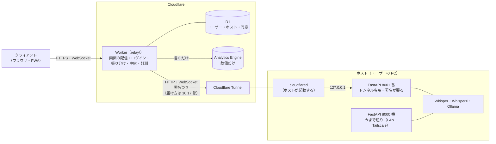
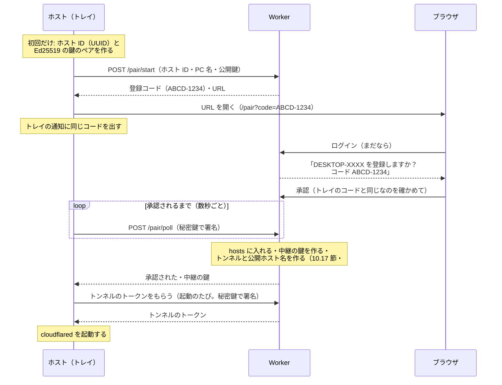
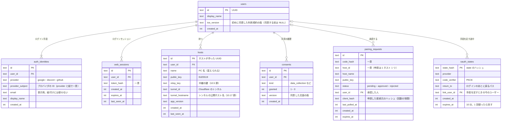

# 10. クラウド版

> [仕様書の目次](README.md)

2026-10-14 に決めたクラウド版の設計（#152）。M12 の Issue（#153〜#170）はここを読んで実装する。試作（#153）や実装で分かったことに合わせて書き換えてよい。「要検証」は #153 などで確かめるもの、「未決」は 10.16 節の一覧にあるもの。

## 10.1 目的

Tailscale・uv・Ollama などを自分で入れられる人だけでなく、余っているゲーミング PC を持っている人（ゲーム好きの大学生など）にも使ってもらう。ホスト（GPU を持つ PC）で今まで通り重い処理をし、クライアント（ブラウザ）は中間サーバーを通してホストにつなぐ。Tailscale もポートの開放も要らない。

- 重い処理（Whisper・WhisperX・Ollama）は今まで通りユーザーのホストでやる。中間サーバーは、画面の配信・ログイン・振り分け・中継・計測だけをする
- 中間サーバーには、音声・文字起こし・要約を置かない（通すだけ。データ収集をする場合は 10.10 節）
- 費用は Cloudflare の無料枠に収める（10.14 節）

## 10.2 ダイレクト版とクラウド版

同じリリース（同じ `web/`・`server/`）で、画面を開いた URL で切り替える。

| | ダイレクト版 | クラウド版 |
|---|---|---|
| 画面を開く URL | ホストの URL（LAN・Tailscale・localhost） | クラウド用のドメイン（staging は `rw-dev.studio-takumi.dev`。本番は 10.15 節） |
| 画面の配信 | ホストの FastAPI（`web/dist`） | Worker（同じ `web/dist` を静的アセットとして） |
| API・WebSocket | `/api/...`・`/ws` | `/h/<hostId>/api/...`・`/h/<hostId>/ws` |
| ログイン | なし（7.4 節） | Google・Discord・GitHub（10.7 節） |
| 外への通信 | **何も送らない**（お知らせを取りに行くことも含めて） | 中間サーバーとだけ |
| 広告 | 出さない | 後で出す（10.13 節） |
- 画面は `location.hostname` がクラウド用のドメイン（ビルド時の設定で渡す）ならクラウド版として動く。コードと設定の値は `cloud`・`direct`
  - ビルド時の設定は環境変数 `VITE_CLOUD_HOSTS`（カンマ区切り）。渡さなければ staging の `rw-dev.studio-takumi.dev` だけ。本番のドメインは、決まったら足す
  - 画面の URL の組み立ては `web/src/endpoint.ts` の 1 か所に集め、入口の状態（`login`・`consent`・`hosts`・`ready`）は `web/src/cloud.ts` に持つ。`ready` でホストが決まるまで、今の画面は出さない
  - PWA は API・WebSocket をキャッシュせず、`/h/`・`/auth/`・`/me/`・`/pair`・`/healthz` は画面の読み込み直しの代わり（navigateFallback）にしない
- ダイレクト版の挙動は変えない。クラウド版のために足す画面（ログイン・同意・ホストの選択・広告・お知らせ）は、ダイレクト版では出さず、そのためのスクリプトも読まない

## 10.3 構成



- Worker は TypeScript の Cloudflare Workers（`relay/`。`server/`・`web/` と並べる）。画面（`web/dist`）を同じオリジンで配信する（Cookie とオリジンを 1 つにするため）
- ホストからは外向きの接続（cloudflared）だけ。ホストのポートを外に開けない
- **WebSocket は素通しにする**（2026-10-20 に決めた）。Worker は、つなぐとき（Upgrade のリクエスト）だけ、ログイン・ホストの持ち主・Origin を確かめ、署名を付けて、そのリクエストをホストへ渡す（`fetch(request)` の応答をそのまま返す）。つないだあとのメッセージは Cloudflare が中継し、Worker のコードは動かない。メッセージを 1 件ずつ受けて中継すると、無料プランの CPU 時間（1 リクエスト 10ms）を超える見込みのため（10.14 節）。録音の数字は、画面が録音ごとに送る（10.9 節）
- 通信の中身（API・WebSocket のメッセージ）はダイレクト版と同じ。違うのは URL の前の `/h/<hostId>` と、Worker が足す署名のヘッダーだけ

## 10.4 URL

| パス | 中身 |
|---|---|
| `/`・`/s/<UUID>` など | 画面（SPA。ダイレクト版と同じ URL） |
| `/h/<hostId>/api/...` | ホストの `/api/...` へ中継 |
| `/h/<hostId>/ws` | ホストの `/ws` へ中継 |
| `/auth/login/<provider>`・`/auth/callback/<provider>`・`/auth/logout` | ログイン（10.7 節）。provider は `google`・`discord`・`github` |
| `/pair?code=...`・`/pair/start`・`/pair/poll` | ホストの登録（10.6 節） |
| `/me/...` | 自分のアカウント・ホスト一覧・同意など、Worker が答える API |
| `/healthz` | Worker の死活 |

- 画面の URL（`/s/<UUID>` など、#177）にはホストを入れない。どのホストを開いているかは画面の状態（とホストが 1 台ならそれ）で決める。ホストを切り替えるとセッションの一覧が替わる
- 画面の URL・API の URL に、文字起こし・プロジェクト名を入れない（広告や計測に URL が渡るため。今の URL は UUID だけなので守れている）

## 10.5 トンネル専用のポートと署名

cloudflared はホストの中から 127.0.0.1 でつないでくるので、IP ではローカルからの接続と区別できない。そこで、トンネルは別のポートに向ける。

- ホストの FastAPI は、8000 番（今まで通り）に加えて **8001 番（トンネル専用）** を開く。8001 番は 127.0.0.1 だけで開き、トンネルのとき以外は開かない（クラウドに登録していないホストでは開かない）
  - 実装（#160）: アプリを署名の確認で包んだ ASGI アプリ（`server/src/remote_whisper/tunnel.py`）を、別の uvicorn で 8001 番に動かす（8000 番のアプリは包まない。アプリの状態は 8000 番のイベントループに結びついているので、8001 番も同じループの上で動かす。`X-Forwarded-*` は信じない）。起動時に cloud.json に中継の鍵があれば開き、登録を承認したら開き、解除したら閉じる
- 8001 番では、**Worker の署名がないリクエストは 401** で断る。WebSocket も同じ（つなぐ前に確かめる）
- 署名: Worker が「ユーザー ID・ホスト ID・時刻（UNIX 秒）・メソッド・パス」をホストごとの鍵で HMAC-SHA256 し、ヘッダーに付けて転送する。ホストは、自分のホスト ID か・時刻が許容幅（60 秒）の中か・署名が合うかを確かめる（比べるのは定数時間で）
  - パスは、Worker が `/h/<hostId>` を外したあとのホスト側のパス（クエリを含む）
  - ヘッダーの形: `X-RW-Relay: v1;user=<userId>;host=<hostId>;ts=<秒>;sig=<base64url>`（5 項目ちょうど、この順だけ）。ブラウザから来た同じ名前のヘッダーは Worker が捨てる
  - **署名の決定版（#160）**: HMAC-SHA256。鍵は中継の鍵（base64url）をデコードしたバイト列。対象は `v1`・userId・hostId・ts（10 進）・METHOD（大文字。WebSocket の Upgrade は `GET`）・path（`/h/<hostId>` を外したホスト側のパス。クエリがあれば `?` 以降も）の 6 つを LF でつないだ UTF-8（末尾に改行なし）。Worker は `relay/src/relay.ts` の `signRelay`。固定値（鍵 = バイト 0〜31、user=`u-1`、host=`11111111-2222-4333-8444-555555555555`、ts=`1800000000`、`GET`、`/api/projects?x=1`）の `sig=` は `sAXwWExaGr2NlUMM5nFRLnVnCvzea-rPM05fI6k4Dso`。両側のテストでこの値を確かめる
  - 中継するのは `/h/<hostId>/api/...` と `/h/<hostId>/ws` だけ。ほかは `404`。ログインしていなければ `401`、他人のホスト・ないホストは `403`（あるかどうかも教えない）、トンネルか中継の鍵がまだないホストは `503`、ホストにつながらなければ `502`
  - 中継先は `hosts.tunnel_hostname`（`rwt-<12 桁>.<ドメイン>` の形のものだけ）。リダイレクトには従わず、ホストの `Set-Cookie` と 3xx の `Location` は落としてブラウザに返す。`Expect` も落とす（1xx の応答で落ちるため）。`Accept-Encoding` はブラウザのものをそのまま渡す
  - 接続元を名乗るヘッダー（`X-Forwarded-*`・`Forwarded`・`X-Real-IP`・`True-Client-IP`・`CDN-Loop`）も落とす。uvicorn は 127.0.0.1 からの `X-Forwarded-For` を信じるので、ブラウザが付けた値がホストの接続元になってしまうため
  - エンコードした `/`・`\`（`%2F`・`%5C`）を含むパスは `404`（URL の正規化で畳まれず、ホストでデコードされて `/api/../` になるため）
  - ホストの応答から `Set-Cookie`・`Location`・`Refresh`・`Clear-Site-Data`・`Service-Worker-Allowed`・`Access-Control-*` を落とし、`X-Content-Type-Options: nosniff` を足す。WebSocket の 101 の応答も同じ
  - **ホスト側で守ること**: 署名を確かめるパスは、デコードする前の形（ASGI の `raw_path` と `query_string`）で組み立てる。メソッドは大文字にしてから比べる。8001 番では Origin を見ない（Worker が確かめる）。8001 番には画面（SPA）を出さない
  - WebSocket は、つなぐとき（Upgrade のリクエスト）に 1 回だけ確かめる。つないだあとのメッセージには署名しない
  - ホストごとの鍵（中継の鍵）は、登録を承認したときに Worker が作り、D1 に置き、`/pair/poll` の返事でホストに渡す（10.6 節）。ホストは秘密のファイル（10.6 節）に置く
  - トンネルの URL が漏れても、署名がなければ入れない。署名つきのリクエストを盗まれても、60 秒で使えなくなる
- 中継するとき、Worker はブラウザの `Cookie`・`Authorization`・`CF-*` のヘッダーをホストに渡さない
- ホストから Worker への API（登録の確認・トンネルのトークンの取得・解除）は、ホストの Ed25519 の秘密鍵で署名する。Worker は登録のときに受け取った公開鍵で確かめる
  - 署名する中身: `v1`・ホスト ID・時刻（UNIX 秒）・メソッド・パス・本文の SHA-256。ヘッダーの形: `X-RW-Host: v1;host=<hostId>;ts=<秒>;sig=<base64url>`
  - 時刻が 60 秒より古い・新しいものは断る（盗んだリクエストを送り直されても、中継の鍵を取られないように）
  - **署名の対象の文字列（#158 で決めた。Worker の #157 も同じに組み立てる）**: 次の 6 つを改行（`\n`、LF 1 文字）でつなぎ、UTF-8 にしたバイト列。末尾に改行は付けない。ホストの実装は `server/src/remote_whisper/cloud.py` の `canonical_string`

    ```
    v1
    <hostId>          # 小文字・ハイフンつきの UUID（ヘッダーの host= と同じ文字列）
    <ts>              # UNIX 秒の 10 進の整数（ヘッダーの ts= と同じ文字列）
    <METHOD>          # 大文字（POST）
    <path>            # Worker が受け取ったパス。クエリがあれば ? 以降も含める（/pair/poll）
    <sha256(body)>    # 本文のバイト列（送ったそのまま）の SHA-256、小文字の 16 進 64 文字。本文がなければ空のバイト列のもの
    ```

  - 鍵は Ed25519。公開鍵は生の 32 バイトを base64url（パディングなし）にしたもの（WebCrypto の `importKey("raw", …, { name: "Ed25519" })` で読める）。`sig=` は 64 バイトの署名の base64url（パディングなし）
  - Worker は、ヘッダーの `host=` の行（hosts、または申請中の行）の公開鍵で確かめる。`/pair/start` だけは、本文の `publicKey` で確かめる（申請する公開鍵と組の秘密鍵を持っていることの証明）
  - ホストは本文を `Content-Type: application/json` で送る。Worker は署名を確かめてから本文を JSON として読む

## 10.6 ホストの登録



- ホスト ID と鍵のペアは登録を始めるときに作り、`setting.json` とは別の秘密のファイル（データのルートの `cloud.json`。`REMOTE_WHISPER_HOME` に従う。権限は本人だけ。5.1 節）に置く。ハードウェアの固有の値は使わない
- **すでに登録されている（解除していない）ホスト ID での `/pair/start` は断る**（409）。別の公開鍵で申請して、ほかの人のホストを乗っ取れないようにする
- 解除したら、hosts の行を消す（トンネルも消す）。ホストは `cloud.json` を消し、次に登録するときは**新しいホスト ID と鍵のペア**で申請する（同じ ID を使い回さない）。資格情報をなくしたホストは、画面の管理から解除してから登録し直す
- サーバーには公開鍵だけを置く。秘密鍵はホストから出さない
- 登録コードは 10 分有効・1 回だけ。DB にはコードのハッシュを置く。トレイとブラウザに同じコードを出し、同じことを確かめてから承認させる（ほかの人の PC を自分のアカウントに登録させる乗っ取りの対策）
- 申請とポーリングには回数の制限を付ける。期限切れの申請は消す（#157）
  - 申請（`/pair/start`）は、同じ接続元（`CF-Connecting-IP` のハッシュ。IP そのものは置かない）から 10 分に 5 回まで
  - ポーリング（`/pair/poll`）は、1 つの申請につき 1 秒に 1 回まで
  - 期限切れの申請は、次の申請のときに消す
- 登録コードは `XXXX-XXXX`（読み間違えやすい `0`・`O`・`1`・`I` を除いた英大文字と数字の 32 文字から 8 文字）。画面で打ち直されたものは、小文字・空白・ハイフンなしもそろえて受け付ける
- 解除（画面から・トレイの「クラウドから外す」・退会）: hosts から消し、トンネルと公開ホスト名の DNS レコードを消し、ホストは資格情報を消して cloudflared を止める。トンネルが消えるので、つながっている WebSocket も切れる
- ログアウトしても、つながっている WebSocket はそのまま（素通しなので Worker から切れない）。閉じたときに切れ、つなぎ直すときにログインを確かめる。これは許容する
- **ホストと Worker のやり取り（#158 で決めた。Worker は #157 で同じに作る）**: どれも `POST`、本文は JSON、10.5 節の `X-RW-Host` の署名つき。エラーの本文は `{"detail": "<理由>"}`（/me などと同じ形。ホストは状態コードだけを見る）

  | パス | 送るもの | 返すもの |
  |---|---|---|
  | `/pair/start` | `{"hostId": "<UUID>", "hostName": "<PC 名>", "publicKey": "<base64url>"}`。署名は本文の `publicKey` で確かめる | `200 {"code": "ABCD-1234", "url": "https://<クラウドのドメイン>/pair?code=ABCD-1234", "expiresInSec": 600}`。登録済みのホスト ID なら `409`、回数の制限なら `429`、形が違えば `400`、署名が合わなければ `401` |
  | `/pair/poll` | `{}` | `200 {"status": "pending"}`・`{"status": "approved", "relayKey": "<base64url>"}`・`{"status": "rejected"}`・`{"status": "expired"}`。申請が見つからない（期限切れで消した）なら `404`、署名が合わなければ `401`、回数の制限なら `429` |
  | `/pair/unpair` | `{}` | `200 {"ok": true}`。hosts から消し、トンネルと DNS レコードを消す。ないホストなら `404` |

  - `approved` は、申請の期限（10 分）までは何度聞かれても同じ `relayKey` で返す。返事がネットワークで落ちても、ホストが聞き直せば受け取れる（持ち主のいないホストを Worker に残さない）。聞けるのは申請の秘密鍵を持つホストだけなので、何度返しても漏れない。期限を過ぎたら申請の行を消す（次の `/pair/poll` は `404`）。`relayKey` は 10.5 節の中継の鍵（32 バイト以上の乱数の base64url）
  - hosts に入れるのは、ブラウザで**承認したとき**。承認より前に `/pair/unpair` が来たら申請を取り消し済み（`rejected`）にして `200` を返し（申請の公開鍵で署名を確かめる）、そのあとの承認は「申請が見つからない」で断る。行は期限まで残す（消すと、申請と取り消しを繰り返して回数の制限を抜けられるため）
  - 確認の画面の `GET /pair/request` は `answeredByMe`（承認・拒否したのが自分か。まだなら `null`）も返す。ほかの人が先に承認していたら、画面で「心当たりがなければクラウドから外す」と知らせる（コードが漏れたときに気づけるように）
  - PC 名からは制御文字と書式の文字（右から左への上書き・ゼロ幅の文字など）を除く
  - 確認の画面の API には回数の制限を付けない。コードは 40 ビット（32 文字から 8 文字）で 10 分しか有効でなく、総当たりは現実的でないため。当てられたときに気づけるよう `answeredByMe` を出す
  - `/pair/start` の `409` は、登録済みのホスト ID に加えて、**申請中の同じホスト ID**（公開鍵が違っても同じでも）にも返す
  - `X-RW-Host` は `;` で区切った `v1`・`host=`・`ts=`・`sig=` の 4 つちょうど、この順だけを受け付ける（同じ項目の重複・余計な項目・空の値は `401`）
  - 署名の対象に中間サーバーのオリジンは入れない。鍵は登録した中間サーバーごとに別（登録のたびに作る）で、staging と本番で同じ鍵を使うことはないため
  - ホストは `401` と、`408`・`429` 以外の 4xx を受けたら聞き直さずにやめる（時計のずれは 10 分待たせずに知らせる）。`429` のあいだは間隔を倍にしていく（上限 30 秒）
  - `code` は英数字とハイフン（4〜32 文字）。ホストはそれ以外の形なら受け付けない（通知に変な文を出さないため）
  - `url` は Worker と同じオリジンのものだけをホストが開く。違えば（または無ければ）ホストが `<中間サーバーの URL>/pair?code=<code>` を組み立てて開く
- **トンネル（#159）**: `POST /pair/tunnel`（署名つき。本文 `{"appVersion": "<版>"}`、appVersion は任意）→ `200 {"token": "<cloudflared のトークン>", "hostname": "<公開ホスト名>"}`。登録済みのホストが**起動のたびに**呼ぶ（トークンをホストに長く置かない）。`last_seen_at` と `app_version` も更新する
  - Worker は、トンネルがなければここで作る（承認のときではない）。手順は「トンネルを作る（`config_src: cloudflare`）→ `hosts.tunnel_id` に残す → 転送先の設定（公開ホスト名 → `http://127.0.0.1:8001`、ほかは 404）と DNS の CNAME（`<tunnel_id>.cfargotunnel.com`、プロキシあり）→ `hosts.tunnel_hostname` に残す」。途中で失敗しても、次に呼ばれたときに続きから作る（トンネルを作り直さない）
  - 返事: 登録していないホストは `404`、署名が合わなければ `401`、トンネルの API の設定（secret・vars）がなければ `503`、Cloudflare の API で失敗したら `502`
  - ホスト側（`cloudflared.py`）: 登録済みのとき、8001 番が開いてから cloudflared を子プロセスで動かす（`cloudflared tunnel --no-autoupdate run`。Windows はコンソールを出さない）。起動のたびにこの API でトークンをもらい、環境変数 `TUNNEL_TOKEN` で渡す（コマンドラインにもファイルにもログにも残さない）。落ちたら 5 秒から倍にして（上限 5 分）起動し直し、そのたびにトークンをもらい直す（60 秒以上動いたら 5 秒に戻す）。`404`・`401` なら止め、`502`・`503`・つながらないときは同じ間隔で聞き直す。解除・サーバーの終了で terminate → 待って kill する。cloudflared の場所は全体設定の `cloud.cloudflaredPath`（空なら、配布用のビルドに同梱の `cloudflared.exe`（#168）、なければ PATH の `cloudflared`。どちらもなければ「見つかりません」と通知して動かさない）。トレイには「トンネル: つながっている／つないでいます／止まっている」を出す
  - 解除（`/pair/unpair`・画面から外す・退会）のときは、DNS のレコード → トンネルの接続 → トンネルの順に消してから行を消す。Cloudflare で消せなくても行は消す（残ったものはログに出す）
- **確認の画面とブラウザの API（#157）**: どれもログインセッションが要る（なければ `401`）。`POST` は Origin が自分のオリジンのときだけ（違えば `403`）
  - 画面 `/pair?code=…`: ログインしていなければログインのボタンを出し、ログインのあとはこの画面に戻る。「〇〇（PC 名）を △△ のアカウントに登録しますか？」とコードを大きく出し、トレイの通知と同じかを確かめさせてから承認・拒否させる
  - `GET /pair/request?code=` → `{"code", "hostName", "status", "expiresAt"}`。見つからない・期限切れは `404`
  - `POST /pair/approve {"code"}` → hosts に入れ（中継の鍵を作る）、申請を `approved` にする（同じトランザクション）。`pending` で期限内のものだけ。ほかの人が承認済みのコードは `404`
  - `POST /pair/reject {"code"}` → 申請を `rejected` にする
- **ホストの管理（#157・#161）**: `GET /me/hosts` → `{"hosts": [{"id", "name", "appVersion", "createdAt", "lastSeenAt", "online"}]}`（鍵は出さない）。`DELETE /me/hosts/<id>` → 自分のホストだけ消せる（ほかの人のものは `404`）。消したホストがポーリングしても中継の鍵は返さない
  - `online` はトンネルの状態（Cloudflare の API の `cfd_tunnel` の `status` が `healthy`・`degraded` なら `true`、ほかは `false`）。トンネルがまだない・API が使えないときは `null`（分からない）。一覧を開くたびにホストの数だけ API を呼ぶ
  - `PATCH /me/hosts/<id> {"name"}` → 名前を変える（PC 名と同じく制御文字と書式の文字を除いて 1〜64 文字。自分のホストだけ）。返事は一覧
- **ホストの選択の画面（#161）**: ログインと同意のあと
  - 0 台なら、トレイから登録する手順の案内
  - 選べるもの（`online` が `false` でない）が 1 台だけ、または前に選んだホスト（この端末の localStorage）が選べるなら、選ぶ画面を出さずにつなぐ。ほかは選ぶ画面（オフラインのものは押せない）
  - 自動でつなぐのは開いて最初の 1 回だけ。つないだあとは上部に「〇〇 につないでいます」を出し、押すと選び直せる（録音中は押せない）
  - このページで前に別のホストにつないでいたら、選んだホストを覚えてページを読み込み直す（#222。画面の状態・WebSocket・溜めた音声は前のホストのものなので、作り直すより確実）。読み込み直すと覚えたホストに自動でつなぐ。同じホストを選び直したときは読み込み直さない。ログアウトして別の人がログインしたときも、前につないだホストと違えば読み込み直す
  - アカウントの画面で、ホストの名前を変える・外す（外すとトンネルも消える）
  - 確かめ方: `cd web && npm run check:cloud-hosts`（偽の Worker で 0 台・1 台・2 台以上・オフライン・前に選んだもの）
- **ホスト（トレイ）の動き（#158）**
  - 「クラウドにログイン」を押すと、新しいホスト ID と鍵のペアを作って `cloud.json` に書き（`relayKey` は `null`）、`/pair/start` を呼ぶ。返ってきた URL をブラウザで開き、登録コードをトレイの通知とメニューの行に出す
  - 3 秒ごとに `/pair/poll` を呼ぶ。`approved` なら `relayKey` を `cloud.json` に足して登録済みにする。`rejected`・`expired`・`404`・10 分たった・「登録をやめる」を押した・`401` などの断り（上の箇条）のどれかなら、`cloud.json` を消して登録していない状態に戻す（次は新しいホスト ID で申請する）。つながらない・`5xx`・`429` のときは、期限まで聞き直す
  - 中間サーバーの URL は全体設定の `cloud.relayUrl`（5.3 節。既定は staging の `https://rw-dev.studio-takumi.dev`。本番ができたら #167 で変える）。登録したときの URL を `cloud.json` の `relayUrl` に残し、その後のやり取り（解除など）はそこにする
  - 「クラウドから外す」を押すと（確認を出す）、`/pair/unpair` を呼び、cloudflared を止め（#159）、`cloud.json` を消す。中間サーバーにつながらないときも、この PC の資格情報は消し、「画面のホストの管理からも外してください」と通知する。`404`・`401` は、Worker 側ではもう外れている（画面から外したなど）とみなす
  - `cloud.json` の形（権限は本人だけ。POSIX は 600、Windows は `icacls` で継承を切って今のユーザーだけにする）:

    ```json
    {
      "version": 1,
      "hostId": "6f1c2a9e-…",
      "privateKey": "<Ed25519 の秘密鍵 32 バイトの base64url>",
      "publicKey": "<公開鍵 32 バイトの base64url>",
      "relayUrl": "https://rw-dev.studio-takumi.dev",
      "relayKey": "<中継の鍵。申請中は null>",
      "registeredAt": 1792000000
    }
    ```

  - 申請中の `cloud.json`（`relayKey` が `null`）が残っていたら（申請中にサーバーを止めたなど）、登録していないとみなす。読めない `cloud.json` も同じ
- **つなげるのは自分のホストだけ**。画面では、0 台なら登録の案内、1 台なら選ぶ画面を出さずにそのままつなぎ「〇〇につないでいます」と出す、2 台以上なら選ぶ（#161）

## 10.7 ログイン

- Google・Discord・GitHub の OAuth（コードフロー、state・PKCE つき）。使う範囲は ID・表示名・メールだけ
- 1 人が複数の手段でログインしても、1 人のユーザーにまとめる。同じプロバイダの同じ ID なら同じユーザー。**メールアドレスで自動に紐付けはしない**（別の手段を足すのは、ログインしている状態で設定から）
- ログインセッション（`web_sessions`）は Cookie（`__Host-` 接頭辞・HttpOnly・Secure・SameSite=Lax）。DB にはトークンのハッシュだけを置き、期限を設ける。ログアウトで失効させる
- 状態を変える API は、Cookie に加えて Origin を確かめる（CSRF の対策。#166）。**`/h/<hostId>/ws` の WebSocket と、`/h/` 以下の GET 以外のリクエストも、Origin が自分のオリジンでなければ断る**。staging・本番は `studio-takumi.dev` のサブドメインで、兄弟のサブドメイン（ポートフォリオなど）は same-site なので、SameSite=Lax の Cookie が WebSocket にも付いてしまうため
- ログインを始めるとき、state を D1（ハッシュだけ）と、このブラウザの短命の Cookie（`__Host-rw_oauth_state`、10 分）の両方に置く。コールバックでは両方が合うときだけ進める（ほかの人が始めたログインの続きの URL を踏ませて、その人のアカウントにログインさせる・手段を足させる、ログイン CSRF の対策）。手段を足す（`?link=1`）ときは、さらにコールバックの時点でも始めたユーザーでログインしていることを確かめる
- ログインのあとに戻るパス（`?return=`）は、同じオリジンのパスだけ。`//`・`\`・制御文字（ブラウザが読み飛ばすタブ・改行）を含むものは `/` にする
- 退会: ユーザー・ログイン手段・ログインセッション・ホスト（とトンネル）・同意の履歴（consents）を消す。**同意の履歴も当面は消す**（持つデータを減らす。法令上残す必要があるとわかったら、ユーザーと切り離して残す形に変える。10.16 節）
- OAuth のコールバックは `/auth/callback/google`・`/auth/callback/discord`・`/auth/callback/github`。クライアント ID とシークレットは secret（10.15 節）

## 10.8 データベース（D1）

最低限の 7 つだけ（6 つと、ログインの途中の状態の `oauth_states`）。音声・文字起こし・要約・プロジェクト名は置かない。



- 時刻は UNIX ミリ秒の整数
- consents は追記だけ（データ収集の許可・撤回の履歴）。今の状態は最後の行で決める
- 利用規約の同意は `users.tos_version`（初めに同意した版）だけを持つ。改定しても同意は取り直さない（10.11 節）
- マイグレーションは足すだけにする（列や表を消す・名前を変えるものは 2 回に分けて出す。#170）
- `relay_key` を D1 にそのまま置くか、Worker の secret で暗号化して置くか、Worker の secret からホスト ID ごとに都度導出する（HKDF。D1 に置かない）かは未決（D1 は Cloudflare のアカウントからしか読めない）
- 解除したホストの行は消す（10.6 節）。同じホスト ID は使い回さない

## 10.9 計測

**数値だけ**を Analytics Engine に書く。WebSocket は素通しなので（10.3 節）、次の 2 つから取る。ホストから計測のために何かを送ることはしない。

1. **Worker が中継する HTTP**（#163）: ユーザー ID・ホスト ID、メソッド・パス（ID は `:id` に伏せる）・ステータス・かかった ms・本文の大きさ、WebSocket をつないだ回数（つなぐときは HTTP なので）、ログイン・登録の回数、国、ブラウザ・OS の大まかな種類
2. **画面が録音ごとに送る数字**（#206）: クラウド版のときだけ、録音 1 回につき 1 回、最終要約ができたとき（ページを閉じたときは `sendBeacon` でその時点まで）に `POST /me/metrics/recording` で送る。ユーザーは Worker がログインの情報から付け、ホストは本文の `hostId` を受け取って、Worker がそのユーザーの（解除していない）ホストかを確かめる（違えば捨てる）。送られる数字は偽れる前提で扱い、回数の制限を付ける（1 ユーザーあたり 1 時間に数十件まで など）

| まとまり | 録音ごとに送る項目 |
|---|---|
| 録音 | 録音の秒数（一時停止を除く）、一時停止の回数、続きから録音したか、マイクかファイルのアップロードか |
| 遅延 | 音声→`ack` の往復（中央値・90%・最大の ms）、送ったチャンク数、`ack` が返ってきたチャンク数 |
| 接続 | 再接続した回数、切れていた秒数の合計、手元に溜めた音声の最大の秒数 |
| 文字起こし | partial・final の件数、録音を始めてから最初の final までの秒数、「文字起こしが止まっている」になった回数 |
| 要約 | リアルタイム要約の回数、停止してから最終要約ができるまでの秒数、浄書済み文字起こしができるまでの秒数 |
| ホストの状態（録音中の `status` から） | GPU キューの最大の長さ、GPU の使用率の平均・最大、VRAM の最大、Whisper・Ollama がつながらなくなった回数 |
| エラー | `error` の code ごとの件数（文面は送らない） |
| 使った設定 | Whisper のモデル名、要約のモデル名、マイクの処理（雑音抑制などのオン・オフ） |

- Worker は許可リストで項目を確かめ、知らない項目は捨てる。文字列は決まった値（モデル名の一覧など）にあるものだけ通す
- **書かないもの**: 音声、partial・final・浄書済み文字起こし・要約・タイトル・用語の本文、プロジェクト名・ファイル名、`error` の文面、セッション ID、IP アドレス
- 文章のログはホストのローカルの `log/`（6.10 節）だけ。クラウド版でも今まで通り書く

### HTTP の計測の形（#163）

Worker は、`/healthz` 以外のすべての HTTP（ホストへの中継・ログイン・登録・`/me`）を答えたあとに、Analytics Engine に 1 行書く（`relay/src/metrics.ts`）。データセットは staging が `remote_whisper_staging`（本番は #167 で決める）。ローカルでは束縛を付けないので書かない。書けなくても応答は止めない。

| 列 | 中身 |
|---|---|
| `blob1` | 種類（`relay`・`auth`・`pair`・`me`・`other`） |
| `blob2` | メソッド |
| `blob3` | パス。決まった語（許可リスト）だけ残し、UUID・数字・16 文字以上の英数字は `:id`、ほか（プロジェクト ID・用語など）は `:v` に伏せる。クエリは書かない。区切り 6 つ・96 文字まで |
| `blob4` | 国（`cf.country`。分からなければ `XX`） |
| `blob5`・`blob6` | ブラウザ（`chrome`・`edge`・`firefox`・`safari`・`opera`・`other`）・OS（`windows`・`macos`・`ios`・`android`・`linux`・`other`） |
| `blob7`・`blob8` | ユーザー ID（ログインしていれば）・ホスト ID（`/h/<id>/` のとき） |
| `blob9` | `ws`（WebSocket をつないだ）か `http` |
| `double1`〜`double4` | ステータス・かかった ms・リクエストの本文の大きさ・応答の本文の大きさ（`Content-Length`。なければ -1） |
| `index1` | ユーザー ID（ログインしていなければ種類）。サンプリングの単位 |

- パスに残すのは、Worker と ホストの API の決まった語（`relay/src/metrics.ts` の `KNOWN_SEGMENTS`）だけ。ほかは `:id`（UUID・数字・16 文字以上の英数字）か `:v`。プロジェクト ID（フォルダ名から作る）や用語が残らないように、許可リストにしている。ホストの API に語を足したら、ここにも足す
- メソッドは `GET`・`HEAD`・`POST`・`PUT`・`PATCH`・`DELETE`・`OPTIONS` だけ、ほかは `OTHER`
- ログイン・登録の回数は、パス（`/auth/callback/<provider>` の 302、`/pair/approve` の 200）で数える。IP アドレス・Cookie・本文は書かない（テストで確かめている）
- ログインした直後（callback）や、ログインしていないリクエストは、`blob7` が空になる

よく使う集計（Analytics Engine の SQL API。サンプリングされるので、件数は `_sample_interval` を足す。`count(DISTINCT …)` はサンプリングで少なめに出る）:

```sql
-- 日ごとの、ログインしている人の数と WebSocket をつないだ回数
SELECT toStartOfDay(timestamp) AS day,
       count(DISTINCT blob7) AS users,
       sumIf(_sample_interval, blob9 = 'ws' AND double1 = 101) AS ws_connects
FROM remote_whisper_staging
WHERE timestamp > now() - INTERVAL '30' DAY
GROUP BY day ORDER BY day;

-- 中継した API の遅さ（パスごとの 50%・95%）
SELECT blob3 AS path,
       quantileExactWeighted(0.5)(double2, _sample_interval) AS p50_ms,
       quantileExactWeighted(0.95)(double2, _sample_interval) AS p95_ms,
       sum(_sample_interval) AS requests
FROM remote_whisper_staging
WHERE blob1 = 'relay' AND timestamp > now() - INTERVAL '7' DAY
GROUP BY path ORDER BY requests DESC LIMIT 20;

-- エラーの多いところ（4xx・5xx）
SELECT blob1 AS kind, blob3 AS path, double1 AS status, sum(_sample_interval) AS n
FROM remote_whisper_staging
WHERE double1 >= 400 AND timestamp > now() - INTERVAL '1' DAY
GROUP BY kind, path, status ORDER BY n DESC LIMIT 20;
```

録音ごとの数字（#206）の集計（録音の長さ・遅延の分布）は、#206 でここに足す。

## 10.10 データ収集

文字起こし・要約を集めるかは**未決**。する場合は次を守る。

- クラウド版のときだけ・本人が許可したときだけ（既定はオフ、あとから設定で変えられる。変えるたびに consents に追記する）
- 音声は集めない
- 何を集めて何に使うかを、許可を聞く画面に短く書く

## 10.11 初回の表示と規約の改定

- クラウド版で初めてログインしたとき、利用規約とプライバシーポリシーへの同意（文面は LP に置く。リンクを出す）と、データ収集の許可（既定はオフ）を聞く。同意しなければ先に進めない（ログアウトはできる）
- API（`relay/src/consent.ts`。状態を変えるものは Origin を確かめる、10.7 節）:
  - `GET /me` に、今の規約の版 `tosCurrent`・リンク先 `termsUrl`/`privacyUrl`・データ収集の今の許可 `dataCollection`（consents の `data_collection` の最後の行。なければ `false`）を含める。同意の画面を出すのは `tosVersion` が `null` のときだけ
  - `POST /me/consent` `{"tosVersion", "dataCollection"}`: `tosVersion` が今の版（`TOS_VERSION`）と同じときだけ受け付け、違えば 409。`users.tos_version` を入れ、consents に `tos`（granted=1）と `data_collection` を 1 つのバッチで追記する
  - `PUT /me/consents/data_collection` `{"granted"}`: 設定から変える。変えるたび（同じ値でも）consents に追記する。規約に同意していなければ 409
  - consents の `version` は、`tos` では規約の版、`data_collection` では説明文の版（`DATA_COLLECTION_VERSION`）。規約の版が上がっても `tos_version` は更新しない
- 規約の改定: 同意は取り直さず、施行日の前にお知らせで知らせる（10.12 節）。データ収集の目的を変えるときだけ、同意を取り直す

## 10.12 お知らせ

- `announcements.json`（LP ができるまでは relay の静的アセット）。項目は `id`・`kind`（`tos`・`release`・`info`）・`title`・`url`・`since`・`until`
- クラウド版の画面: 開いたときに読み、まだ見ていないものを控えめに出す。閉じたら同じものは出さない（見たかどうかは localStorage）
- 常駐アイコン: クラウドに登録しているときだけ読み、`release` で今より新しいバージョンがあれば知らせる
- ダイレクト版の画面と、クラウドに登録していない常駐アイコンは読みに行かない

## 10.13 広告

**後回しにした**（2026-10-20。#165 は残して後のマイルストーンに移した）。入れるときは次のとおり。

- クラウド版だけ。PC は右の空いている列、スマホは画面の下に 1 本（高さを固定）
- 控えめにする: マイクボタン・文字起こし・要約に重ねない、枠の大きさを先に取って画面をずらさない、1 画面に 1 つまで
- 広告のスクリプト（AdSense）は、設定で ID を渡したときだけ読む。審査に通るまでは空の枠も出さない設定にできる

## 10.14 費用

- Cloudflare の無料枠に収める: Workers（リクエスト数・CPU 時間）、D1、Analytics Engine、Tunnel（無料）。足りなくなったら Workers Paid にする
- 固定費はドメイン代だけにしたい
- 無料プランの CPU 時間の上限は 1 リクエストあたり 10ms。WebSocket を Worker で受けて中継すると、録音 1 時間で上り約 7,200・下り約 15,000 件のメッセージを同じリクエストで扱うので超える見込みだった（#153）。そこで WebSocket は素通しにし（10.3 節）、Worker のコードが動くのはつなぐときだけにした。録音の数字は画面から録音ごとに 1 回送る（10.9 節）
- それでも素通しの WebSocket が長い録音で切られないかは、staging で 10〜15 分の録音を流して確かめる（#154。ローカルの `wrangler dev` は上限を当てない）

## 10.15 環境・名前・秘密情報

| | 名前 |
|---|---|
| ドメイン | `studio-takumi.dev`（Cloudflare で取ったもの。2026-10-20） |
| Worker | `remote-whisper-staging`（`--env staging`。カスタムドメイン `rw-dev.studio-takumi.dev`。workers.dev の URL は使わない（`workers_dev: false`。画面がクラウド版と判定せず、Cookie とオリジンも分かれるため））・`remote-whisper`（本番。サブドメインは #167 で決める。例: `rw.studio-takumi.dev`） |
| トンネルの公開ホスト名 | `rwt-<ホスト ID からハイフンを除いた頭 12 文字>.studio-takumi.dev` のように **1 段のサブドメイン**にする（同じ名前がすでにあれば、文字数を足して作り直す）（無料の証明書は `*.studio-takumi.dev` にしか効かないため。2 段にすると証明書が有料になる）。staging と本番は前置きを変える（例: staging は `rwt-dev-…`） |
| `wrangler dev` のポート | 8787 |
| ホストのトンネル専用のポート | 8001（127.0.0.1 だけ） |
| OAuth のコールバック | `/auth/callback/google`・`/auth/callback/discord`・`/auth/callback/github` |
| Worker の secret | `GOOGLE_CLIENT_ID`・`GOOGLE_CLIENT_SECRET`・`DISCORD_CLIENT_ID`・`DISCORD_CLIENT_SECRET`・`GITHUB_CLIENT_ID`・`GITHUB_CLIENT_SECRET`・`CF_API_TOKEN`（トンネルの操作と、`studio-takumi.dev` の DNS の編集だけの権限）・`CF_ACCOUNT_ID`・`CF_ZONE_ID`（秘密ではないが、公開のリポジトリに置かないため secret にする。#159） |
| Worker の vars（秘密でない） | `TUNNEL_DOMAIN`（`studio-takumi.dev`）・`TUNNEL_PREFIX`（dev は `rwt-local-`、staging は `rwt-dev-`、本番は `rwt-`。#159） |
| GitHub Actions の secret（自動デプロイ。#170） | `CLOUDFLARE_API_TOKEN`（デプロイ用）・`CLOUDFLARE_ACCOUNT_ID`（秘密ではないが、workflow ではここから読む） |

- 環境は dev（ローカル。`wrangler dev`）・staging（`rw-dev.studio-takumi.dev`）・prod（本番のサブドメイン。#167）。OAuth のリダイレクト URI は、localhost と staging のドメインのものをクライアントに足す
- 秘密情報は `wrangler secret`。ローカルは `relay/.dev.vars`（git に入れない。MEGA で同期されるので、localhost 専用の OAuth のクライアントだけを入れる）
- デプロイは main に入ったときの自動デプロイ（#170）。本番ができるまでは staging に出す
- 匠が用意するもの（アカウント・OAuth のクライアント・API トークン）は、リポジトリの外の手順書にある

## 10.16 まだ決めていないこと

| 項目 | メモ |
|---|---|
| データ収集をするか | する場合は 10.10 節の条件で。何を何に使うか |
| 利用規約・プライバシーポリシーの文面 | LP に置く（別の計画）。広告を出していること・広告のスクリプトが動くことも書く（#165） |
| 本番のサブドメイン | `studio-takumi.dev` のサブドメイン（例: `rw`）。#167 で決める |
| 退会したときの同意の履歴 | 当面は消す（10.7 節）。法令上残す必要があるか |
| 中継の鍵の置き方 | D1 にそのまま置くか、暗号化するか、都度導出するか（10.8 節） |
| 素通しの WebSocket が長い録音で切られないか | staging で確かめる（10.14 節） |
| 広告 | 後回し（10.13 節・#165） |
| 長い音声ファイルのアップロード | Worker が受け取れる本文は 100MB まで（10.17 節）。上限を出すか、分けて送るか |

## 10.17 試作で分かったこと（#153）

2026-10-20 に、ローカルの `wrangler dev` の試作の Worker と quick tunnel を、開発用のサーバー（`--mock`）の前に挟んで確かめた（結果の表は #153 のコメント）。

- **経路を変えるだけで、通信の中身はいじらずに済む**。今の画面のまま、録音（音声・`ack`）・partial・final・リアルタイム要約・最終要約・録音ファイルのダウンロード（Range も）・音声ファイルのアップロード・WebSocket の再接続（Worker を作り直しても、画面は手元で録音を続けて待ち、同じセッションのまま続いた）が動いた
- WebSocket をいったん受けて中継し、`type` と大きさを数える形でも動いた（ただし無料プランの CPU 時間に収まらない見込みなので、本番は素通しにする。10.3 節）
- 遅延（`ack` の往復の中央値）: 直接 1ms、トンネルだけ 31ms、Worker（ローカル）＋トンネル 34ms。0.5 秒ごとの送信には問題ない
- 中継の実装で気をつけること（#160）:
  - WebSocket のバイナリが Blob で届くことがある（ローカル。メッセージを Worker で受けるときの話で、素通しなら当たらない）
  - `Expect: 100-continue` を上流に渡すと、1xx の応答で落ちる。中継のときに落とす
  - Worker から上流への fetch は自動で圧縮をつけ、圧縮されたままの本文を返す。圧縮の扱いを決めておく
  - Worker が受け取れるリクエストの本文は 100MB まで（無料・Pro）。16kHz・モノラルの WAV は 1 時間で約 115MB になる（m4a・mp3 なら十分小さい）
- **Worker からホストのトンネルへの届け方**:
  - 名前つきのトンネルの公開ホスト名には、Cloudflare に置いたドメインが要る（workers.dev では作れない）
  - **ドメイン（`studio-takumi.dev`）ができたので、最初から名前つきのトンネルにする**（2026-10-20）。登録を承認したとき、Worker が Cloudflare の API でホスト用のトンネルと公開ホスト名（`rwt-<ホスト ID の頭 12 文字>.studio-takumi.dev`。10.15 節。DNS の CNAME も作る）を作り、転送先をホストの `http://127.0.0.1:8001` にする。ホストは起動のたびにトンネルのトークンを Worker からもらって cloudflared を起動する（#159）
  - Worker は、中継先のホスト名を `hosts.tunnel_hostname`（自分で作ったもの）から取る。ホストから URL を受け取らない（Worker を踏み台にして、ほかのサイトへ署名つきのリクエストを出させないため）。中継のときはリダイレクトに従わない
  - 公開ホスト名は誰でも引けるが、8001 番は Worker の署名がなければ断るので入れない
  - quick tunnel（`cloudflared tunnel --url`）は、試作と開発のときだけ使う（本番向けではない。同時のリクエスト数の上限があり、保証もない）
  - Workers VPC（ベータ。公開ホスト名なしでトンネルの先に届く）は、WebSocket が通るか・ホストごとに宛先を変えられるかが分かったら見直す
- 無料プランの CPU 時間の上限は、ローカルでは確かめられない（10.14 節）
