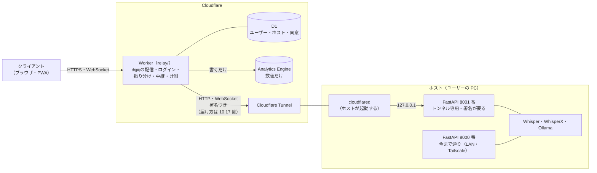
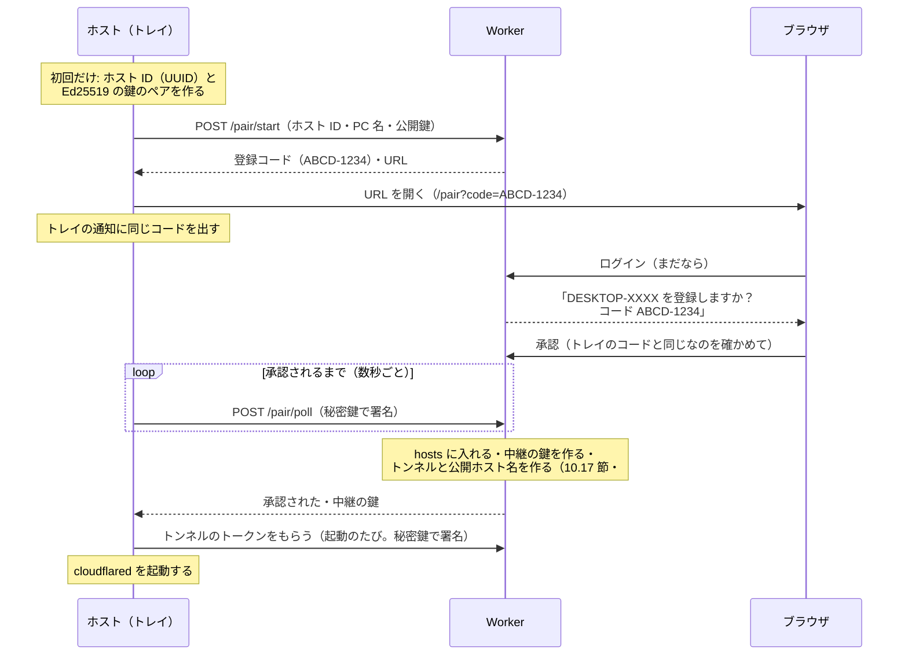
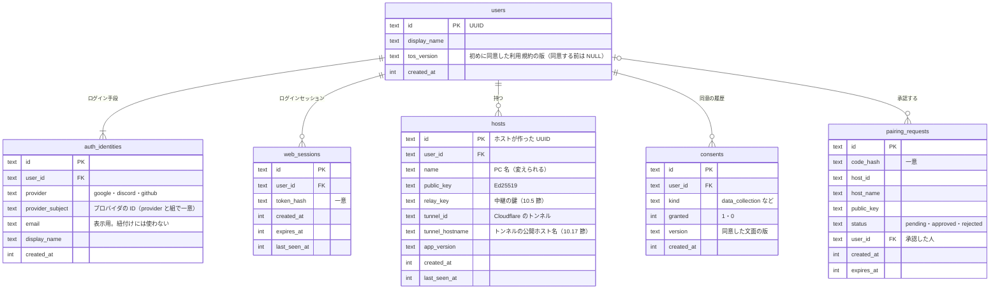

# 10. クラウド版

> [仕様書の目次](README.md)

2026-10-14 に決めたクラウド版の設計（#152）。M12 の Issue（#153〜#170）はここを読んで実装する。試作（#153）や実装で分かったことに合わせて書き換えてよい。「要検証」は #153 などで確かめるもの、「未決」は 10.16 節の一覧にあるもの。

## 10.1 目的

Tailscale・uv・Ollama などを自分で入れられる人だけでなく、余っているゲーミング PC を持っている人（ゲーム好きの大学生など）にも使ってもらう。ホスト（GPU を持つ PC）で今まで通り重い処理をし、クライアント（ブラウザ）は中間サーバーを通してホストにつなぐ。Tailscale もポートの開放も要らない。

- 重い処理（Whisper・WhisperX・Ollama）は今まで通りユーザーのホストでやる。中間サーバーは、画面の配信・ログイン・振り分け・中継・計測だけをする
- 中間サーバーには、音声・文字起こし・要約を置かない（通すだけ。データ収集をする場合は 10.10 節）
- 費用は Cloudflare の無料枠に収める（10.14 節）

## 10.2 ダイレクト版とクラウド版

同じリリース（同じ `web/`・`server/`）で、画面を開いた URL で切り替える。

| | ダイレクト版 | クラウド版 |
|---|---|---|
| 画面を開く URL | ホストの URL（LAN・Tailscale・localhost） | クラウド用のドメイン（staging は `rw-dev.studio-takumi.dev`。本番は 10.15 節） |
| 画面の配信 | ホストの FastAPI（`web/dist`） | Worker（同じ `web/dist` を静的アセットとして） |
| API・WebSocket | `/api/...`・`/ws` | `/h/<hostId>/api/...`・`/h/<hostId>/ws` |
| ログイン | なし（7.4 節） | Google・Discord・GitHub（10.7 節） |
| 外への通信 | **何も送らない**（お知らせを取りに行くことも含めて） | 中間サーバーとだけ |
| 広告 | 出さない | 後で出す（10.13 節） |

- 画面は `location.hostname` がクラウド用のドメイン（ビルド時の設定で渡す）ならクラウド版として動く。コードと設定の値は `cloud`・`direct`
- ダイレクト版の挙動は変えない。クラウド版のために足す画面（ログイン・同意・ホストの選択・広告・お知らせ）は、ダイレクト版では出さず、そのためのスクリプトも読まない

## 10.3 構成

- Worker は TypeScript の Cloudflare Workers（`relay/`。`server/`・`web/` と並べる）。画面（`web/dist`）を同じオリジンで配信する（Cookie とオリジンを 1 つにするため）
- ホストからは外向きの接続（cloudflared）だけ。ホストのポートを外に開けない
- **WebSocket は素通しにする**（2026-10-20 に決めた）。Worker は、つなぐとき（Upgrade のリクエスト）だけ、ログイン・ホストの持ち主・Origin を確かめ、署名を付けて、そのリクエストをホストへ渡す（`fetch(request)` の応答をそのまま返す）。つないだあとのメッセージは Cloudflare が中継し、Worker のコードは動かない。メッセージを 1 件ずつ受けて中継すると、無料プランの CPU 時間（1 リクエスト 10ms）を超える見込みのため（10.14 節）。録音の数字は、画面が録音ごとに送る（10.9 節）
- 通信の中身（API・WebSocket のメッセージ）はダイレクト版と同じ。違うのは URL の前の `/h/<hostId>` と、Worker が足す署名のヘッダーだけ

## 10.4 URL

| パス | 中身 |
|---|---|
| `/`・`/s/<UUID>` など | 画面（SPA。ダイレクト版と同じ URL） |
| `/h/<hostId>/api/...` | ホストの `/api/...` へ中継 |
| `/h/<hostId>/ws` | ホストの `/ws` へ中継 |
| `/auth/login/<provider>`・`/auth/callback/<provider>`・`/auth/logout` | ログイン（10.7 節）。provider は `google`・`discord`・`github` |
| `/pair?code=...`・`/pair/start`・`/pair/poll` | ホストの登録（10.6 節） |
| `/me/...` | 自分のアカウント・ホスト一覧・同意など、Worker が答える API |
| `/healthz` | Worker の死活 |

- 画面の URL（`/s/<UUID>` など、#177）にはホストを入れない。どのホストを開いているかは画面の状態（とホストが 1 台ならそれ）で決める。ホストを切り替えるとセッションの一覧が替わる
- 画面の URL・API の URL に、文字起こし・プロジェクト名を入れない（広告や計測に URL が渡るため。今の URL は UUID だけなので守れている）

## 10.5 トンネル専用のポートと署名

cloudflared はホストの中から 127.0.0.1 でつないでくるので、IP ではローカルからの接続と区別できない。そこで、トンネルは別のポートに向ける。

- ホストの FastAPI は、8000 番（今まで通り）に加えて **8001 番（トンネル専用）** を開く。8001 番は 127.0.0.1 だけで開き、トンネルのとき以外は開かない（クラウドに登録していないホストでは開かない）
- 8001 番では、**Worker の署名がないリクエストは 401** で断る。WebSocket も同じ（つなぐ前に確かめる）
- 署名: Worker が「ユーザー ID・ホスト ID・時刻（UNIX 秒）・メソッド・パス」をホストごとの鍵で HMAC-SHA256 し、ヘッダーに付けて転送する。ホストは、自分のホスト ID か・時刻が許容幅（60 秒）の中か・署名が合うかを確かめる（比べるのは定数時間で）
  - パスは、Worker が `/h/<hostId>` を外したあとのホスト側のパス（クエリを含む）
  - ヘッダーの形（案）: `X-RW-Relay: v1;user=<userId>;host=<hostId>;ts=<秒>;sig=<base64url>`。ブラウザから来た同じ名前のヘッダーは Worker が捨てる
  - WebSocket は、つなぐとき（Upgrade のリクエスト）に 1 回だけ確かめる。つないだあとのメッセージには署名しない
  - ホストごとの鍵（中継の鍵）は、登録を承認したときに Worker が作り、D1 に置き、`/pair/poll` の返事でホストに渡す（10.6 節）。ホストは秘密のファイル（10.6 節）に置く
  - トンネルの URL が漏れても、署名がなければ入れない。署名つきのリクエストを盗まれても、60 秒で使えなくなる
- 中継するとき、Worker はブラウザの `Cookie`・`Authorization`・`CF-*` のヘッダーをホストに渡さない
- ホストから Worker への API（登録の確認・トンネルのトークンの取得・解除）は、ホストの Ed25519 の秘密鍵で署名する。Worker は登録のときに受け取った公開鍵で確かめる
  - 署名する中身: `v1`・ホスト ID・時刻（UNIX 秒）・メソッド・パス・本文の SHA-256。ヘッダーの形（案）: `X-RW-Host: v1;host=<hostId>;ts=<秒>;sig=<base64url>`
  - 時刻が 60 秒より古い・新しいものは断る（盗んだリクエストを送り直されても、中継の鍵を取られないように）

## 10.6 ホストの登録

- ホスト ID と鍵のペアは登録を始めるときに作り、`setting.json` とは別の秘密のファイル（データのルートの `cloud.json`。`REMOTE_WHISPER_HOME` に従う。権限は本人だけ。5.1 節）に置く。ハードウェアの固有の値は使わない
- **すでに登録されている（解除していない）ホスト ID での `/pair/start` は断る**（409）。別の公開鍵で申請して、ほかの人のホストを乗っ取れないようにする
- 解除したら、hosts の行を消す（トンネルも消す）。ホストは `cloud.json` を消し、次に登録するときは**新しいホスト ID と鍵のペア**で申請する（同じ ID を使い回さない）。資格情報をなくしたホストは、画面の管理から解除してから登録し直す
- サーバーには公開鍵だけを置く。秘密鍵はホストから出さない
- 登録コードは 10 分有効・1 回だけ。DB にはコードのハッシュを置く。トレイとブラウザに同じコードを出し、同じことを確かめてから承認させる（ほかの人の PC を自分のアカウントに登録させる乗っ取りの対策）
- 申請とポーリングには回数の制限を付ける。期限切れの申請は消す
- 解除（画面から・トレイの「クラウドから外す」・退会）: hosts から消し、トンネルを消し、ホストは資格情報を消して cloudflared を止める
- **つなげるのは自分のホストだけ**。画面では、0 台なら登録の案内、1 台なら選ぶ画面を出さずにそのままつなぎ「〇〇につないでいます」と出す、2 台以上なら選ぶ（#161）

## 10.7 ログイン

- Google・Discord・GitHub の OAuth（コードフロー、state・PKCE つき）。使う範囲は ID・表示名・メールだけ
- 1 人が複数の手段でログインしても、1 人のユーザーにまとめる。同じプロバイダの同じ ID なら同じユーザー。**メールアドレスで自動に紐付けはしない**（別の手段を足すのは、ログインしている状態で設定から）
- ログインセッション（`web_sessions`）は Cookie（`__Host-` 接頭辞・HttpOnly・Secure・SameSite=Lax）。DB にはトークンのハッシュだけを置き、期限を設ける。ログアウトで失効させる
- 状態を変える API は、Cookie に加えて Origin を確かめる（CSRF の対策。#166）。**`/h/<hostId>/ws` の WebSocket と、`/h/` 以下の GET 以外のリクエストも、Origin が自分のオリジンでなければ断る**。本番のドメインは匠のポートフォリオと同じドメインのサブドメインを想定していて、兄弟のサブドメインは same-site なので、SameSite=Lax の Cookie が WebSocket にも付いてしまうため
- 退会: ユーザー・ログイン手段・ログインセッション・ホスト（とトンネル）を消す。同意の履歴（consents）は、法令上残す必要があるかを決めてから扱う（未決）
- OAuth のコールバックは `/auth/callback/google`・`/auth/callback/discord`・`/auth/callback/github`。クライアント ID とシークレットは secret（10.15 節）

## 10.8 データベース（D1）

最低限の 6 つだけ。音声・文字起こし・要約・プロジェクト名は置かない。

- 時刻は UNIX ミリ秒の整数
- consents は追記だけ（データ収集の許可・撤回の履歴）。今の状態は最後の行で決める
- 利用規約の同意は `users.tos_version`（初めに同意した版）だけを持つ。改定しても同意は取り直さない（10.11 節）
- マイグレーションは足すだけにする（列や表を消す・名前を変えるものは 2 回に分けて出す。#170）
- `relay_key` を D1 にそのまま置くか、Worker の secret で暗号化して置くか、Worker の secret からホスト ID ごとに都度導出する（HKDF。D1 に置かない）かは未決（D1 は Cloudflare のアカウントからしか読めない）
- 解除したホストの行は消す（10.6 節）。同じホスト ID は使い回さない

## 10.9 計測

**数値だけ**を Analytics Engine に書く。WebSocket は素通しなので（10.3 節）、次の 2 つから取る。ホストから計測のために何かを送ることはしない。

1. **Worker が中継する HTTP**（#163）: ユーザー ID・ホスト ID、メソッド・パス（ID は `:id` に伏せる）・ステータス・かかった ms・本文の大きさ、WebSocket をつないだ回数（つなぐときは HTTP なので）、ログイン・登録の回数、国、ブラウザ・OS の大まかな種類
2. **画面が録音ごとに送る数字**（#206）: クラウド版のときだけ、録音 1 回につき 1 回、最終要約ができたとき（ページを閉じたときは `sendBeacon` でその時点まで）に `POST /me/metrics/recording` で送る。ユーザーとホストは Worker がログインの情報と URL から付ける

| まとまり | 録音ごとに送る項目 |
|---|---|
| 録音 | 録音の秒数（一時停止を除く）、一時停止の回数、続きから録音したか、マイクかファイルのアップロードか |
| 遅延 | 音声→`ack` の往復（中央値・90%・最大の ms）、送ったチャンク数、`ack` が返ってきたチャンク数 |
| 接続 | 再接続した回数、切れていた秒数の合計、手元に溜めた音声の最大の秒数 |
| 文字起こし | partial・final の件数、録音を始めてから最初の final までの秒数、「文字起こしが止まっている」になった回数 |
| 要約 | リアルタイム要約の回数、停止してから最終要約ができるまでの秒数、浄書済み文字起こしができるまでの秒数 |
| ホストの状態（録音中の `status` から） | GPU キューの最大の長さ、GPU の使用率の平均・最大、VRAM の最大、Whisper・Ollama がつながらなくなった回数 |
| エラー | `error` の code ごとの件数（文面は送らない） |
| 使った設定 | Whisper のモデル名、要約のモデル名、マイクの処理（雑音抑制などのオン・オフ） |

- Worker は許可リストで項目を確かめ、知らない項目は捨てる。文字列は決まった値（モデル名の一覧など）にあるものだけ通す
- **書かないもの**: 音声、partial・final・浄書済み文字起こし・要約・タイトル・用語の本文、プロジェクト名・ファイル名、`error` の文面、セッション ID、IP アドレス
- 文章のログはホストのローカルの `log/`（6.10 節）だけ。クラウド版でも今まで通り書く

## 10.10 データ収集

文字起こし・要約を集めるかは**未決**。する場合は次を守る。

- クラウド版のときだけ・本人が許可したときだけ（既定はオフ、あとから設定で変えられる。変えるたびに consents に追記する）
- 音声は集めない
- 何を集めて何に使うかを、許可を聞く画面に短く書く

## 10.11 初回の表示と規約の改定

- クラウド版で初めてログインしたとき、利用規約とプライバシーポリシーへの同意（文面は LP に置く。リンクを出す）と、データ収集の許可（既定はオフ）を聞く。同意しなければ先に進めない（ログアウトはできる）
- 規約の改定: 同意は取り直さず、施行日の前にお知らせで知らせる（10.12 節）。データ収集の目的を変えるときだけ、同意を取り直す

## 10.12 お知らせ

- `announcements.json`（LP ができるまでは relay の静的アセット）。項目は `id`・`kind`（`tos`・`release`・`info`）・`title`・`url`・`since`・`until`
- クラウド版の画面: 開いたときに読み、まだ見ていないものを控えめに出す。閉じたら同じものは出さない（見たかどうかは localStorage）
- 常駐アイコン: クラウドに登録しているときだけ読み、`release` で今より新しいバージョンがあれば知らせる
- ダイレクト版の画面と、クラウドに登録していない常駐アイコンは読みに行かない

## 10.13 広告

**後回しにした**（2026-10-20。#165 は残して後のマイルストーンに移した）。入れるときは次のとおり。

- クラウド版だけ。PC は右の空いている列、スマホは画面の下に 1 本（高さを固定）
- 控えめにする: マイクボタン・文字起こし・要約に重ねない、枠の大きさを先に取って画面をずらさない、1 画面に 1 つまで
- 広告のスクリプト（AdSense）は、設定で ID を渡したときだけ読む。審査に通るまでは空の枠も出さない設定にできる

## 10.14 費用

- Cloudflare の無料枠に収める: Workers（リクエスト数・CPU 時間）、D1、Analytics Engine、Tunnel（無料）。足りなくなったら Workers Paid にする
- 固定費はドメイン代だけにしたい
- 無料プランの CPU 時間の上限は 1 リクエストあたり 10ms。WebSocket を Worker で受けて中継すると、録音 1 時間で上り約 7,200・下り約 15,000 件のメッセージを同じリクエストで扱うので超える見込みだった（#153）。そこで WebSocket は素通しにし（10.3 節）、Worker のコードが動くのはつなぐときだけにした。録音の数字は画面から録音ごとに 1 回送る（10.9 節）
- それでも素通しの WebSocket が長い録音で切られないかは、staging で 10〜15 分の録音を流して確かめる（#154。ローカルの `wrangler dev` は上限を当てない）

## 10.15 環境・名前・秘密情報

| | 名前 |
|---|---|
| ドメイン | `studio-takumi.dev`（Cloudflare で取ったもの。2026-10-20） |
| Worker | `remote-whisper-staging`（`--env staging`。カスタムドメイン `rw-dev.studio-takumi.dev`。workers.dev の URL も残る）・`remote-whisper`（本番。サブドメインは #167 で決める。例: `rw.studio-takumi.dev`） |
| トンネルの公開ホスト名 | `rwt-<ホスト ID の頭 12 文字>.studio-takumi.dev` のように **1 段のサブドメイン**にする（無料の証明書は `*.studio-takumi.dev` にしか効かないため。2 段にすると証明書が有料になる）。staging と本番は前置きを変える（例: staging は `rwt-dev-…`） |
| `wrangler dev` のポート | 8787 |
| ホストのトンネル専用のポート | 8001（127.0.0.1 だけ） |
| OAuth のコールバック | `/auth/callback/google`・`/auth/callback/discord`・`/auth/callback/github` |
| Worker の secret | `GOOGLE_CLIENT_ID`・`GOOGLE_CLIENT_SECRET`・`DISCORD_CLIENT_ID`・`DISCORD_CLIENT_SECRET`・`GITHUB_CLIENT_ID`・`GITHUB_CLIENT_SECRET`・`CF_API_TOKEN`（トンネルの操作だけの権限） |
| Worker の vars（秘密でない） | Cloudflare の Account ID、クラウド用のドメイン |
| GitHub Actions の secret（自動デプロイ。#170） | `CLOUDFLARE_API_TOKEN`（デプロイ用）・`CLOUDFLARE_ACCOUNT_ID`（秘密ではないが、workflow ではここから読む） |

- 環境は dev（ローカル。`wrangler dev`）・staging（`rw-dev.studio-takumi.dev`）・prod（本番のサブドメイン。#167）。OAuth のリダイレクト URI は、localhost と staging のドメインのものをクライアントに足す
- 秘密情報は `wrangler secret`。ローカルは `relay/.dev.vars`（git に入れない。MEGA で同期されるので、localhost 専用の OAuth のクライアントだけを入れる）
- デプロイは main に入ったときの自動デプロイ（#170）。本番ができるまでは staging に出す
- 匠が用意するもの（アカウント・OAuth のクライアント・API トークン・ドメイン）は、リポジトリの外の手順書にある

## 10.16 まだ決めていないこと

| 項目 | メモ |
|---|---|
| データ収集をするか | する場合は 10.10 節の条件で。何を何に使うか |
| 利用規約・プライバシーポリシーの文面 | LP に置く（別の計画）。広告を出していること・広告のスクリプトが動くことも書く（#165） |
| 本番のサブドメイン | `studio-takumi.dev` のサブドメイン（例: `rw`）。#167 で決める |
| 退会したときの同意の履歴 | 残す必要があるか |
| 中継の鍵の置き方 | D1 にそのまま置くか、暗号化するか、都度導出するか（10.8 節） |
| 素通しの WebSocket が長い録音で切られないか | staging で確かめる（10.14 節） |
| 広告 | 後回し（10.13 節・#165） |
| 長い音声ファイルのアップロード | Worker が受け取れる本文は 100MB まで（10.17 節）。上限を出すか、分けて送るか |

## 10.17 試作で分かったこと（#153）

2026-10-20 に、ローカルの `wrangler dev` の試作の Worker と quick tunnel を、開発用のサーバー（`--mock`）の前に挟んで確かめた（結果の表は #153 のコメント）。

- **経路を変えるだけで、通信の中身はいじらずに済む**。今の画面のまま、録音（音声・`ack`）・partial・final・リアルタイム要約・最終要約・録音ファイルのダウンロード（Range も）・音声ファイルのアップロード・WebSocket の再接続（Worker を作り直しても、画面は手元で録音を続けて待ち、同じセッションのまま続いた）が動いた
- WebSocket をいったん受けて中継し、`type` と大きさを数える形でも動いた（ただし無料プランの CPU 時間に収まらない見込みなので、本番は素通しにする。10.3 節）
- 遅延（`ack` の往復の中央値）: 直接 1ms、トンネルだけ 31ms、Worker（ローカル）＋トンネル 34ms。0.5 秒ごとの送信には問題ない
- 中継の実装で気をつけること（#160）:
  - WebSocket のバイナリが Blob で届くことがある（ローカル。メッセージを Worker で受けるときの話で、素通しなら当たらない）
  - `Expect: 100-continue` を上流に渡すと、1xx の応答で落ちる。中継のときに落とす
  - Worker から上流への fetch は自動で圧縮をつけ、圧縮されたままの本文を返す。圧縮の扱いを決めておく
  - Worker が受け取れるリクエストの本文は 100MB まで（無料・Pro）。16kHz・モノラルの WAV は 1 時間で約 115MB になる（m4a・mp3 なら十分小さい）
- **Worker からホストのトンネルへの届け方**:
  - 名前つきのトンネルの公開ホスト名には、Cloudflare に置いたドメインが要る（workers.dev では作れない）
  - **ドメイン（`studio-takumi.dev`）ができたので、最初から名前つきのトンネルにする**（2026-10-20）。登録を承認したとき、Worker が Cloudflare の API でホスト用のトンネルと公開ホスト名（`rwt-<ホスト ID の頭 12 文字>.studio-takumi.dev`。10.15 節）を作り、転送先をホストの `http://127.0.0.1:8001` にする。ホストは起動のたびにトンネルのトークンを Worker からもらって cloudflared を起動する（#159）
  - Worker は、中継先のホスト名を `hosts.tunnel_hostname`（自分で作ったもの）から取る。ホストから URL を受け取らない（Worker を踏み台にして、ほかのサイトへ署名つきのリクエストを出させないため）。中継のときはリダイレクトに従わない
  - 公開ホスト名は誰でも引けるが、8001 番は Worker の署名がなければ断るので入れない
  - quick tunnel（`cloudflared tunnel --url`）は、試作と開発のときだけ使う（本番向けではない。同時のリクエスト数の上限があり、保証もない）
  - Workers VPC（ベータ。公開ホスト名なしでトンネルの先に届く）は、WebSocket が通るか・ホストごとに宛先を変えられるかが分かったら見直す
- 無料プランの CPU 時間の上限は、ローカルでは確かめられない（10.14 節）
