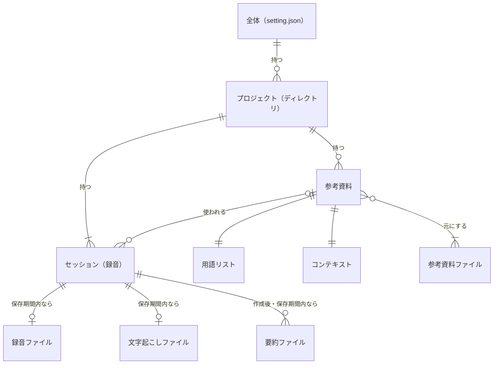

# 4. データモデル

> [仕様書の目次](README.md)

- プロジェクトは、ふつうに使っていればセッションを1つ以上持つ。登録した直後で、まだ一度も録音していないときだけ、一時的に0個になる。
- 録音ファイルと文字起こしは、保存期間が過ぎると消えるので、セッションから見ると「0か1」になる。
- 最終要約は、再生成するたびに新しいファイルとして増えていく（6.5 節）。作る前、失敗したとき、保存期間が過ぎたあとは0個になる。
- 1つの参考資料は、複数のセッションで使い回せる。参考資料を使わないセッションもある。
- 用語リストとコンテキストは、必ず同じ参考資料ファイルから1組で作る。
- セッションは、あとから別のプロジェクトへ移せる（#172。5.4 節）。移すと、使った参考資料は移動先にもコピーされる（元のプロジェクトにも残る）。
