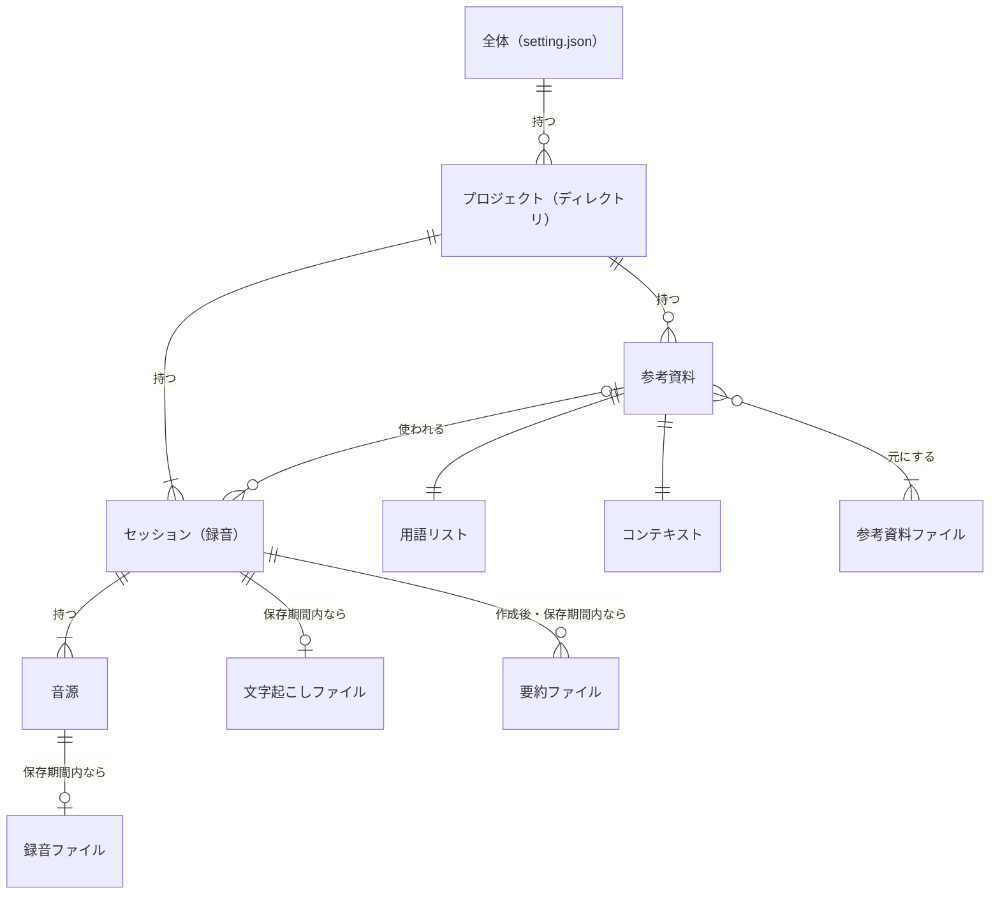

# 4. データモデル

> [仕様書の目次](README.md)

- プロジェクトは、ふつうに使っていればセッションを1つ以上持つ。登録した直後で、まだ一度も録音していないときだけ、一時的に0個になる。
- セッションは音源を 1 つ以上持つ（#241。6.16 節）。今までのセッションは音源が 1 つ（主の音源だけ）。録音中にほかの端末が参加したセッションと、複数の音声ファイルから作ったセッションは、音源が 2 つ以上になる。録音ファイルは音源ごとに 1 つで、音源を足し合わせた録音は作らない。文字起こしは音源が何個でもセッションに 1 つで、行ごとにどの音源から出たかを持つ。音源と話者は別のもの（1 つのマイクが複数の人の声を拾い、同じ人の声を複数のマイクが拾う）なので、音源から話者を決めない。
- 録音ファイルと文字起こしは、保存期間が過ぎると消えるので、セッションから見ると「0か1」になる（録音ファイルは音源ごとに「0か1」）。
- 最終要約は、再生成するたびに新しいファイルとして増えていく（6.5 節）。作る前、失敗したとき、保存期間が過ぎたあとは0個になる。
- 1つの参考資料は、複数のセッションで使い回せる。参考資料を使わないセッションもある。
- 用語リストとコンテキストは、必ず同じ参考資料ファイルから1組で作る。
- セッションは、あとから別のプロジェクトへ移せる（#172。5.4 節）。移すと、使った参考資料は移動先にもコピーされる（元のプロジェクトにも残る）。
