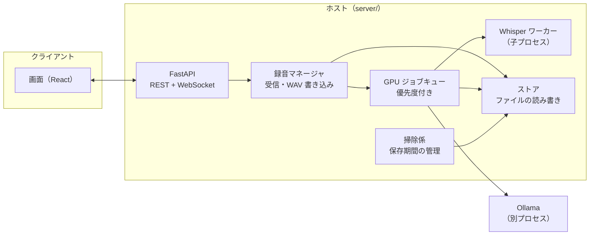
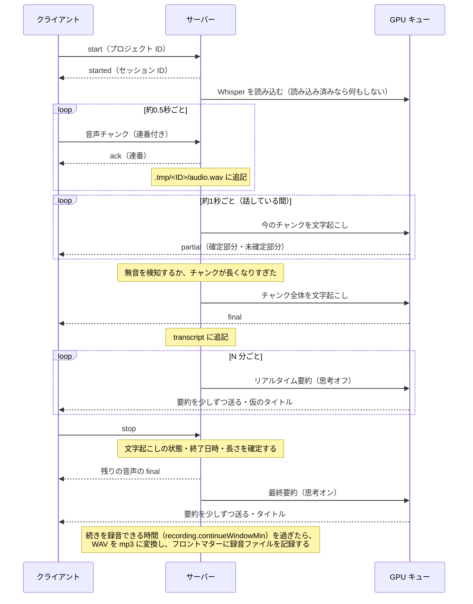
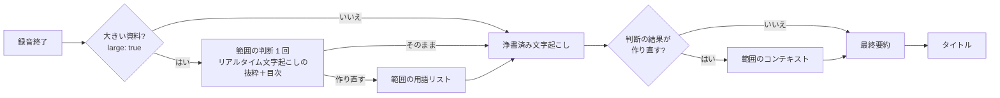

# 6. 処理の流れ

> [仕様書の目次](README.md)

## 6.1 構成

- Whisper は子プロセスで動かす。CUDA まわりの異常終了がサーバー全体を道連れにしないようにするため（基本方針の1）。Ollama はもともと別プロセス。
- 録音マネージャは GPU に依存しない。キューやワーカーが止まっていても、音声の受信と保存は続ける。

## 6.2 録音

- Whisper の読み込みが終わる前に届いた音声は、溜めておいて後でまとめて文字起こしする。
- チャンクの切り出しは、`whisper.speechThreshold` で次のどちらかにする。
  - `auto`（既定）: Silero VAD（faster-whisper に同梱のもの、CPU）で、32ms ごとに話している確率を出し、0.35 以上で話し始め、0.2 未満が `whisper.silenceMs` 続いたら区切る。離れた場所の小さい声は、元の音量のままだと VAD が声と判定しないので、直近 2 秒の大きめの音（上から 5%）が -20 dBFS になるように持ち上げてから判定する（下げはしない。上げるのは +30dB まで）。Whisper にも持ち上げた音を渡す（録音ファイルは元の音のまま）。
    - チャンクの前に 0.3 秒、後ろに 0.2 秒の余白を足す（言葉の頭と終わりが欠けないように）。
    - チャンクが 3 秒より短いうちは、`whisper.silenceMs` では区切らず、2 秒黙るまで次の声を待ってつなげる。短いチャンクは Whisper が前後の文脈を使えず、聞き違いや定番の文が出やすいため。
    - チャンクごとに、VAD が話しているとみなした長さを覚えておく（下の定番の文の判定に使う）。
    - **VAD が反応しなくなったとき（#120）**: ブラウザや OS のマイクの処理が途中で切り替わるなどで音の性質が変わると、音量は話し声くらいあるのに VAD がずっと反応しなくなることがある。20 秒のあいだ VAD が一度も反応せず、その間に「声くらいの音」（32ms ごとの元の音量が、直近 30 秒の下から 10% の音量より 12dB 以上大きく、かつ -35 dBFS 以上）が 20〜90% あったら、音量で区切る（声くらいの音を話しているとみなす。ずっと鳴り続ける音は 90% を超えるので切り替えない）。VAD が 3 窓続けて反応したら VAD に戻す。切り替えたことはログに残す。話していない部分から出た文は、下のハルシネーションの判定で落とす。
    - **止まったことを知らせる（#120）**: 最後に文字が出てから、声くらいの音（`manual` では話していると判定した音）が合わせて 60 秒届いても文字が出なければ、クライアントに `transcriptionStalled`（`stalled: true`）を送る。画面は、マイクの警告（#102）と同じ場所に警告を出し、タブのタイトルの頭に「⚠」を付ける。また文字が出たら `stalled: false` を送る。
  - `manual`: 20ms ごとの音量が `whisper.speechDbfs` を超えたら話しているとみなし、無音が `whisper.silenceMs` 続いたら区切る。
- 無音や弱い雑音を Whisper に渡すと、「ご視聴ありがとうございました」などの定番の文を作ることがある（ハルシネーション）。これを抑えるため、partial と final のどちらも次のようにする。
  - `manual` のときは、Whisper の `vad_filter`（Silero VAD）で、話していない部分を除いてから文字起こしする。`auto` のときはチャンクを VAD で切り出しているので、`vad_filter` は使わない。
  - Whisper が返すセグメントごとの信頼度（`no_speech_prob`・`avg_logprob`・`compression_ratio`）を見て、話していないのに出てきた文を捨てる。定番の文の一覧に一致しても、信頼度が低いときだけ捨てる（本当に話した「ありがとうございました」を消さないため）。
  - ただし `auto` で、VAD が話しているとみなした長さが 0.6 秒未満のチャンクから定番の文が出たら、信頼度が高くても捨てる。持ち上げた声の切れ端からは、信頼度の高い定番の文が出ることがあるため。本当に言ったなら 1 秒前後は話している。
  - 捨てた文は、理由と信頼度と一緒にサーバーのログに残す。
- partial は LocalAgreement で「確定部分」と「未確定部分」に分けて送る。クライアントは確定部分だけを文字送りの演出で表示し、未確定部分は薄い色で表示する想定。
- 録音中は、全体設定のうち文字起こしのモデル・区切り・マイクの処理を変更できない（5.3 節）。そのセッションで使った設定値は、フロントマターに記録する。
- stop を受けたら、まず文字起こしの状態（`done`）・終了日時・長さを確定し、設定のロックを外す。残りのチャンクの final と mp3 への変換はその後ろで行う（クライアントが「録音中」のまま待たないようにするため）。この間にサーバーが落ちると、最後のチャンクが文字起こしに残らないことがある（録音ファイルは次の起動時に変換する。6.7 節）。
- **録音中に用語を拾う**（#103。全体設定の `ollama.pickTerms`（既定はオフ、#116）とプロジェクトの `selection.pickTerms` の両方がオンのとき）: 長い録音では、繰り返し出てくる固有名詞や専門用語がある。リアルタイム要約と同じ間隔（`liveSummaryIntervalMin`、GPU キューの優先度 2）で、前回から増えた文字起こし（長ければ新しい方の約 4000 文字）から、固有名詞・専門用語を Ollama で抜き出す（JSON Schema で一覧を返させる。思考モードはオフ）。
  - 誤認識した語を足すと、その誤りが固まる。そのため、次の条件をすべて満たす語だけを採用する。
    - 文字起こしの **2 行以上に出てくる**（1 回しか出ない語・その場限りの誤認識は足さない）。長さは 2〜20 文字。
    - 語のうち、**カタカナ（3 文字以上）かラテン文字が続くところだけ**を使う（「ハルシオン計画」→「ハルシオン」）。漢字・ひらがなのところは、同音の誤認識（「負荷試験」→「付加試験」、「基盤」→「基板」など）と見分けられず、足すとその誤りが固まった（#103 で測った）。漢字の用語は参考資料から入れる。
    - よく使うカタカナ語（チーム・データ・スケジュールなど）ではない。
    - **1 文字だけ違う書き方**（「基盤」と「基板」など）が文字起こしに出てくるなら、その倍以上出てくる。同じくらいなら、どちらが正しいか分からないので足さない。
    - ほかに採用した語に含まれる短い語ではない（「ケルビン同期」があれば「ケルビン」「同期」は足さない）。
  - 毎回同じように誤認識される語（たとえば、人名がいつも同じ別の字になる）は、文字起こしだけからは見分けられない。拾われたら画面で消す（足さなくても、もともと同じように誤る）。
  - 採用した語は、出てくる行が多い順に、用語リスト（資料抽出）（`useHotwords` がオンのとき）の後ろに足し、Whisper に渡す用語リストを約 200 文字までに収める（6.6 節の上限。用語リスト（資料抽出）が先）。次のチャンクから効く。
  - 用語リスト（文字起こし抽出）は文字起こしのフロントマター（`pickedTerms`）に残し、`terms` で画面に知らせる。画面には、全体設定の `display.showPickedTerms`（既定はオフ、#147）がオンのときだけ、文字起こしのタブに一覧を出し、誤った語は × で消せる（`rejectedTerms` に残し、そのセッションでは以後足さない）。続きを録音するとき（6.7 節）は引き継ぐ。
  - **手で語を足す**（#175）: 聞き間違えている固有名詞に気づいたら、セッション画面の用語の欄の入力（「用語を足す」。Enter で足す。複数行の貼り付けは行ごとに足す）で、その場で足せる。録音中・一時停止中・録音後のどれでも、また用語を拾うのがオフのセッションでも使える。
    - 手で足した語はそのセッションだけに持つ（文字起こしのフロントマターの `manualTerms`。用語リスト（文字起こし抽出） `pickedTerms` とは分ける）。プロジェクトの参考資料の用語リストには足さない。
    - 録音中なら、足した（外した）ときにすぐ Whisper に渡す用語リストを差し替える（次のチャンクから効く。用語リスト（文字起こし抽出）が変わったときと同じ仕組み）。
    - Whisper に渡す順は「**手で足した語 → 用語リスト（資料抽出） → 用語リスト（文字起こし抽出）**」。長さの上限（約 200 文字。6.6 節）を超えるときは、用語リスト（文字起こし抽出）から削る。手で足した語と用語リスト（資料抽出）は削らない。手で足した語だけで上限を超えるときは、足せない（`409`）。語は 1〜40 文字で、「、」「/」と改行は含められない。
    - 手で足した語を外しても `rejectedTerms` には入れない。前に × で外した語を手で足したら、`rejectedTerms` から消す。用語リスト（文字起こし抽出）に同じ語があれば、手で足した語の方に移る。
    - 浄書（浄書済み文字起こしの再生成を含む。6.9 節）でも、手で足した語を使う。録音後に足した語は、浄書済み文字起こしを再生成するまで反映されない（画面にもそう出す）。
    - 画面では、手で足した語は用語リスト（文字起こし抽出）より枠を濃くして見分けられるようにし、どちらも × で外せる。用語リスト（文字起こし抽出）の一覧は `display.showPickedTerms` がオフなら出さないが、手で足す入力と手で足した語は常に出す。
    - 文字起こしの文字を選んで直したとき（6.13 節）も、正しい語を手で足した語に入れる。
  - **置き換え**（#176。6.13 節）: 録音中に置き換えを足すと、すでに出た行（ファイルの中身）と、以後に出る行に当てる。
  - Ollama に失敗したら、次の回に同じ範囲から拾い直す。ネット検索で表記を確かめることはしない（話の内容を外に送ることになるため）。
- マイクボタンの上の経過時間は、クライアントが録音した（サーバーに送る）サンプル数 ÷ 16000 から出す。サーバーも受け取ったサンプル数から文字起こしの時刻を出すので、同じ時計になる（時計で数えると、裏に回したタブではタイマーが間引かれてずれていく）。接続が切れて手元に溜めている音声も、録音した長さとして数える。
- 録音は一時停止・再開できる。一時停止中もセッションは続いているので、設定のロックなどは録音中と同じ扱いにする。一時停止中は経過時間とリアルタイム要約のタイマーを止め、再開したら続きから数える。
  - 一時停止していた時間は、録音ファイルと文字起こしの時刻に含めない（録音ファイルは詰める）。一時停止中に届いた音声は保存しない（**仮**。実際に使ってから見直す）。
  - 一時停止中にクライアントとの接続が切れた場合も、`recording.resumeTimeoutMin` 分で `interrupted` にする（6.7 節。続きから録音できる）。

## 6.3 GPU ジョブの優先順位

GPU を使う処理は、1つのキューを通して順番に実行する。

| 優先度 | ジョブ |
|---|---|
| 1 | 文字起こし（partial と final） |
| 2 | リアルタイム要約・仮のタイトル・録音中の用語の抽出 |
| 3 | 浄書済み文字起こし・最終要約・タイトル・参考資料の作成・再生成・範囲の判断と参考資料の作り直し（6.12 節） |

- 実行中のジョブは途中で止めない（例外は浄書済み文字起こしで、録音が始まったら止めて、録音が終わってから作り直す。6.9 節）。リアルタイム要約や前のセッションの最終要約を作っている間は、文字起こしのジョブがその後ろで待たされる。
- 何が詰まっているかを画面で見られるよう、ジョブには種類（`transcribe`・`whisperLoad`・`liveSummary`・`finalSummary`・`contextSet`・`terms`・`finalTranscript`・`materialRange`・`other`）とセッションを持たせ、実行中のジョブと待っているジョブの一覧を `status` の `jobs` で送る（7.2 節）。
- リアルタイム要約を作っている間に partial がどれだけ遅れるかは、まだ測っていない（**要検証**）。このシステムの肝になる部分。要約を途中で止めて文字起こしを先に通す（横取り）かどうかは、測ってから決める。
- 最終要約を作る前に、ほかに録音中のセッションがなければ Whisper を VRAM から下ろす。
- Whisper は、最後に使ってから `unloadAfterMin` 分たったら下ろす。Ollama は `keep_alive` で同じように管理する。録音中は `-1`（下ろさない）にする。ただし録音中に載せておく Ollama のモデルは 1 つだけにし、別のモデル（処理ごとのモデル、5.3 節）を使う前に、録音中に載せたほかのモデルを下ろす（#178）。リアルタイム要約・タイトル・用語の抽出のモデルを全部載せたままにすると、Whisper と合わせて VRAM 6GB が溢れ、読み込みに 1 分以上かかって文字起こしが止まったため。

## 6.4 リアルタイム要約

- 入力は、置き換え（6.13 節）を当てたあとの文字起こし。録音中に置き換えを足したら、要約がすでに持っている行にも当てる（確定させた要約区間の要約は書き直さない）。
- `liveSummaryIntervalMin` 分ごとに、前回から確定した文字起こしが増えていれば作る。思考モードはオフ。`num_ctx` は最終要約と同じ値にする（値が変わると Ollama がモデルを読み込み直すため）。
- 録音が長くなっても前半の要約が縮んでいかないよう、文字起こしを最終要約と同じ区切り方（6.5 節。行の区切りで約 4000 文字ずつ、前から順に詰める）で要約区間に分ける。
  - 要約区間が閉じたら（次の要約区間が始まったら）、その要約区間の要約を確定させ、以後は書き直さない。要約区間の要約は、要約詳細と同じ書き方にする。1つ前の要約区間の要約を、つながりの参考として渡す。確定させた要約は後から直せないので、続いていた間の要約の 1/3 より短ければ（モデルが読み違えて一部しか書かなかったとき）、もう一度作って長い方を使う。
  - まだ続いている最新の要約区間だけを、毎回その要約区間の文字起こし全体から作り直す。
  - 要約区間ごとの要約には、要約度の `liveSummaryDensity`（5.3 節）を効かせる。
  - 要約区間が2つ以上になったら、要約区間ごとの要約から短い「ここまでの概要」（3〜6 個の箇条書き）を作る。
  - 結果は「`## ここまでの概要`」・確定した要約区間・続いている要約区間の順に、要約区間の時刻の範囲を見出しにして並べる（`## 00:00:00〜00:09:40`、続いている要約区間は `## 00:19:05〜`）。要約区間が1つのうちは、見出しを付けずにその要約だけを出す。
  - 続いている要約区間の要約だけを、届いた分から `summary.delta`（live）で流して送る（#123）。先に、前回の「ここまでの概要」・確定した要約区間・続いている要約区間の見出しを前置きとして `replace: true` で送り、そのあとに続いている要約区間の本文を流す（要約区間に分かれていれば、本文の見出しは1段下げる）。流し終えて新しい概要を作ったら、できあがった全体を `replace: true` で送って置き換え、`summary.done` を送る。画面は、確定した要約区間を畳んだまま、続いている要約区間だけが流れて見える。途中で失敗したら（`ollama_unavailable`）、画面は下書きを捨てて前の要約に戻す。前置きが空（要約区間が1つのうち）の間は、前の要約を出しておく。
  - Ollama に失敗したら、確定できた要約区間はそのまま残し、次の回に続きから作る。
  - 最終要約で確定済みの要約区間の要約を使い回すことはしない（最終要約は思考モードありで作り直す）。
- 画面では、確定した要約区間（終わりの時刻がある見出し）を畳んで出し、開けば読める。概要と続いている要約区間は開いておく。開け閉めは更新が届いても覚えておく。更新が届いたら、読んでいるあたり（読める範囲の上から 1/3）にかかっている要約区間が同じ位置に来るようにスクロールし直し、概要が伸び縮みしても読んでいる位置がずれないようにする。
- 結果は `.tmp/<ID>/live-summary.md` に保存する。最終要約を保存できたら削除する。最終要約に失敗した場合は残しておく。
- 更新するたびに、仮のタイトルも作る。

## 6.5 最終要約とタイトル

- 浄書済み文字起こし（6.9 節）があれば、そのいちばん新しい版から作る（置き換え（6.13 節）を当てたもの）。なければ（作らない設定・作れなかった）リアルタイム文字起こしから作る。録音を終えたあとは、浄書済み文字起こしができるまで待ってから作る。
- 文字起こし全体が `num_ctx` に収まれば、一度に要約する。収まらなければ要約区間ごとに要約し、次の2段にする。要約の濃さを、録音の長さにかかわらずだいたい一定にするため（1つにまとめ直すと、長い録音ほど凝縮されてしまう）。
  - **全体概要**（`## 全体の概要`）: 要約詳細から作った、短い凝縮版。見出しを付けない箇条書きにする。要約詳細を合わせても長すぎるときは、いくつかずつまとめてから作る。
  - **要約詳細**: 時間の順にそのまま並べる。見出しは文字起こしの時刻の範囲（例: `## 00:00:00〜00:13:12`）にし、モデルが付けた見出しは1段下げる。要約区間の境目で話が途切れないよう、1つ前の要約区間の要約（後ろの一部）を参考として渡す。
  - ストリーミングで送るのは全体概要からで、そのあと要約詳細を続けて送る。タイトルは全体概要から作る。
- 要約度（5.3 節）は、作り始めた時点の全体設定のものを使う。全体概要には `overviewDensity`、要約詳細（一度に収まるときはその要約）には `detailDensity` を使い、使った値をフロントマターに残す。
- **要約の書き方**（リアルタイム要約・最終要約（要約詳細・全体概要を含む）のすべてで同じ）: 会議・講義・雑談のどれにも使える言い回しにする。見出しは決まった項目に当てはめず、内容に合わせて付けさせる。「決まったこと」「次にやること」は、文字起こしの中で実際に決まったり頼まれたりしたときだけ書かせ、中身のない見出しは出させない。短い話や雑談でも、要約は必ず作らせる。
- 要約は Markdown のままストリーミングで送る。タイトルは要約の後に別のリクエストで作り、JSON Schema（`format`）で「15文字以内」に制限する。
- 保存先は `summary-<ID>-<版 ID>.md` と、選んだディレクトリへのコピー（5.1 節）。
- **再生成**: 過去のセッションについて、今の全体設定で最終要約を再生成できる。既存の要約は上書きせず、新しい版 ID で別のファイルとして保存する（別のモデルの結果と見比べられるようにするため）。選んだディレクトリにも、新しいコピーを置く。
- 最終要約の本文が届き始めるまで（モデルの読み込み・思考・要約詳細の間）、クライアントはリアルタイム要約を出しておき、本文が届き始めたら差し替える。再生成のときは、今表示している要約を出しておく。失敗したときはリアルタイム要約を残したまま、失敗を表示する（6.7）。
- 要約詳細（一度に収まるときはその要約）は要約詳細のモデル（`ollama.models.detail`）、全体概要（とその前のまとめ）は全体概要のモデル（`overview`）、タイトルは最終要約のタイトルのモデル（`finalTitle`）で作る（#178）。フロントマターの `model` は要約詳細のモデル、`overviewModel` は全体概要のモデル。
- クライアントでは、今の全体設定の全体概要と要約詳細のモデルの組で作った要約のうち、いちばん新しいものを表示する。その組の要約がなければ、モデルを問わずいちばん新しい要約を表示する。`overviewModel` のない前の要約は、`model` と同じモデルで作ったものとみなす。
- 全体概要か要約詳細のモデルを変えたとき、開いているセッションにその組の要約がなければ、自動で再生成を始める。簡易設定と設定モーダルのどちらで変えた場合も同じ。
- **要約詳細に参考資料のページを付ける（#237）**: 全体設定の `ollama.detailMaterialPages`（5.3 節。既定はオフ）がオンなら、要約詳細の項目（行の頭の箇条書き）ごとに、関係する参考資料の場所を行の終わりに付ける（例: `- 固有値の求め方（線形代数.pdf p.12–13 の内容）`。複数のページは `p.3, 7–9`、複数の資料は「、」で並べる。関係する資料がない項目には付けない）。全体概要・浄書済み文字起こしには付けない。作り始めた時点の設定で決まり、すでにある要約は書き換えない（オンにしたあとで作った要約・再生成した要約に付く）。
  - 使うのは、そのセッションの参考資料セットの資料のうち **PDF だけ**（ページが分かるのは PDF だけのため。6.12 節の目次の `pages`）。見出し・文字数で区切る資料（md・txt・html）は、ページの代わりに名前だけ付けても場所の手がかりにならないので付けない。範囲を判断したセット（6.12 節）なら、その範囲のページだけを使う。ファイル名は参考資料の画面と同じく、資料ファイルの名前（パスの最後の部分）。
  - 要約詳細ができたあとに、別のリクエストで付ける（要約詳細の書き方・濃さは変えない）。項目ごとに、文字の 2-gram が多く重なるページを 3 つまで候補に選び、候補のページの本文に `[資料名 p.N]` の印を付けて、項目の一覧と一緒に要約詳細のモデルに渡す。項目ごとの場所を JSON Schema（`format`。思考はオフ）で答えさせる。項目は 10 個ずつ、資料は 1 回 9000 文字（1 ページ 1500 文字）まで。
  - **答えた場所のうち、そのリクエストで渡したファイル・ページにないものは消す**（作った場所を出さない）。候補のページがない項目は聞かない。Ollama につながらない・答えの形が合わない・資料を読めないときは、付けずに保存する（要約そのものは失敗にしない）。
  - 一度に収まるときは、流した本文には付いておらず、保存したものに付く（画面は保存したものを取り直す）。

## 6.6 参考資料の作成

1. クライアントで参考資料ファイルを選ぶと、その場で作成を始める。
2. 資料のテキストを取り出す。`.md` と `.txt` はそのまま読む。`.html` はタグを取り除く。`.pdf` はテキストを抽出する（パスワード付きの PDF は対象外）。
3. Ollama（思考オン）で用語リストとコンテキストを作る。
4. `hotwords-<ID>.md` と `context-<ID>.md` に保存する。資料ファイルごとの目次も、`context-<ID>.md` のフロントマター（`toc`。5.5 節）に残す。

**資料の目次**（#181。Ollama は使わず、ルールで決める）: 録音するまでどの範囲を扱うか分からないので、あとで範囲を選べるように、資料ごとにページ（区切り）の一覧を取っておく。区切りには 1 から番号（`index`）を振り、範囲は「資料ファイル＋始まり〜終わりの `index`」で表す。
- PDF: ページごとに、ページ番号・見出し・文字数。見出しは、しおり（outline）があれば「そのページ以前でいちばん後ろのしおり」（階層つき）、なければページの先頭の行。
- md・html: 見出し（md は `#`、html は `h1`〜`h6`）ごとに、見出し・階層・文字数。見出しの前に文があれば、それを最初の区切りにする。md のコードブロックの中の `#` は見出しにしない。
- txt と、見出しのない md・html: 行の切れ目で約 2000 文字ずつに区切り、区切りの先頭の行を見出しにする。
- 大きい資料: 区切りが 2 つ以上あり、文字数が 6000 文字を超える資料に `large: true` を付ける。6000 は、用語リスト・コンテキストを作るときに Ollama に渡す資料の長さの上限で、これを超える資料は今も削って渡している。区切りが 1 つしかないものは、範囲を選べないので大きい資料とはみなさない。
- 目次ができる前に作った参考資料には `toc` がない。使うとき（範囲を決める前）に資料から取り出して、`context-<ID>.md` に書き足す。資料が消えているなどで取り出せない資料があるときは、書き足さずに取り出せた分だけを使う。
- 録音のあとに、今回扱った範囲で作り直したセッション専用の参考資料（6.12 節）は、`project.json` の `contextSets` に `session`（そのセッションの ID）付きで載る。画面の一覧（`GET .../context-sets`）・選択の既定・同じ資料の参考資料の使い回しには出さない。

- 同じ資料の組み合わせ（ハッシュが一致するもの）で作った参考資料がすでにあれば、作り直さずに使い回す。
- Whisper のプロンプトには上限がある（`hotwords` と `initial_prompt` を合わせて約224トークン）。上限を超える用語は、重要度の低いものから外す。用語リスト（文字起こし抽出）（6.2 節）は、用語リスト（資料抽出）の後ろに、約 200 文字に収まるまで足す。手で足した語（6.2 節）は用語リスト（資料抽出）の前に置き、削らない。
- 作成中（数分かかる）に録音が始まった場合は、用語リストなしで文字起こしを始める。参考資料ができた時点から、次のチャンクに適用する。リアルタイム要約のコンテキストも同じ。
- 失敗した参考資料（`failed`）は使い回さない。同じ資料を選び直すと、新しく作る。
- `POST .../context-sets` は 202 を返す。同じ資料の参考資料があれば、それを `reused: true` で返す。資料が `materials.roots` の外なら 403、ないなら 404、拡張子が `materials.extensions` にないなら 400。

## 6.7 障害が起きたとき

| 状況 | 動作 |
|---|---|
| Whisper が読み込めない・落ちた | 録音は続ける。クライアントには状態を通知する。文字起こしは録音ファイルから後で作り直す（**提案**: 文字起こしの作り直し機能） |
| Ollama に接続できない | 録音と文字起こしは続ける。要約は失敗として記録し、後で再生成できるようにする |
| クライアントとの接続が切れた | サーバーはセッションを `recording.resumeTimeoutMin` 分（既定 10 分）保持する。その間クライアントは録音を続け、音声を手元に溜める。再接続したら、受け取り済みの連番の次から送ってもらい、同じセッションのまま続ける。時間を過ぎたら `interrupted` にして、そこまでの録音を保存する（続きから録音できる。下の「続きから録音」） |
| 端末の画面がスリープする | 録音中（一時停止中も）は Screen Wake Lock API で画面のスリープを止める。タブを裏に回すとブラウザが外すので、表に戻ったら取り直す。使えないブラウザでは何もしない |
| マイクが止まった | マイクのトラックが止まった（`ended`）・音が届かない（`mute`）・音声の処理が止まった（`AudioContext` が `running` でない）ときは、すぐに目立つ警告（上に貼り付けた場所と通知）を出す。「マイクを開き直す」で、録音を続けたままマイクを開き直す（`mute` は OS やほかのアプリが止めているので、戻るのを待つ） |
| ページを読み込み直した・タブが落とされた | サーバーに届いていない音声（ack されていないチャンク）は IndexedDB にも置き、ack を受けたら消す。上限は約 60 分（120MB）で、超えた分は手元（メモリ）だけに持ち、警告を出す。次にページを開いたとき残っていれば知らせ、「送って続きを録音」で同じセッションの続きを録音する（サーバーが待っていれば `resume` で同じ連番のまま送り直し、`started` の `offsetSec` から経過時間を戻す。待つ時間を過ぎていれば `continue` で、届かなかった音声を頭に足す）。「捨てる」で消す |
| サーバーが落ちた | 次に起動したとき、`.tmp/` に残っている WAV を mp3 に変換する（mp3 がもうあっても、途中まで変換したものかもしれないので WAV から変換し直す。変換できなければ WAV を残す。書きかけの `recording-<ID>.mp3.tmp` は消す）。最終要約の途中で止まったセッション（要約がなく失敗の記録もない）は、要約の失敗として記録する。`status: recording` のままの文字起こしは `interrupted` に直し、最後のチャンクの時刻を終了日時にする（チャンクがなければ、開始日時に WAV の長さを足したもの） |

**続きから録音**（#101・#174）: `interrupted` のセッションは、いつでも同じセッションのまま続きを録音できる（気づくのが遅れることがあるため）。普通に終えた（`done`）セッションも、終えてから `recording.continueWindowMin` 分（既定 10 分）の間は続けられる（停止を押し間違えた・休憩のあとに同じ会議を続けるとき）。過ぎたら `cannot_continue`。音声ファイルから作ったセッション（6.11 節）は続けられない。
- 画面: そのセッションを開いているとき、終えてから `recording.continueWindowMin` 分の間は、マイクボタンが「続きから録音」になる（Tooltip に「録音を終えてから N 分の間は、続きから録音できます」と残りの時間）。過ぎたら、マイクボタンは今までどおり新しく録音する。`interrupted` のセッションは、時間を過ぎてもセッション画面の「続きから録音」と、途中で終わったときの通知のボタンから続けられる。どれも同じ入口（`continue`）を通る。
- 普通に終えたときの後始末: 続けられる間は mp3 に変換せず WAV を残す（続けるたびに mp3 をデコードし直さないため）。浄書・最終要約・タイトルはすぐ作る（浄書は WAV から作る）。時間を過ぎたら（浄書・最終要約を作っている途中なら、終わってから）mp3 に変換して WAV を消す。サーバーを止めたら、変換は次の起動時の復旧（上の表）で行う（続けられなくなってよい）。変換するまでの間は、録音の再生（`GET .../recording`）と浄書は `.tmp` の WAV（録音全体）を使う（続きを録音したあとの mp3 は前の部分だけのことがあるため）。変換の時刻は録音を終えたときに決まるので、途中で設定の時間を変えても、その回には効かない。続けられる間に別のプロジェクトへ移したら、移動先ですぐ変換する（5.4 節）。
- 普通に終えたセッションの続きを始めたら、GPU キューで待っている最終要約と、まだ作り終えていない浄書は取り消す（作っている途中の浄書は、録音が始まると止まる。6.9 節）。すでに動いている最終要約は、そのまま終わらせて前の版として残す。続きの録音を終えたら、録音全体で浄書・最終要約を新しい版として作る。
- クライアントは `continue`（`project`・`session`）を送る。サーバーは前の録音を `.tmp/<ID>/audio.wav` に戻してから、その後ろに続けて書く。`.tmp` に WAV が残っていればそれを、なければ変換済みの mp3（m4a）を WAV に戻す（mp3 から戻した分は、録音し終えたときにもう一度 mp3 に変換するので、少し音質が落ちる）。録音ファイルが保存期間を過ぎて消えていれば、続けられない（`cannot_continue`）。
- 時刻は前の録音の長さ（`started` の `offsetSec`）から続ける。止まっていた間の時間は含めない（一時停止と同じ）。文字起こしは同じファイルの後ろに足し、リアルタイム要約は前の文字起こしも含めて作る。
- 文字起こしの状態は `recording` に戻し、録音を終えたら、終了日時・長さ（前の録音と続きを合わせたもの）・状態を決め直す。`stop` で終えれば最終要約を作る。続きでも途中で終わったら、もう一度続きから録音できる。
- 前の録音の後始末（残りのチャンクの文字起こし・mp3 への変換）の途中で続きを始めたら、残りの文字起こしは待たずにそのまま進め、mp3 への変換は続きを録音し終えたときにまとめて行う（変換している途中なら、終わるのを待つ）。
- 接続が切れている間にクライアントが録音した音声（サーバーに届かなかった分）は、そのページを開いている間はクライアントが持っておき、続きを録音するときに頭に送る（ページを読み込み直すと消える）。

## 6.8 保存期間の管理

- サーバーの起動時と、その後1日1回、掃除を行う。
- 期間はセッションの終了日時から数える。参考資料は作成日時から数える。
- 音声ファイルをアップロードして作ったセッション（6.11 節）は、アップロードした日時（`uploadedAt`）から数える。古い録音を上げると、終了日時から数えるとすぐ消えてしまうため。
- 浄書済み文字起こし（6.9 節）は、文字起こしの期間（`retentionDays.transcript`）で、リアルタイム文字起こしと一緒に消す。
- 期間を過ぎたファイルは消して、`project.json` を更新する。クライアントでは、ファイルがないものを「期限切れ」と表示する。
- 選んだディレクトリに置いた要約のコピーは消さない。

## 6.9 浄書済み文字起こし（#121）

リアルタイム文字起こしはチャンク（無音か 25 秒）ごとに 1 行になり、文の途中で行が分かれる。VAD が反応しなくなったときのように、取りこぼすこともある。そこで録音を終えたあとに、保存した録音全体から文字起こしを作り直す。

- **いつ作るか**: 録音を終え（`done`）たあと、最終要約の前（続きを録音できる間は mp3 に変換せず、WAV から作る。6.7 節の「続きから録音」）。最終要約は、できた浄書済み文字起こしから作る（6.5 節）。全体設定の `whisper.finalTranscript` がオフのとき・サーバーに WhisperX が入っていないときは作らない。途中で終わったセッション（`interrupted`）では作らない。
- **作り方**: WhisperX（faster-whisper の `BatchedInferencePipeline` でまとめて文字起こし → wav2vec2 で文字ごとの時刻 → pyannote で話者分け）を使う。
  - 文字起こしのモデルは、作り始める時点の `whisper.model`（`computeType` も同じ）。録音のときと同じ用語リスト（手で足した語、用語リスト（資料抽出）、用語リスト（文字起こし抽出）の順。6.2 節）を hotwords で渡す。手で足した語は、参考資料を使わないセッションでも渡す（#175）。日本語では、句読点つきの短い例文を `initial_prompt` で渡す（large-v3-turbo は日本語で「。」をあまり打たず、文ごとに分けにくいため。#141）。
  - 日本語の時刻合わせのモデルは、WhisperX の日本語の既定の `jonatasgrosman/wav2vec2-large-xlsr-53-japanese`。
  - 話者分けのモデルは `pyannote/speaker-diarization-community-1`。HuggingFace のトークン（`HF_TOKEN` か、`hf auth login` で `HF_HOME` に保存したもの）と、モデルのページで利用条件に同意していることが要る。使えない（トークンがない・同意していない・`whisper.diarize` がオフ）ときは、話者を分けずに作る。
  - モデルは HuggingFace のキャッシュ（`HF_HOME`）に置く。
- **GPU と VRAM**: GPU キュー（優先度 3、種類 `finalTranscript`）で、子プロセス（`final_transcribe_worker`）として動かす。VRAM（6GB を想定）を空けるため、前にリアルタイム文字起こしの Whisper と、Ollama に読み込まれているモデルを下ろす。子プロセスの中では、文字起こし・時刻合わせ・話者分けのモデルを順に読み込み、使い終わったら下ろす。終わったらプロセスごと終わるので、VRAM は必ず空く。
- **録音との関係**: 録音中は作らない（作り始めるのを待つ）。作っている途中で録音が始まったら、子プロセスを止めて（VRAM がすぐ空く）、録音がすべて終わってから作り直す（3 回まで）。リアルタイム文字起こしの邪魔をしないため。
- **行**: 文ごとに 1 行（`[HH:MM:SS] 文`。話者を分けたときは `[HH:MM:SS] 話者 1: 文`。話者は出てきた順に番号を振る）。#141 で、文に分けてから話者を付ける順にした。
  - **文に分ける**: 「。」「？」などで区切るほか、「。」がなくても 0.8 秒以上の間で区切る。wav2vec2 の時刻合わせでは文字のあいだに隙間ができず、間の分だけ前の文字が伸びるので、0.9 秒以上伸びた文字の後も間とみなす。「ます」「です」「ね」「よ」など文末らしいところは、0.3 秒の間（0.6 秒伸びた文字）でも区切る。80 文字を超えたら短い間（0.25 秒・0.5 秒伸びた文字）でも区切り、160 文字で必ず区切る。句読点だけの単語の前では区切らない。
  - **語の途中では区切らない**: 区切るのは、形態素解析（fugashi + unidic-lite。extra `final` に含む）で語の境目になるところだけ。文末らしいところもこれで見分ける。形態素解析を使うのは日本語のときだけ（辞書が日本語のため）。日本語以外のときと、形態素解析が入っていないときは、どの文字の境目でも区切り、文末らしいところは見ない。
  - **話者**（#148）: 語ごとに付ける。形態素解析の語ごとに文字の時刻をまとめて語の区間を作り、話者分けの区間といちばん長く重なる話者にする（句読点は前の語に付ける）。重なる区間がない語は、前の語の話者（先頭なら後ろの語の話者）にする。行は、文の区切りに加えて、話者が替わる語の境目で必ず分ける。文ごとに 1 人に決めると、短い相づちや短い発言での交代が消えるため。
    - ただし、文の中の短い断片（2 語以下で 1 秒以下）は、区間の端のずれ（1〜2 文字）とみなして隣にまとめる。まず同じ話者に挟まれた断片を前後にまとめ、次に文の端の断片を、隣の断片が短くなければそちらにまとめる。短い断片 2 つだけの文は、長く話した方の話者にする。文の全体が 1 つの断片（相づちだけの文）なら、そのまま 1 行になる。
    - 12 分の雑談（ゆる言語学ラジオ、話者分けは 4 人と判定）で、文ごとの多数決（前の方式）と比べた。生の区間との一致率（時間重み）は 89.9% → 90.9%、話者の交代は 94 → 101 回、1〜2 語の行は 34 → 31、3 文字以下の行は 26 → 24、語の途中で切れる行は 0% のまま。まとめる処理がないと、一致率は 91.4% だが 1〜2 語の行が 76 に増えた。
- **置き換え**（#176。6.13 節）: 版のファイルは書き換えず、表示するとき（`GET .../final-transcripts/{gid}`）と最終要約の入力にするときに当てる。「全部」の置き換えは再生成した版にも当たり、「この行だけ」はその版のその行にだけ当たる。再生成するときは、置き換えで足した正しい語も（手で足した語として）hotwords で渡す。
- **保存**: `transcript-final-<ID>-<版 ID>.md`（5.5 節）。リアルタイム文字起こし（`transcript-<ID>.md`）は残す。再生成すると新しい版が増える（#124）。できたら `finalTranscript` を全員に送る（7.2 節）。
- 子プロセスは「15 分 + 録音の長さ」で打ち切る（固まっても GPU キューを止めたままにしないため。RTX 2060 で 60 分の録音が 7.5 分）。
- 作れなかったとき（WhisperX が入っていない・子プロセスが失敗した・打ち切った・録音ファイルがない）は、ログに残し、リアルタイム文字起こしから最終要約を作る。作っている途中でサーバーを止めたときも作られない。どちらも、あとから再生成できる（#124）。

## 6.10 ログ（#134）

サーバーのログは、コンソールに出すほか、`<データのルート>/log/server.log` にも書く（コンソールを閉じても残るように）。日付が変わったら `server.log.YYYY-MM-DD` に切り替え、10 日より古いものは消す。

- **書くもの**
  - 通信の概略: WebSocket の接続・切断（どの端末から）、録音の開始・続き・再接続・一時停止・再開・終了、API の HTTP リクエスト（メソッド・パス・ステータス・かかった時間。画面の静的ファイルは書かない）
  - 音声の受信量と送ったメッセージの数（種類ごと）は、1 件ずつではなく 1 分ごとにまとめて書く
  - Whisper: 読み込みの開始・完了（秒）・失敗、アンロード、子プロセスが落ちた、final のチャンクごとの実行時間（音声の長さと文字数）・失敗
  - Ollama: つながらなくなった・戻った、モデルの読み込み（秒）・アンロード、リアルタイム要約・最終要約・タイトル・用語拾いの開始・終了（秒）・失敗
  - 浄書済み文字起こし: 開始・終了（秒）・失敗、話者分けを飛ばした理由
  - GPU キュー: ジョブの開始（待った時間）・終了（かかった時間）。文字起こし（partial と final）は数が多いので書かない
- **書かないもの**: 文字起こしの本文・要約の本文・用語リスト（文字起こし抽出）・音声の中身（セッションの md と録音に残っているため）。例外として、話していないのに出てきたとして捨てた文（#81）は、ほかに残らないので書く。
- **子プロセス**（Whisper のワーカー・浄書済み文字起こし）のログも同じファイルに入れる。子はファイルを開かず、親に渡して親が書く（子がファイルを開いたままだと、Windows では日付が変わってファイルを切り替えるときに失敗するため）。Whisper のワーカーは、ログ（警告から上）と標準エラーをキューで親に渡す。浄書済み文字起こしの子プロセスは、標準出力と標準エラーを親が受け取って 1 行ずつ書く（進み具合のバーは書かない）。

## 6.11 音声ファイルのアップロード（#180）

ほかのアプリで録った音声（wav・mp3・m4a など）から、セッションを作る。リアルタイム文字起こしとリアルタイム要約は飛ばして、**浄書済み文字起こし → 最終要約 → タイトル** の順に作る。ほかは録音したセッションと同じに扱う（再生成・再生・保存期間の掃除など）。

- **受け付ける形式**: PyAV で読めるもの（wav・mp3・m4a・aac・flac・ogg・opus・webm など）。動画（mp4 など）は音声だけを使う。大きさの上限は全体設定の `recording.uploadMaxMb`（MB、既定 2048）。超えたら `413`、読めない・音声がない・長さが 0 なら `415`、空なら `400`。
- **API**: `POST /api/projects/{pid}/sessions/upload?name=<元のファイル名>&lastModified=<更新日時（ミリ秒）>`。本文はファイルそのもの（multipart にしない。`curl --data-binary @会議.m4a` で投げられる）。作ったセッションをすぐ `202` で返し（`projectId` 付き）、文字起こしと要約は後ろで作る。
- **録音ファイルの置き方**: mp3・m4a（AAC）で、1 分あたり約 1MB（≒ 136kbps）以下なら、変換せずに `recording-<ID>.<拡張子>` に名前だけ変えて置く。それ以外（wav・flac・ビットレートの高いもの・動画）は、録音したときと同じ形式（16kHz・モノラル・64kbps の mp3。エンコーダーがなければ m4a）に変換する。
- **フロントマター**: `source: upload`・`originalName`・`uploadedAt` を残す（5.5 節）。状態は `done`、長さはファイルから読む。
- **開始日時**: ファイルの更新日時（ブラウザの `File.lastModified`）から長さを引いたもの。録り終えたときに更新日時が付くため。更新日時が分からなければアップロードした日時、未来の更新日時（時計のずれ）はアップロードした日時にそろえる。セッション ID も開始日時から作り、同じ ID がすでにあれば 1 秒ずつずらす。
- **処理の順番**: 浄書済み文字起こし（6.9 節）は録音したときと同じ（GPU キューの優先度 3、録音中は終わるまで待つ）。浄書済み文字起こしを作れない（WhisperX が入っていない・`whisper.finalTranscript` がオフ・失敗した）ときは、Whisper で録音全体を 30 秒ずつ文字起こしして `transcript-<ID>.md` に書く。区切りごとに GPU キュー（優先度 3）に積むので、途中で録音が始まってもリアルタイム文字起こしは長く待たされない。録音中のセッションがあれば、始める前に録音が終わるまで待つ。そのあと最終要約とタイトルを、録音したときと同じように作る（6.5 節）。
- **参考資料**: プロジェクトで選んでいる参考資料を、録音したときと同じように使う（用語リストは文字起こしに、コンテキストは要約に）。
- **進み具合**: 浄書済み文字起こしの間は `status` の `transcribing`、要約ができるまでは `summarizing` に入れる。`jobs` には `finalTranscript`・`finalSummary` のジョブが出る。
- **画面**: 新規セッション画面に「音声ファイルから作る」のボタンを置き、その画面へのドロップでも受け付ける（入口はこの画面だけで、サイドバーにはボタンを置かない）。アップロード中は進み具合（%）を出し、終わったらそのセッション（`/s/<UUID>`）を開いて、要約ができるまで「作成中」を出す。アップロードしたセッションには、サイドバーとセッションの画面に小さな印（音声ファイルのアイコン、「音声ファイルから作成」）を付ける。失敗したら理由を出す。途中で切れたアップロードは再開しない（もう一度上げる）。

## 6.12 今回扱った範囲で参考資料を作り直す（#182）

大きい資料（目次の `large: true`、6.6 節）は、どこを扱ったかが録音して文字起こしができるまで分からない。資料全体から作った用語リスト・コンテキストは、そのセッションで扱った範囲に合っていない。そこで、大きい資料が付いたセッションだけ、録音を終えたあとに**今回扱った範囲を 1 回だけ判断**し、必要ならその範囲で用語リストとコンテキストを作り直す。判断の結果は両方で使う（判断は 2 回しない）。

- **範囲の判断**: 材料は、リアルタイム文字起こしの抜粋（頭・中ほど・終わりから合わせて約 4000 文字）と、大きい資料の目次。モデルは「範囲の判断」のモデル（`ollama.models.scope`、5.3 節）で、思考モードはオフ、JSON Schema で「話題ごとの範囲の一覧（`topic`・`from`・`to`）」を返させる。目次の番号は、資料をまたいだ通し番号にする（小さいモデルが「資料の番号」と「章の番号」を取り違えたため）。話題を先に書かせると、話題と章を結び付けて選ぶようになった（#182 で 2b・4b・0.8b を比べた）。同じ材料なら同じ範囲になるよう、温度は 0 にする。おすすめのモデルは 4b（2b は回ごとに答えがばらつき、温度 0 では目次を全部写すだけだった。0.8b は外れた）。作り直すかどうかはモデルに聞かず、範囲が資料のほぼ全体かどうかで決める（聞くと、範囲と食い違う答えが多かった）。
  - 講義などは 1 つの章だけを扱うとは限らないので、章ではなく目次の区切り（PDF はページ）の範囲で持ち、複数の範囲を返せるようにする（複数の章にまたがる・章の途中から始まる・章の途中で終わる、のどれも表せる）。
  - 判断がぎりぎりで外れないよう、範囲の前後に 1 区切りずつ足し、重なる・続く範囲はまとめる。
  - 範囲が大きい資料のほぼ全体（文字数で 8 割以上）なら作り直さない。
  - 判断できない（Ollama が使えない・形の合わない答え）・当てはまる範囲がないときは、資料全体の参考資料のまま進め、ログに残す。
  - リアルタイム文字起こしがほとんどない（200 文字未満。Whisper が動いていなかったなど）ときは判断しない。
- **作り直し**: 用語リスト（資料抽出のモデル）は**浄書済み文字起こしの前**に、範囲のテキストだけから作る（浄書済み文字起こしの用語に効かせるため）。範囲のない資料（小さい資料）は全体を使う。コンテキスト（コンテキストのモデル）は**浄書済み文字起こしの後**、最終要約の前に作る（コンテキストと最終要約は、おすすめでは同じモデルなので、続けて動かせば読み込み直さずに済む）。どちらも作れなければ、資料全体のもののまま。
- **保存**: 作ったものは、そのセッション専用の参考資料（新しい参考資料 ID の `hotwords-<ID>.md`・`context-<ID>.md`。フロントマターに `session`・`materialRange`）として保存し、資料全体の参考資料は上書きしない。セッションの `contextSet`（文字起こしのフロントマターと `project.json`）をその参考資料に切り替え、元の参考資料を `baseContextSet` に残す。保存期間は参考資料と同じ（`retentionDays.contextSet`）。
- 使った範囲は、文字起こしと最終要約のフロントマター（`materialRange`）に残し、セッションの画面に「参考資料は、今回扱った範囲（slides.pdf の 12〜30 ページ）で作り直しました」のように出す。
- 浄書済み文字起こし・最終要約の再生成は、`contextSet`（セッション専用の参考資料）を使う。「資料全体の参考資料で作り直す」ボタンは付けない。
- 途中で終わったセッションの続きを録音して終えたとき（6.7 節）は、その回の流れでもう一度、元の（資料全体の）参考資料で判断する（範囲が広がるため）。
- GPU キューのジョブの種類は `materialRange`（優先度 3。判断・用語リスト・コンテキストのそれぞれ）。
- **アップロードしたセッション**（6.11 節）: リアルタイム文字起こしがないので、浄書済み文字起こし（作れなければ Whisper での文字起こし）の後に、その抜粋で判断する（判断は 1 回）。用語リストは浄書済み文字起こしに間に合わないので作り直さず（元のものを写す）、コンテキストだけを作り直す。

## 6.13 文字起こしの置き換え（#176）

固有名詞は用語リストに入れても毎回は直らず、同じ間違い方を繰り返しやすい（「高橋件」→「高橋健」など）。そこで、文字起こしの文字を選んで正しい語に直すと、「間違った文字列 → 正しい語」の組（置き換え）として残し、同じセッションの同じ間違いにも当てる。

- **画面**: リアルタイム文字起こしでも浄書済み文字起こしでも、1 行の本文の中で文字を選ぶと、近くに小さな入力欄が出る（時刻・話者の札を含めて選んだとき・行をまたいだときは出ない）。録音中・一時停止中・録音後のどれでも使える。
  - 初期値は選んだ文字列。正しい語に直して Enter で決める。Esc か外を押すと閉じる。PC では選んだ範囲の上に出し、指で操作する端末では、ブラウザが範囲の上に出すメニューと重ならないよう下に出す。
  - 決めると、いま出している文字起こしで置き換わる件数を見せ（「このセッションの 3 箇所を『高橋健』に置き換えます」）、「全部」「この行だけ」「やめる」から選ぶ。間違った文字列が普通の言葉のこともある（「貴社」と「記者」など）ので、確かめずに全部は置き換えない。置き換わる箇所がない（選んだところがすでに正しい語の一部）ときは、そう出して閉じる。
  - 用語の欄に、保存した置き換えの一覧（「高橋件 → 高橋健」。この行だけのものはどの行か）を出し、× で外せる。
- **置き換え方**: すでに正しい語になっているところと重なる箇所は置き換えない（正しい語を壊さないように。「高橋」→「高橋健」で「高橋健」の頭、「田健」→「高田健」で「高田健」の中など）。浄書の行の話者の札（「話者 1: 」）には当てない。間違った文字列は 1〜80 文字で改行を含めない。正しい語は手で足す語（6.2 節）と同じ条件。
- **決めたときにすること**: 正しい語を手で足した語（`manualTerms`。以後の文字起こしと浄書に効く）に入れ、置き換えを文字起こしのフロントマター（`corrections`。5.5 節）に足す。ほかの端末には `corrections`（7.2 節）で知らせ、画面は文字起こしを取り直す。
- **当てる先**:
  - リアルタイム文字起こし: すでに出た行はファイルの中身を直す。「全部」なら以後に出る行にも当てる。
  - 浄書済み文字起こし: 版の中身は書き換えず、表示と要約の入力のときに当てる（6.9 節）。
  - 要約: 置き換えたあとの文を、リアルタイム要約（6.4 節）と最終要約（6.5 節）の入力にする。
- **外したとき**: 一覧から消し、以後は当てない。リアルタイム文字起こしのすでに直した行は戻さない（ファイルの中身を直しているため）。浄書済み文字起こしは表示のときに当てているので元に戻る。正しい語は手で足した語に残る（要らなければ用語の欄から外す）。
- 選んだ区間だけを新しい用語リストで文字起こしし直すことはしない。

## 6.14 最終要約ができたときの通知（#245）

録音を終えてから最終要約ができるまで時間がかかり、スマホの PWA は画面を閉じていることが多い。そこで、最終要約ができたら、通知を許可したクライアントに Web Push で知らせる。

- **送るとき**: 録音を終えたあとの最終要約と、音声ファイルのアップロード（6.11 節）の最終要約を保存できたとき。**再生成では送らない**（頼んだ人が画面で待っているため）。作れなかったときも送らない。
- **中身**: タイトル「最終要約ができました」、本文はセッションのタイトルだけ、押したときに開く画面の URL（`/s/<セッションの UUID>`）とセッション ID。**要約の本文は載せない**。
- **送る側**: ホスト（ダイレクト版もクラウド版も）。要約ができたことを知っているのはホストで、クラウド版でもホストにつなげるのはホストを登録したアカウントのクライアントだけ（10.5 節）なので、購読はそのアカウントのクライアントのものだけになる。Worker から送ると、ホスト → Worker の知らせと鍵の受け渡しが増えるため。
- **鍵**: VAPID の鍵（P-256）は、ホストが最初に起動したときに作ってデータのルートの `push-vapid.pem` に置く（本人だけが読める権限。5.1 節）。読めなければ作り直し、前の鍵で作った購読は消す。秘密鍵はファイルの外（ログ・API の応答・画面）に出さない。公開鍵だけを `GET /api/push/key` で渡す。
- **購読**: クライアントの `PushSubscription` を `POST /api/push/subscriptions` でホストに送り、`push-subscriptions.json` に置く（同じ送り先は置き換える。50 件まで、超えたら古いものから消す）。送り先（`endpoint`）は、ブラウザの push サービスの https の URL（`fcm.googleapis.com`・`push.services.mozilla.com`・`notify.windows.com`・`push.apple.com` とその下）だけを受け付ける（購読は認証なしの API から足せるので、ホストから任意の URL へ送らせない）。形が違えば `422`。オフにしたら `DELETE /api/push/subscriptions?endpoint=...` で消す。
- **送り方**: RFC 8291（aes128gcm）で暗号化し、RFC 8292 の VAPID（ES256 の JWT。`sub` はリポジトリの URL）を付けて push サービスへ POST する（`TTL` は 1 日）。push サービスが `404`・`410` を返した購読は期限切れとして消す。送れなかったことで要約の後始末は止めない。
- **クライアント（service worker）**: `push` を受けたら、そのセッションを画面に出しているクライアント（見えているタブ・PWA で、開いている画面のパスが同じもの）があれば通知を出さない。画面は URL を history で書き換えるので、開いている画面のパスを書き換えるたびに service worker に知らせる（`client.url` は開いたときのままのことがある）。通知を押したら、開いているタブ（PWA）があればそこでそのセッションの URL を開き、なければ新しく開く。service worker は vite-plugin-pwa の generateSW のまま、`importScripts` で `push-sw.js` を足す（更新の知らせとオフラインのキャッシュの動きは変えない）。
- 画面の設定は 8 章（「最終要約ができたら通知する」）。
